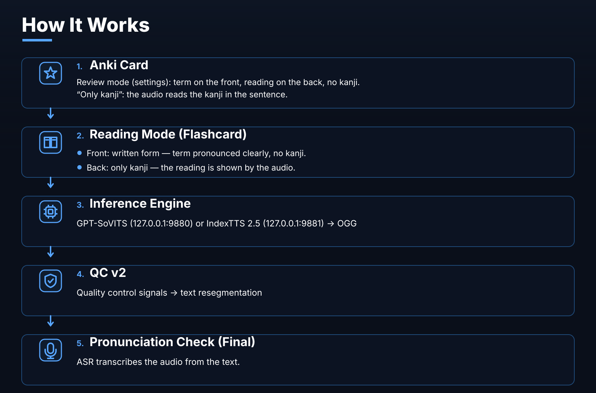

<p align="center">
  
</p>

<p align="center">
  <a href="https://github.com/Daii1414/AnkiVoice/actions/workflows/checks.yml">
    
  </a>
  <a href="https://github.com/Daii1414/AnkiVoice/releases/latest">
    
  </a>
  <a href="https://github.com/Daii1414/AnkiVoice/blob/main/LICENSE">
    
  </a>
  
  
</p>

<p align="center"><b>Japanese audio for your Anki cards</b><br>
A GPT-SoVITS or IndexTTS 2.5 voice - entirely on your own computer. The engine
reads the kanji itself, connected, in the context of the sentence, while the
reading of the main term comes from the card's furigana. Finished .ogg files land
straight in the Anki fields.</p>

<p align="center">
  <a href="https://github.com/Daii1414/AnkiVoice/releases/latest">
    
  </a>
  &nbsp;&nbsp;
  <a href="#what-you-need-before-installing">What you need before installing →</a>
</p>

<p align="center">
  
  
  
  
  
</p>

<p align="center">
  <a href="#how-it-works">How it works</a> •
  <a href="#quick-start">Install</a> •
  <a href="#interface-four-tabs">Interface</a> •
  <a href="#how-kanji-are-read">Reading</a> •
  <a href="#troubleshooting">If it does not work</a> •
  <a href="#development">Development</a>
</p>

<p align="center"></p>

[Русский](README.md) | **English**

---

## Table of contents

- [Features](#features)
- [What this is and who it is for](#what-this-is-and-who-it-is-for)
- [How it works](#how-it-works)
- [What you need before installing](#what-you-need-before-installing)
- [Your first sound in 60 seconds](#your-first-sound-in-60-seconds)
- [Interface (four tabs)](#interface-four-tabs)
- [Pronunciation check](#pronunciation-check)
- [A second engine: IndexTTS 2.5](#a-second-engine-indextts-25)
- [How kanji are read](#how-kanji-are-read)
- [How text becomes hiragana](#how-text-becomes-hiragana)
- [Card fields](#card-fields)
- [Console](#console)
- [Updates](#updates)
- [Troubleshooting](#troubleshooting)
- [What gets overwritten, what goes over the network](#what-gets-overwritten-what-goes-over-the-network)
- [Development](#development)
- [Repository layout](#repository-layout)
- [Contributing](#contributing)
- [License](#license)
- [Credits](#credits)

---

## Features

| | |
|---|---|
| 🎧 **Deck dubbing** | Writes `<audio>` with the sentence and the word straight into Anki fields. GPT-SoVITS clones the voice itself. |
| 📖 **Two reading modes** | The engine reads the kanji itself - connected, in context - while the main term keeps the reading from the card's furigana. No furigana - it reads the kanji itself. |
| 🧩 **Per-deck settings** | Fields and reading mode belong to a deck: switch decks and its settings come with them. |
| 🧪 **Quality control** | QC v2 measures several independent signals (silence, speech gaps, duplicate speech, clipping, level, speed) and re-synthesizes rejects on its own. |
| 🎙 **Pronunciation check** | The app listens to its own audio and compares it with the text, showing where the sentence diverged. Advice, not a verdict - you decide. |
| 🧙 **First-run wizard** | Five steps: pick the engine, the engine folder, AnkiConnect, server, test phrase. It tells you what to download, where to put it and what to click. |
| 🔄 **In-app updates** | "Check for updates": changelog, installer download and a mandatory SHA256 check. |
| 🌐 **Two languages** | The whole interface in English and Russian - switch with the EN button in the header. |
| 🔒 **Fully local** | The page works offline, without a CDN. The only outbound request is the update check. |
| 🧩 **Transparent** | No telemetry, no accounts. AGPL-3.0 - the sources are open. |
## How it works



AnkiVoice does not copy the engine's code: [GPT-SoVITS](https://github.com/RVC-Boss/GPT-SoVITS)
runs as an ordinary local server, the app sends it text and takes the sound back.
So the engine's own web interface and any of its voices keep working next to it.
## What you need before installing

| What | Where to get it | Size | Required | Why |
|---|---|---|---|---|
| **AnkiVoice** (the app) | [Releases](https://github.com/Daii1414/AnkiVoice/releases/latest) → `AnkiVoice-Setup-1.9.exe` | 125 MB, ~1 GB on disk | yes | the window, the local server, the reading dictionary |
| **Anki + AnkiConnect** | Anki → Add-ons → code `2055492159` | ~0 MB | yes | the bridge to your decks and fields |
| **An engine** (one of two) | [GPT-SoVITS](https://github.com/RVC-Boss/GPT-SoVITS/releases) or [IndexTTS 2.5](https://github.com/index-tts/index-tts) | 6-10 GB or ~5 GB | yes, one | speech synthesis |
| **A voice** | with the engine or from the community | weights + a 3-10 s reference | yes | timbre and speech character |
| **The recognition model** | HuggingFace cache (`faster-whisper`) | ~1.5 GB | no | the pronunciation check only |
| **GPU and NVIDIA driver** | NVIDIA driver, CUDA 12.8+ | from 6 GB VRAM | yes | synthesis on the GPU |

The internet is only needed to download - the dubbing itself runs fully offline.

### The app and the engine are two separate installations

| Question | AnkiVoice (the app) | The engine | Hint |
|---|---|---|---|
| Where it comes from | GitHub Releases, one file | the engine's own release | the engine is downloaded separately |
| Size | 125 MB, ~1 GB on disk | 6-10 GB / ~5 GB | five to ten times heavier |
| What's inside | the UI, the server, the reading dictionary | the model and the voice weights | the engine makes the sound |
| If it's missing | the app runs, there is no synthesis | dubbing is impossible | install the engine first |

Nothing else has to be installed: the reading dictionary and the bundled Python
are already inside the installer (`pyruntime.zip`, `sudachidict.zip`) and
unpack themselves.

## Your first sound in 60 seconds


1. Download **`AnkiVoice-Setup-1.8.exe`** from the
   [Releases](https://github.com/Daii1414/AnkiVoice/releases/latest) page — one
   file with everything inside. Size **125 MB**, SHA256:
   `385481551c6404ec8927a37d6c234630c87ee71660aa5c689eab9654da0dbc28`
   (The **Code → Download ZIP** button gives you the sources, not the installer —
   you do not need to unpack and run those by hand.)
2. Run it: **“Далее” → “Установить” → “Завершить”** (Next → Install → Finish;
   the “Launch AnkiVoice” checkbox is on, so the app opens by itself).
   > [!IMPORTANT]
   > The installer is not digitally signed, so Windows shows a blue SmartScreen
   > window. Click **“More info” → “Run anyway”** - the usual warning for files
   > downloaded outside the store.
3. The setup wizard walks you through the steps: pick the engine → engine folder
   → AnkiConnect → server → test phrase. It opens by itself on every launch
   until the setup is finished.

   

4. Then: the **“Голос”** (Voice) tab to pick a voice, the **“Поля колоды”**
   (Deck fields) tab to pick a deck and fields, and the **“Озвучка”** (Dubbing)
   tab to press **“Начать озвучку”** (Start dubbing).

The **AnkiConnect** add-on code is `2055492159` (Anki → Tools → Add-ons → Get
Add-ons). Restart Anki after installing the add-on.

The app starts a local server and opens a page in your browser — that is
normal, nothing else needs to be installed. The server only accepts its own
requests: another site open in the same browser cannot start dubbing or close
the app.

The **EN** button in the header switches the interface to English (and back). It installs into your user profile
(`%LOCALAPPDATA%\Programs\AnkiVoice`) and does not ask for administrator
rights. To uninstall: Start menu → “Удалить AnkiVoice” (settings and voices
are kept).

> [!TIP]
> No engine yet? The wizard links to the official
> [GPT-SoVITS](https://github.com/RVC-Boss/GPT-SoVITS/releases) releases and
> shows which files must be in the folder. It does not download the engine for
> you.

## Interface (four tabs)

The shell is a local web page (`anki_web.py`): the server listens only on
`127.0.0.1`, nothing goes outside. The old tkinter window is still available
via the `--classic` flag.

### “Озвучка” (Dubbing) — the main screen


* **Synthesis engine — two big cards at the top.** GPT-SoVITS or IndexTTS 2.5,
  each with a one-line description. You can switch while working, no restart:
  the engine folder, the server address and the voice list all follow. Under
  the cards — how many voices are ready and where the server lives.
* **Deck** and **Voice** — lists pulled from Anki and `voices.json`.
* **What to voice** — “word + sentence” (the usual choice), sentence only or
  word only; a card limit (0 = all); “rebuild everything” ignores cards that
  are already done.
* **The limit is an amount of work**, not a position in the deck: “voice 20
  cards” takes the 20 cards that have no audio yet, not the first twenty.
* **“Начать озвучку”** (Start dubbing) — the main button; next to it are
  **“Остановить”** (Stop), **“Проверить колоду”** (Check deck) and
  **“Самопроверка”** (Self-test).
* **Progress bar** — an exact “N / total” counter and the error count.
* **Log** — a live SSE stream with color coding: green = done, red = error,
  yellow = rejected and QC retries.

### “Поля колоды” (Deck fields) — what to read from where


* **Deck** + the **“Поля выбранной колоды”** (Fields of the selected deck)
  button — fills the role table automatically from the template
  (Sentence / Expression / \*Audio / Furigana). The fields also fill
  themselves in: pick a deck and the app reads its fields and matches the
  roles; you can still change them by hand on the “Поля колоды” tab.
* Table rows: sentence text, sentence audio, main word, word audio,
  **word furigana ← field** and the reading source.
* An empty choice in the “→” column means “do not write audio”. Empty
  furigana means the word is read automatically.

### “Голос” (Voice) — reference and speech character


* **Voice cards** — every voice from `voices.json`; ✅/✗ shows whether the
  gpt/sovits/ref files were found.
* **Reference (3–10 s)** — the voice sample: file, its text and language. Do
  not use a long aux reference — the API will run out of memory.
* **Speech character** — `temperature`/`top_p`/`top_k`/`speed` sliders and a
  `seed` field: lower values give more even, calmer speech (defaults from the
  official web UI: 0.6 / 0.6 / 20).
* **“Прослушать тест”** (Play test) — a quick voice check; the file plays
  right on the page. **“Обновить веса в движке”** (Refresh engine weights) —
  scans for new weights.

### “Приложение” (App) — wizard, updates, diagnostics


* **Setup wizard** — four steps: engine, AnkiConnect, server, test phrase. It
  shows the status of each step and what to do when one is red. The first step
  picks the engine (two cards) and its folder.
* **Updates** — the “Check for updates” button shows the latest changelog,
  downloads the installer and verifies its SHA256.
* **Diagnostics** — everything at once: tool, config, path, Anki, server, voice
  list. Look here first if something does not work.
* **Where the files live** — program folder and config.

Status chips in the header: **Anki** (connected?), **Server** (GPT-SoVITS is
running), the version and a running-operation indicator. The theme is toggled
on the right.

Light theme — the same tabs: [Dubbing](doc/shots/voice-light.png),
[Deck fields](doc/shots/anki-light.png), [Voice](doc/shots/sound-light.png),
[App](doc/shots/app-light.png). A full-page snapshot:
[voice-dark-full.png](doc/shots/voice-dark-full.png).

## A second engine: IndexTTS 2.5

Besides GPT-SoVITS you can run **IndexTTS 2.5**, a zero-shot engine that
needs only one reference clip. The switch lives **on the main screen**, at the
top, as two large cards. The choice is remembered and applies to the whole app.

| | GPT-SoVITS | IndexTTS 2.5 |
|---|---|---|
| a voice | `.ckpt` + `.pth` files + a reference | **one reference** (3-10 s) |
| weights | per voice | shared by the model |
| install | unpacked archive | `git clone` + `uv sync --extra webui` + weights in `checkpoints` |
| size on disk | 6-10 GB (weights separate) | ~5 GB of model weights |
| Japanese reading | the engine's g2p | its own Japanese g2p (`ja_g2p`) |
| pronunciation check | yes (faster-whisper in the environment) | no, acoustic QC only |
| manual sound settings | seed, temperature, top_p, top_k | none, the UI hides them |
| who it is for | I want quality and control | I want as little fuss as possible: one reference |

You switch between them with two large cards on the main screen.

Install IndexTTS 2.5:

```
git clone https://github.com/index-tts/index-tts.git D:\DOWNLOAD\index-tts
cd D:\DOWNLOAD\index-tts
uv sync --extra webui
uv tool install "huggingface-hub"
hf download IndexTeam/IndexTTS-2.5 --local-dir checkpoints
```

Point AnkiVoice at that folder in “App” (or press “Check” - it finds the
folder by itself). `uv` has to be in PATH and the NVIDIA driver needs CUDA
12.8 or newer.

**Why a bridge.** IndexTTS has no HTTP API - only a Python API and a web UI.
AnkiVoice starts a small service next to itself
(`lab/indextts_service.py`, shipped with the installer) that loads the model
**once** and answers `POST /tts`. Without it every card would reload the
weights.

What stays the same: the acoustic QC, the reading mode (auto / kanji only),
the rules for substituting the furigana reading, writing the audio into the
card, the review deck and the verdicts.

What is missing in the IndexTTS mode:

* the **content check** (recognising our own voice) - it lives in the
  GPT-SoVITS environment (faster-whisper). Without GPT-SoVITS the acoustic
  check remains and the recognition is off;
* the manual sampling settings (seed, temperature, top_p, top_k) - IndexTTS
  has none, the interface hides them.

## What's new in 1.8

- **The repository root is tidy:** the code lives in `app/`, the heavy archives
  (the bundled Python and the Sudachi dictionary) in `bundled/`, the lab in
  `lab/`, the interface checks in `qa/`.
- **`AnkiVoice.exe` is no longer in the repository** - it is a build artifact.

## Pronunciation check

GPT-SoVITS sometimes **loses a chunk of a sentence or invents extra**: the
duration looks normal, the sound is speech, but the content is wrong. A
"silence / length / duplicate" check cannot see that.

On the "Dubbing" tab, **"Check pronunciation"**: the app recognizes its own
audio (faster-whisper) and compares it with the text it was asked to say. The
divergence is reported to a fraction of a second - you see right away where the
sentence went apart.

**This is advice, not a verdict.** Measured on 27 labeled cards: 2 confirmed
failures against 25 false alarms - the recognizer mangles domain terms
("だいくはこうさぶ" → "ないくはこうさぶん"), and by text alone they cannot be
told apart from a real mistake. So the check

* does not reject a card and does not tag it;
* prints the coverage, the error rate and the diverging span in the log;
* collects the doubtful pieces into a **"Брак" (Rejects) deck**, three
  variants each. Listen and write down "верно" or "ложное срабатывание".

Three buttons on the "Dubbing" tab:

* **"Check pronunciation"** - recognizes the cards you have already voiced;
* **"Build the “Брак” deck"** - collects the doubtful pieces with variants;
* **"Verdict summary"** - counts your labels and shows where our thresholds
  sit too low.

### What the app checks on its own

| What it checks | How | Result |
|---|---|---|
| Silence, clipping, duplicates | QC v2 over several signals | rejects are re-generated automatically |
| Breaks inside the speech | a pause longer than 4 s inside a phrase | the piece is re-synthesized |
| Level and speed | too quiet or too fast | re-synthesis at another speed |
| Pronunciation (optional) | ASR listens to its own audio and compares it with the text | a hint, the decision is yours |

**We check sentences, not words.** An isolated word is transcribed
unreliably: the zones "real failure" and "false alarm" overlap completely. The
word is guarded by the acoustic QC (silence, tempo, length).

**Thresholds are per voice.** One voice may sit at 0.95 coverage, another at
0.85. The app measures the norm from the accepted pieces and compares against
it, not against one global number.

What it needs: `faster-whisper` in the GPT-SoVITS python and one downloaded
model (in the HuggingFace cache). Without them the check simply does not run
and dubbing goes on as usual. One piece takes about 0.5 s on a GPU.
## What this is and who it is for

| Who you are | What you get | Read next |
|---|---|---|
| I learn Japanese with Anki cards | ready `.ogg` files in the card fields, all local | [Your first sound in 60 seconds](#quick-start) |
| I want a specific voice | a 3-10 s reference plus the engine weights | [Which engine to pick](#a-second-engine-indextts-25) |
| I want the terms read exactly | the reading comes from the card's furigana | [How kanji are read](#how-kanji-are-read) |
| I am looking for a TTS HTTP API | not this one: it is an Anki app, not a service | — |

## How kanji are read

GPT-SoVITS can read kanji on its own - but on rare terms it picks its own
reading. So the reading mode is switched in "Deck fields" → "Reading source":

| Mode | What the engine gets | When to pick it |
|---|---|---|
| **Auto (default)** | If the furigana field has something in it - the whole text in kanji, except the main term, whose reading is substituted from the furigana. If the field is missing or empty - the whole text in kanji | Universal: exact reading where there is a furigana, ordinary reading where there is none |
| **Kanji only (the engine reads it)** | The whole text in kanji, nothing substituted | Decks with ordinary words: the sound is the most connected |

The mode is a **per-deck setting**: it is stored in the deck profile together
with the fields. In the "auto" mode the decision is made **for every card**: an
empty furigana field means "read the kanji yourself", and there is nothing to
substitute.

What "exact" and "plain" cost, measured on 150 sentences and a blind A/B on 10
of them:

* in sound, plain kanji wins - 7 votes out of 10;
* but in 12 sentences out of 150 the model read the term differently from the
  card (`麻院[あさすさ]` → "アサイン"). In the mixed mode it is 2 out of 150.

The card's furigana is the source of truth for the main term: the
`ExpressionFurigana` field (or another one, if the deck names it
differently). Substitution rules: clean kana only, only when the term is
found in the sentence as a whole, otherwise the card is left as it is.

Two exceptions, both measured on cards with katakana terms:

* a reading that covers the whole word ("点群データ[てんぐんでーた]") is taken
  as it is - otherwise the okurigana ("データ") would be added a second time and
  the word would be heard twice. As a safety net, the finished text is checked:
  if the okurigana would be heard twice, the term is left as it is and the
  engine reads it itself;
* terms with latin letters or digits ("3D", "PLATEAU", "BIM/CIM", "2.0") are
  left alone: the engine reads them better on its own, and our own
  transcription ("3D" -> "すりーでぃー") sends the model into a loop - measured
  96 seconds and coverage 0.89 against 4 seconds and 1.00.

In the console this is the `--reading ""|mix|asis` flag (empty = auto).
| Case | What the app does | Why |
|---|---|---|
| A term with furigana | substitutes the reading from the furigana field | the card knows it better than the engine |
| Okurigana (データ) | leaves the word as it is | otherwise it would sound twice |
| Latin letters and digits (3D, PLATEAU) | does not convert to kana | the engine reads it better: 4 s against 96 s |
| The word is not found in the text | the card stays as it is | you cannot substitute a foreign reading |

## How text becomes hiragana

The sentence goes to the engine **in kanji**: GPT-SoVITS reads the kanji
itself, in the context of the sentence - that is what makes the sound connected
instead of a set of separate pieces.

The `kanaize()` pipeline prepares hiragana - but only where it is needed:

* **the main term** - in the mode with a furigana the reading is taken from the
  card's furigana; if the furigana does not fit (the word is not found in the
  text, the reading still has kanji in it) the word is converted to kana by our
  own pipeline;
* **in the "kanji only" mode** nothing is prepared: both the word and the
  sentence go to the engine as they are, it reads them itself.

The steps of `kanaize()`:

1. **NFKC normalization** — full-width letters/digits and half-width katakana
   are folded into normal forms (punctuation is left alone);
2. **Latin → katakana by letters** (`IEC` → アイイーシー);
3. **katakana → hiragana** (greetings コンニチハ/コンバンハ stay katakana —
   otherwise MeCab reads them as a particle; the repetition marks ヽゝゞヾ are
   expanded contextually — repeat of the previous syllable);
4. **g2p only for the kanji that are left**: Haqumei reads every word in the
   context of the sentence (sandhi, neighbouring katakana), with Sudachi over
   the UniDic dictionary and pyopenjtalk (MeCab) as fallbacks; digits always go
   through MeCab, because Sudachi reads numbers as dates (2024 → 二月二日);
5. **one more katakana → hiragana pass** — and the API receives pure hiragana.

What the pipeline **does not touch**: the note in Anki itself (a copy of the
text is processed) and the card's furigana (it is only used as a reading
source).

Reading is covered by tests: `pipeline.bat selftest` (10 substitution checks
and 11 reading-mode checks) and the extended battery
`python kana_stress.py` (63 difficult words). Detailed measurements live in
[doc/reports/](doc/reports).

## Card fields

Decks name their fields differently — where to take the text from and where to
write the audio is configurable (GUI: the “Поля колоды” tab; console: the
`voice` / `make-deck` / `check` commands):

```
--sentence-src "Sentence"             field with the sentence text
--sentence-audio "SentenceAudio"      field the sentence audio goes to
--word-src "Expression"               field with the word (furigana parsing works for Expression)
--word-audio "ExpressionAudio"        field the word audio goes to
--furigana-src "ExpressionFurigana"   field with the furigana of the main word
    --reading ""|mix|asis         reading mode (see above; empty = auto)
```

## Console

`pipeline.bat` is the same thing in the console; it finds the engine folder on
its own:

```
pipeline.bat list              list of voices
pipeline.bat selftest          check the environment (run it when in trouble)
pipeline.bat test --voice madara --text "こんにちは"
pipeline.bat voice --voice madara --deck "Архитектура" --mode both
pipeline.bat verify --deck "Архитектура"    check the pronunciation of what is voiced
pipeline.bat qc-deck                         build the "Брак" deck with variants
pipeline.bat verdicts                        summary of your verdicts
pipeline.bat check --deck "Архитектура"          full check of a deck
pipeline.bat check --deck "Архитектура" --fast   the same without downloading audio
pipeline.bat scan --apply     find voices in the engine and add them to voices.json
```

Diagnostics are available in the exe as well: `AnkiVoice.exe doctor`.
## Updates

* **From the app**: the “Приложение” tab → **“Проверить обновления”**. The
  app shows the changelog, downloads the installer and verifies the SHA256 —
  without that check the download is not started. Then press “Запустить
  установщик” (Launch installer).
* **Manually**: download the new installer from
  [Releases](https://github.com/Daii1414/AnkiVoice/releases/latest) and run it
  over the old version — the engine path and the settings are kept.
* **Uninstall**: Start menu → “Удалить AnkiVoice” (settings are kept and are
  picked up again on the next install).

## What gets overwritten, what goes over the network

The boundaries of the app - honestly, without hedging.

| Action | What happens to the card |
|---|---|
| Dubbing | a new file is written into the sound field; the old one stays in the media folder, and the link to it is lost |
| The card text | never changes |
| The "Брак" deck | creates a new deck with copies of the cards; the originals are not touched |
| The pronunciation check | writes nothing - it only listens and advises |

| What goes over the network | When |
|---|---|
| A request to `api.github.com` | only when you press "Check for updates" |
| Downloading the installer | from the update button (with a SHA256 check) |
| Your cards and texts | **never** - everything is computed locally |
| Telemetry, accounts | **none** |

The internet is needed once: to download the installer and the engine. The
dubbing itself, the pronunciation check and the update of your cards all run
fully offline.

## Troubleshooting

| Message | Why | What to do |
|---|---|---|
| `GPT-SoVITS folder not found` | the path is not set or points nowhere | Set the path: `gptsovits_path.txt`, the `GPT_SOVITS_ROOT` environment variable, or the "Browse…" button in the app |
| `AnkiConnect unavailable` | Anki is closed or the add-on is missing | Open Anki; Tools → Add-ons → Get Add-ons, code `2055492159`, then restart Anki |
| The wizard asks for an engine folder | the engine is a separate download | install the engine and point to its folder |
| Ready voices: 0 of 5 | the weights or the reference are not in the engine folder | "Refresh engine weights" or fix the path |
| `Reference X s - the API wants 3-10 s` | the clip is out of range | Trim the clip to 3-10 seconds |
| `Could not switch... Restarting` | not enough video memory | Normal: the pipeline restarts the server and retries |
| `The server returned an empty sound` | VRAM is occupied by a browser or a game | Close heavy programs or restart the server: `pipeline.bat serve --voice <voice>` |
| `The pipeline is already running` | another job is in progress | Wait for it to finish (protection against double work) |
| The first sound takes minutes | the pronunciation check is on | turn off "Check pronunciation" - without it the sound takes seconds |
| The sound is old, I want it again | the limit only takes cards without sound | "Rebuild everything" - it will ask for confirmation |
| Windows: "Your PC has been protected" | the exe is not signed | "More info" → "Run anyway" |

Useful: `selftest` prints exactly what it sees (engine, voices, reading
dictionary, reading modules, QC v2, AnkiConnect, server) — 90% of problems are
visible immediately.

## Development

```bash
git clone https://github.com/Daii1414/AnkiVoice.git
cd AnkiVoice
```

A rebuild is needed only after editing `app/anki_gui.py`, `app/anki_web.py` or
`anki_web_page.py` — `voice_pipeline.py` runs from disk and takes effect
immediately.

**exe** (needs the Python from the GPT-SoVITS engine with PyInstaller):

```bat
set ENGINE=C:\Path\To\GPT-SoVITS
%ENGINE%\runtime\python.exe -m pip install pyinstaller
%ENGINE%\runtime\python.exe -m PyInstaller --noconfirm --onefile --windowed ^
    --name AnkiVoice --distpath . --workpath %TEMP%\pyi_build --specpath %TEMP% app\anki_gui.py
```

**installer** (Inno Setup 6, run it from the repository root):

```bat
ISCC.exe AnkiVoice.iss
```

→ produces `dist\AnkiVoice-Setup-1.8.exe`.

**tests** (Python 3.12+, no GPU and no network needed):

```bash
python -m pip install numpy haqumei
python lab/qc_unit.py
python lab/quality_unit.py
python lab/test_g2p_infrastructure.py
python lab/test_v12_features.py
python lab/web_js_check.py
python lab/integration_check.py
python lab/readme_check.py
python lab/fmt_check.py
```

`lab/readme_check.py` compares the READMEs with the code: the files listed in
the layout table, the images, the table-of-contents anchors, the console
commands, the number of reading modes and the modules shipped with the
installer. If they drift apart, it fails.

`lab/fmt_check.py` checks that every format string has as many placeholders
as there are arguments - such a mismatch only blows up at the moment it runs,
usually at the very end of a long job.

`lab/robust_tests.py` — 10 robustness checks of the pipeline; it needs a
running Anki. CI runs everything else on every push
([checks.yml](.github/workflows/checks.yml)) and builds the installer on
windows-latest.

## Repository layout

| File | What it is |
|---|---|
| `AnkiVoice.exe` | The app with the interface (double-click) |
| `AnkiVoice.iss` | Installer build script (Inno Setup 6) |
| `app/voice_pipeline.py` | All logic: synthesis, kanji reading, substitution, CLI |
| `app/anki_gui.py` | Exe entry point: web UI by default, `--classic` for the old window |
| `app/anki_web.py` | Local HTTP server for the UI (127.0.0.1 only) |
| `app/anki_web_page.py` | HTML/CSS/JS for the page (offline, no CDN) |
| `pipeline.bat` | Console entry point |
| `app/sudachi_g2p.py` | Fallback “reader” helper: SudachiPy 0.7 + UniDic dictionary |
| `app/g2p_core.py` | Haqumei reading core: word in sentence context, pron form |
| `app/kana_stress.py` | A battery of 63 difficult words for reading checks |
| `app/i18n_en.py` | Dictionary of the English interface (RU/EN) |
| `lab/pron_check.py` | Pronunciation check: recognition, coverage, quarantine, locating the divergence |
| `lab/align_ja.py` | Experimental acoustic alignment with a Japanese CTC model (off by default) |
| `bundled/pyruntime.zip` | Bundled Python + Haqumei 0.12.2 + SudachiPy 0.7 (~44 MB, unpacks itself) |
| `bundled/sudachidict.zip` | Sudachi core dictionary 20261015 (~73 MB, unpacked by the helper) |
| `app/voices.json` | Voice registry: weights, references, prompt, sampling |
| `lab/` | Reading system, QC v2 modules and the IndexTTS service (10 files ship with the installer) + tests and dev tools |
| `doc/` | UI screenshots, logo, engine media, measurement reports |
| `CHANGELOG.md`, `CONTRIBUTING.md`, `SECURITY.md` | History, development rules, security policy |
| `.github/` | CI, issue and pull request templates |
| `LICENSE` | AGPL-3.0 |

Not tracked by git: `gptsovits_path.txt`, `pyruntime/` (unpacked from the zip),
`test_*.ogg`, `logs/`, `dist/`.

## Contributing

* Patches and ideas — via [issues](https://github.com/Daii1414/AnkiVoice/issues)
  and pull requests. Templates live in `.github/ISSUE_TEMPLATE`.
* Development rules, build, commit style — in
  [CONTRIBUTING.md](CONTRIBUTING.md).
* Vulnerabilities — follow the instructions in [SECURITY.md](SECURITY.md).

## License

**AGPL-3.0** (text in [LICENSE](LICENSE)): whoever modifies and distributes
this tool is obliged to publish the sources of their changes, including when
it is used over a network.

## Credits

* [GPT-SoVITS](https://github.com/RVC-Boss/GPT-SoVITS) — the synthesis engine
  (MIT).
* [Haqumei](https://github.com/o24s/haqumei) — context-aware kanji readings
  (the main core).
* [Sudachi](https://github.com/WorksApplications/SudachiPy) and the UniDic
  dictionary — fallback and reading checks.
* [gradio](https://github.com/gradio-app/gradio) — the Voice tab is styled
  after their web UI.
* [AnkiConnect](https://ankiweb.net/shared/info/2055492159) — the bridge to
  Anki.
