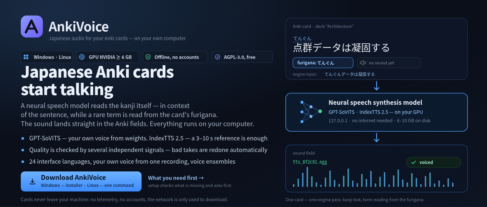
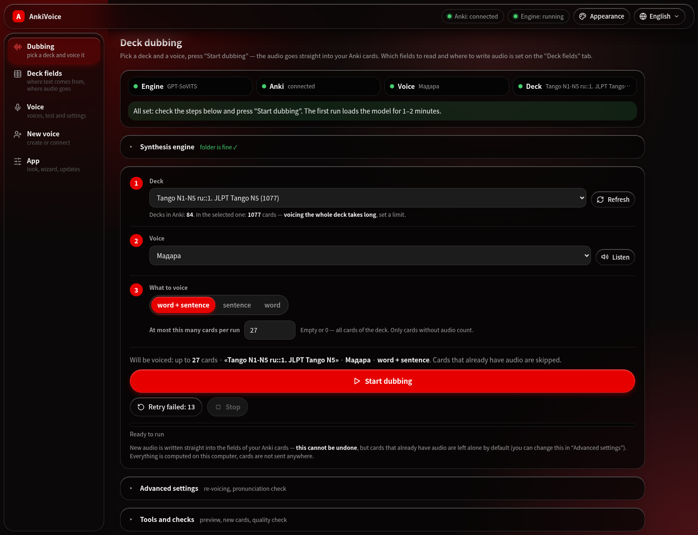
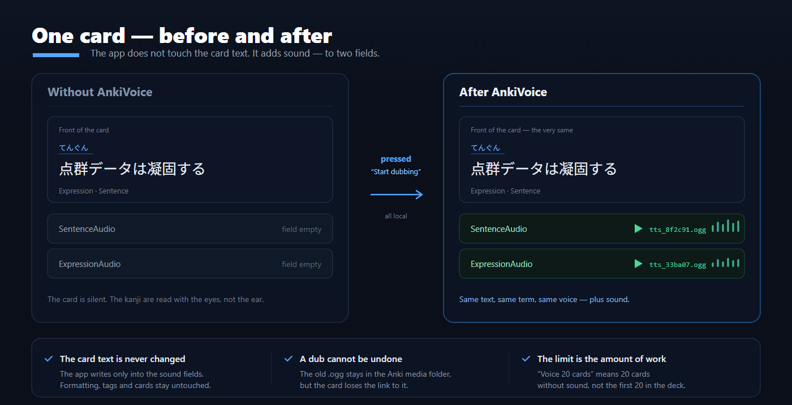
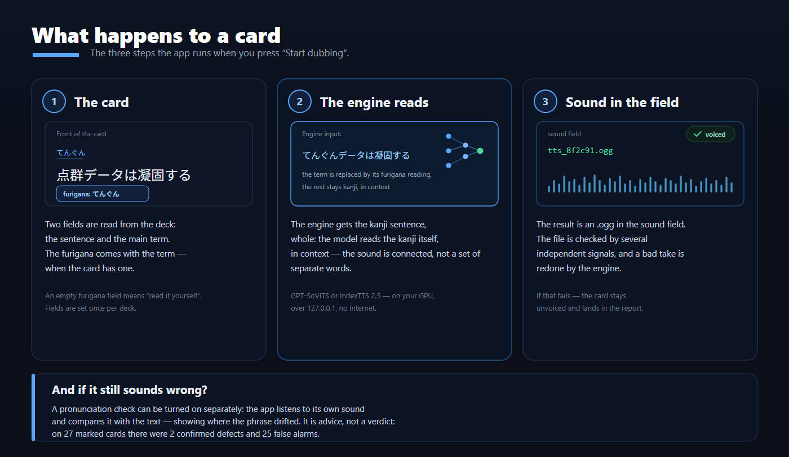
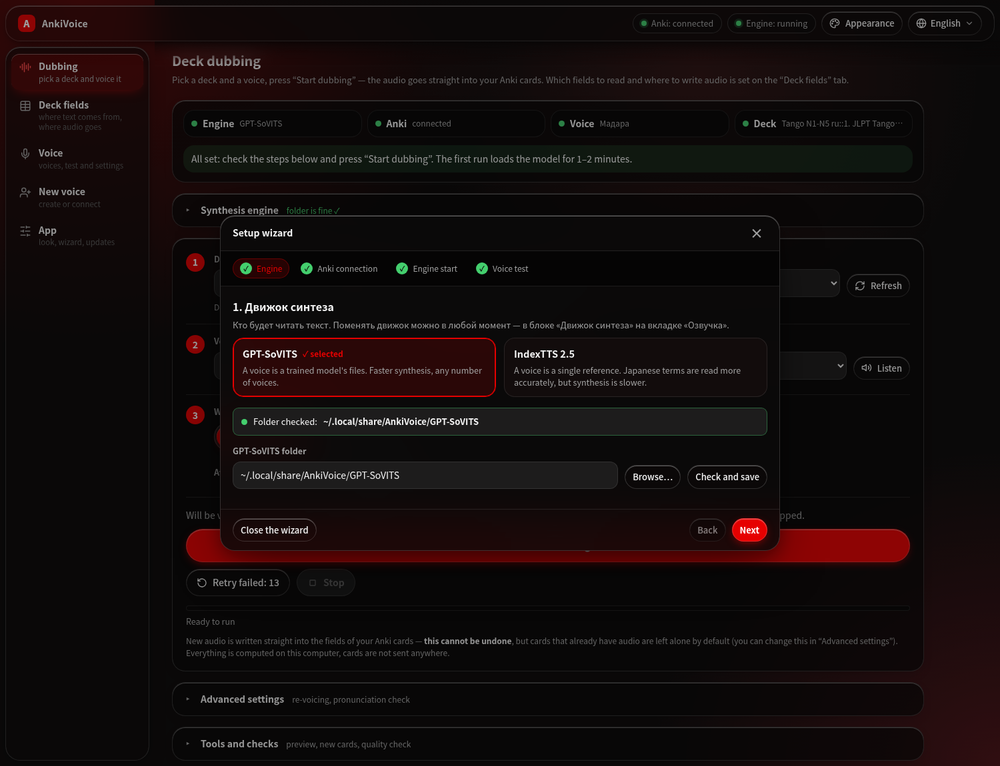
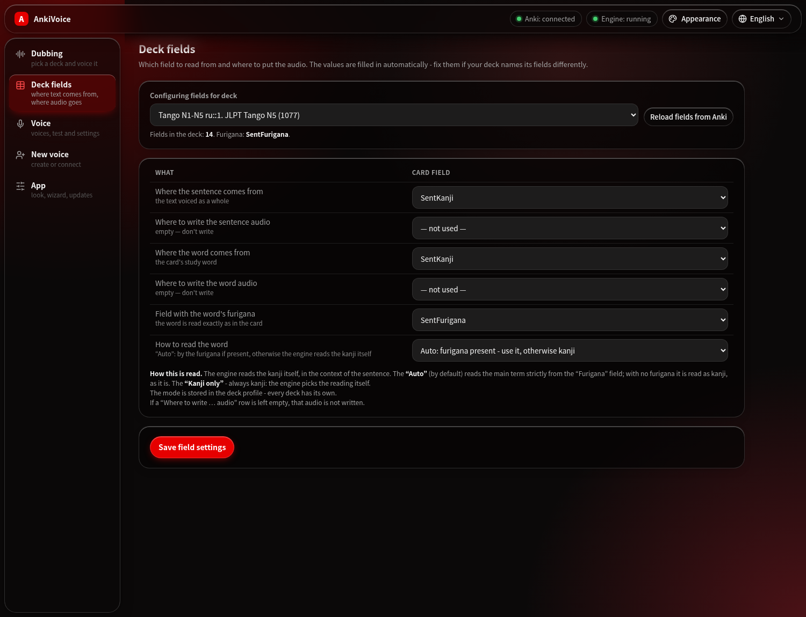
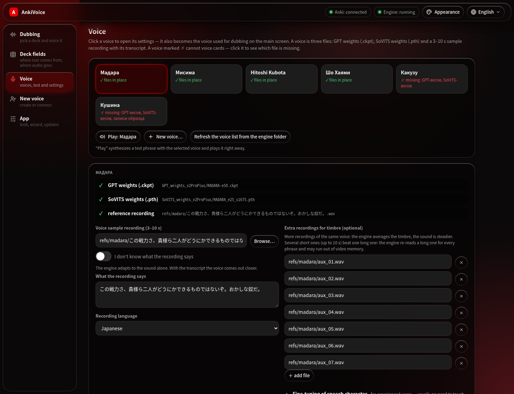
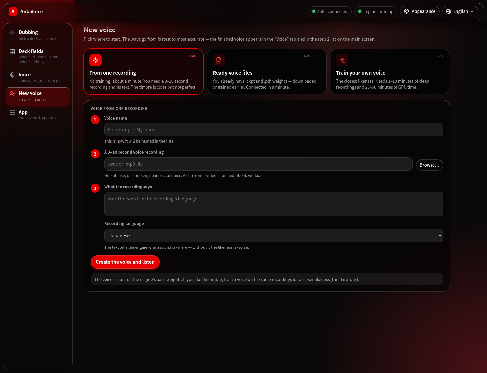
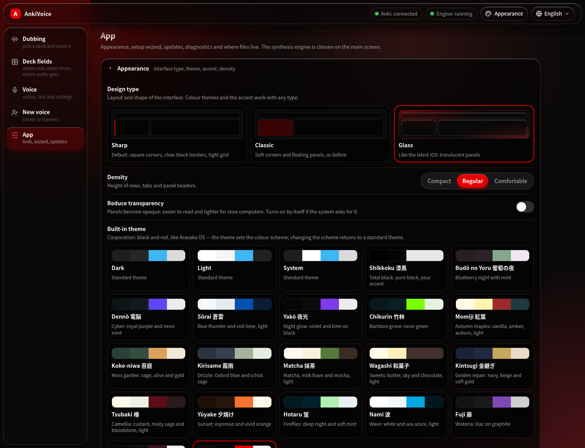
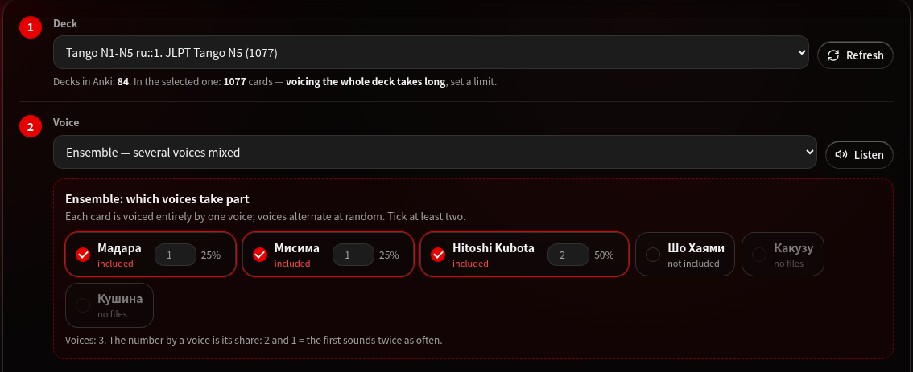

<p align="center">
  
</p>

<p align="center">
  <a href="https://github.com/Daii1414/AnkiVoice/releases/latest">
    
  </a>
  <a href="https://github.com/Daii1414/AnkiVoice/blob/main/LICENSE">
    
  </a>
  
  
</p>

<p align="center"><b>Japanese audio for your Anki cards</b><br>
A GPT-SoVITS or IndexTTS 2.5 voice, entirely on your own computer. The engine reads
the kanji itself, fluently, in the context of the sentence, while the reading of the
main word comes from the card's furigana. The finished audio (.ogg) goes straight
into the Anki fields.</p>

<p align="center">
  <a href="https://github.com/Daii1414/AnkiVoice/releases/latest">
    
  </a>
  &nbsp;
  <a href="#installing-on-linux">
    
  </a>
  &nbsp;&nbsp;
  <a href="#what-you-need">What you need →</a>
</p>

<p align="center">
  
</p>

<p align="center">
  <a href="#how-it-works">How it works</a> •
  <a href="#installing-on-windows">Windows</a> •
  <a href="#installing-on-linux">Linux</a> •
  <a href="#the-interface">Interface</a> •
  <a href="#your-own-voice">Your own voice</a> •
  <a href="#how-kanji-are-read">Kanji reading</a> •
  <a href="#troubleshooting">Troubleshooting</a>
</p>

<p align="center"></p>

[Русский](README.md) | **English**

---

## What it is and who it is for

| You are | You get | Read on |
|---|---|---|
| Learning Japanese with Anki | sentence and word audio right in the card's fields, all local | [First sound](#first-sound) |
| After a specific voice | your own voice from a single recording — or one trained on a few minutes of speech | [Your own voice](#your-own-voice) |
| After variety | an ensemble: cards are shared between several voices | [Voice ensembles](#voice-ensembles) |
| Want terms read exactly | the reading comes from the card's furigana | [How kanji are read](#how-kanji-are-read) |
| Looking for a TTS HTTP API | not this: it is an Anki app, not a service | — |



## Contents

- [Features](#features)
- [How it works](#how-it-works)
- [What you need](#what-you-need)
- [Installing on Windows](#installing-on-windows)
- [Installing on Linux](#installing-on-linux)
- [First sound](#first-sound)
- [The interface](#the-interface)
- [Voice ensembles](#voice-ensembles)
- [Your own voice](#your-own-voice)
- [Appearance and languages](#appearance-and-languages)
- [Audio format and size](#audio-format-and-size)
- [Pronunciation check](#pronunciation-check)
- [Second engine: IndexTTS 2.5](#second-engine-indextts-25)
- [How kanji are read](#how-kanji-are-read)
- [Documentation](#documentation)
- [Updates and uninstalling](#updates-and-uninstalling)
- [What gets overwritten, what goes online](#what-gets-overwritten-what-goes-online)
- [Troubleshooting](#troubleshooting)
- [Contributing](#contributing)
- [License](#license)
- [Credits](#credits)

---

## Features

| | |
|---|---|
| 🎧 **Card dubbing** | Puts sentence and word audio straight into Anki fields. GPT-SoVITS (or IndexTTS 2.5) clones the voice. |
| 📖 **Accurate reading** | The engine reads the kanji itself — fluently, in context; the main word's reading comes from the card's furigana. No furigana — the engine reads the kanji on its own. |
| 🔤 **English words** | The [e2k](https://github.com/Patchethium/e2k) network turns them into katakana (bus→バス), abbreviations are spelled out (USB→ユーエスビー), mixed tokens come from a dictionary (3D→スリーディー). |
| 🎭 **Voice ensembles** | An “Ensemble” entry in the voice list: tick voices and their shares — cards are split between them, each voiced entirely by one voice. |
| 🎙 **Your own voice** | The “New voice” tab: a voice from one recording in a minute, connecting ready weights, or step-by-step training in the GPT-SoVITS studio. |
| 🗜 **Light decks** | Audio is compressed to .ogg (Vorbis) — ~50 KB per phrase instead of ~300 KB as .wav; old .wav audio is re-encoded with one button. |
| 🧪 **Quality control** | Several independent signals (silence, gaps, duplicates, clipping, level, tempo) — bad takes are redone automatically; engine failures (out of video memory) are detected separately. |
| 🔍 **Pronunciation check** | The app listens to its own audio and compares it with the text. Advice, not a verdict — the decision is yours. |
| ♻ **Only what is needed** | Already voiced cards are skipped; “Update changed” re-voices only cards whose text or voice changed; “Retry failed” — only errors. |
| 🧩 **Per-deck settings** | Fields, reading mode and ensemble make-up are remembered per deck. |
| 👁 **Preview** | Without synthesis shows what text will be voiced and whether the furigana substitution worked. |
| 🎨 **Fragile design** | Three interface types (sharp, classic, glass), 19 colour themes, your own accent, density; smooth animations that respect “reduce motion”. |
| 🌐 **24 languages** | Russian, English, Chinese in every variant (Simplified — China and Singapore; Traditional — Taiwan and Hong Kong; Cantonese), Japanese, Korean and 15 more. |
| 🧙 **Installers that ask** | On Windows and Linux they check what is missing (Anki, AnkiConnect, the engine, ffmpeg…) and ask before any download: install it, or point to the folder where it already is. |
| 🔒 **Fully local** | The page works offline, no CDN, no telemetry, no accounts. AGPL-3.0. |

> **Hear how it sounds:** [demo clip](doc/gptsovits/gpt-sovits-demo.mp4) —
> Japanese sentences voiced by the model (synthesis runs offline on your machine).

## How it works



AnkiVoice does not copy the engine's code: [GPT-SoVITS](https://github.com/RVC-Boss/GPT-SoVITS)
runs as an ordinary local server (`127.0.0.1`), the app sends it text and takes the
audio back. Cards are read and written through the
[AnkiConnect](https://ankiweb.net/shared/info/2055492159) add-on. The interface is a
local web page the app opens in your browser.

## What you need

| What | Where | Size | Required | Why |
|---|---|---|---|---|
| **AnkiVoice** | Windows — [Releases](https://github.com/Daii1414/AnkiVoice/releases/latest) → `AnkiVoice-Setup-x.y.exe`; Linux — [one command](#installing-on-linux) | ~160 MB (Windows) | yes | interface, local server, reading dictionary, e2k |
| **Anki + AnkiConnect** | [apps.ankiweb.net](https://apps.ankiweb.net); add-on `2055492159` | ~200 MB | yes | decks and fields |
| **Engine** (one of two) | [GPT-SoVITS](https://github.com/RVC-Boss/GPT-SoVITS/releases) or [IndexTTS 2.5](https://github.com/index-tts/index-tts) | 6–10 GB or ~5 GB | yes, one | speech synthesis |
| **Voice** | your own (“New voice” tab), in the engine or from the community | weights + 3–10 s recording | yes | timbre and speaking style |
| **NVIDIA GPU** | NVIDIA driver, CUDA 12.4+ | 6 GB VRAM or more | recommended | without it synthesis runs on the CPU, many times slower |
| **Recognition model** | downloaded with a button in the app (`faster-whisper`) | ~1.5 GB | no | pronunciation check only |

The installers check all of this themselves and ask what to download. The internet
is only needed to download — dubbing itself runs offline.

> [!NOTE]
> Voice weights must match the engine version: **v2Pro / v2ProPlus** weights load
> only in engine `20250606v2pro` or newer. An older package (e.g. `v3lora-20250228`)
> understands only v1/v2/v3.

## Installing on Windows

1. Download **`AnkiVoice-Setup-x.y.exe`** from
   [Releases](https://github.com/Daii1414/AnkiVoice/releases/latest). The checksum is
   in the release notes (`certutil -hashfile AnkiVoice-Setup-x.y.exe SHA256`).
   **Code → Download ZIP** gives the sources, not the installer.
2. Run it and pick the installer language (21 languages; it also becomes the app's
   language).
   > [!IMPORTANT]
   > The installer is not signed — Windows shows a SmartScreen window. Click
   > **“More info” → “Run anyway”**.
3. The **“What AnkiVoice needs”** page checks Anki, AnkiConnect, the GPT-SoVITS
   engine and the NVIDIA driver. For each missing item — **“Download and install”**
   or **“Already installed — folder”** (e.g. the engine on drive D: — setup checks
   that the folder really contains it). Before downloading it shows the plan and
   asks for confirmation. It can download:
   - Anki 26.09.3 (MSI);
   - AnkiConnect — straight into Anki's add-on folder;
   - the GPT-SoVITS v2pro-20250604 engine (~8 GB, extracted with `tar.exe`; if that
     fails it tells you to extract the archive with 7-Zip).
4. “Install” → “Finish” — the app opens by itself.

It installs into `%LOCALAPPDATA%\Programs\AnkiVoice`, no administrator rights.

## Installing on Linux

One command first checks the system and asks what to install, then downloads the
app, builds both Python environments, finds (or downloads) the GPT-SoVITS engine
and creates the `ankivoice` command:

```bash
curl -fsSL https://raw.githubusercontent.com/Daii1414/AnkiVoice/main/install.sh | bash
```

Supported: Arch (and Manjaro, EndeavourOS, CachyOS), Debian/Ubuntu (Mint, Pop!_OS),
Fedora (and RHEL-likes), openSUSE, Void, Solus and Gentoo; NixOS and Alpine with
caveats (the installer names them). It works in three stages:

1. **Check** — what is already there: git, curl, ffmpeg, compiler and cmake, uv,
   NVIDIA GPU, disk space, Anki, AnkiConnect, the GPT-SoVITS engine.
2. **Questions before any download** — for every missing item: install it (distro
   package, Flathub or download), **point to the folder where it is already
   installed** (e.g. on another drive — it goes into the PATH of the `ankivoice`
   command), or skip it if it is optional. Low on space — it offers to put the
   environments and the engine on another drive.
3. **Plan and confirmation**, then the installation. AnkiConnect is added by the
   installer itself (from AnkiWeb, into Anki's add-on folder).

Questions appear in `whiptail` dialogs (if available) or as text, in Russian or
English. From a downloaded folder it is the same: `./install.sh`. Flags:

| Flag | What it does |
|---|---|
| `--check` | only show what is there and what is missing |
| `--dry-run` | go through the questions and show the plan without changing anything |
| `--engine DIR` | use your own GPT-SoVITS folder (an unpacked Windows package works too: `api_v2.py`, weights and library versions are taken from it) |
| `--download-engine` | download GPT-SoVITS `20250606v2pro` and its models (~6 GB) |
| `--no-engine` | set the engine up later |
| `--data-dir DIR` | where to put the environments and the engine (~8 GB), e.g. another drive |
| `--cpu` | CPU-only torch (no NVIDIA GPU) |
| `--yes` | no questions: missing items are installed, optional ones skipped |
| `--no-tui` | text questions instead of `whiptail` dialogs |
| `--lang ru\|en` | installer language (default: the system's) |
| `--uninstall` | remove (asks whether to delete environments and settings) |

Where things live:

| What | Where |
|---|---|
| the app and `pyruntime/` (Python 3.12: Haqumei, SudachiPy, web UI) | install folder (default `~/.local/share/AnkiVoice/app`) |
| engine Python (3.10, torch, GPT-SoVITS dependencies) | `~/.local/share/AnkiVoice/gsv-venv` or `.venv` inside a downloaded engine |
| settings, run summaries, reports | `~/.config/AnkiVoice/` |
| launcher | `~/.local/bin/ankivoice` + an “AnkiVoice” menu entry |

Run `ankivoice` (opens the page in your browser); without PATH — `./run.sh` from the
app folder. Console: `ankivoice pipeline selftest`,
`ankivoice pipeline voice --voice NAME --deck "Deck"`. Diagnostics —
`ankivoice doctor`, update — `ankivoice update`, uninstall — `ankivoice uninstall`.

## First sound

1. Open Anki (with AnkiConnect) and start AnkiVoice.
2. If something is missing, the **setup wizard** opens by itself: engine → Anki
   connection → engine start → voice test. Each step shows what is wrong and what
   to click.

   

3. On the main screen: **1** — deck, **2** — voice, **3** — what to voice (word +
   sentence, sentence only or word only) and how many cards per run.
4. **“Start dubbing”**. The first run loads the model for 1–2 minutes, then it is
   seconds per phrase. If every card is already voiced, the button says so: “All
   cards are already voiced”.

The app picks which fields to read and where to write audio from the field names;
adjust them on the “Deck fields” tab.

## The interface

Five tabs on the left; in the header — Anki and engine status, “Appearance” and the
language. The server listens only on `127.0.0.1` and accepts only its own requests:
another site open in the same browser cannot start dubbing.

### “Dubbing” — the main screen


* **Readiness** — four badges (engine, Anki, voice, deck) and one “do this now” line
  with a button when something is off.
* **Synthesis engine** — GPT-SoVITS or IndexTTS 2.5 as two cards plus the engine
  folder with a check. Switches on the fly.
* **Steps 1–3** — deck, voice (or [ensemble](#voice-ensembles)), what to voice and
  the per-run limit. The limit is an amount of work: “27 cards” means 27 cards
  without audio, not the first 27 in the deck.
* **Summary** above the button — how many cards lack audio, how many will be voiced,
  which voice and mode.
* **“Start dubbing”**, **“Retry failed”**, **“Stop”**; a progress bar with a “≈ left”
  estimate.
* **Advanced settings** — what to do with cards that already have audio (skip /
  update changed / re-voice all) and the pronunciation check.
* **Tools and checks** — preview, “Voice new cards”, check audio in cards, find
  unused audio files, **“Compress the deck's audio to .ogg”** and the step-by-step
  quality check (the “Брак” deck, verdicts, summary).
* **Log** — a live, colour-coded log: green — done, red — error, yellow — bad takes
  and retries.

### “Deck fields” — what to read from where



Rows phrased as questions: where to take the sentence from, where to write its
audio, where to take the word from, where to write the word's audio, the furigana
field and how to read the word. Values are filled in from the field names; an empty
“where to write audio” means that audio is not written. Settings are saved per deck.

### “Voice” — voices and their settings



* **Voice cards** — every voice from `voices.json`; incomplete ones show which file
  is missing.
* **Editor** — the voice's files (GPT weights, SoVITS weights, reference recording)
  with ✓/✗ marks, the 3–10 s reference and its text, language, **extra recordings
  for the timbre** (several short ones, up to 10 s, beat one long one).
* **Fine-tuning the speaking style** — seed, “liveliness” (temperature), top_p,
  top_k, speed; “Reset to defaults”.
* **“Listen”** — synthesizes a test phrase and plays it right away.

### “New voice”



Three ways to get a voice — see [Your own voice](#your-own-voice).

### “App”



[Appearance](#appearance-and-languages), the setup wizard, updates, checks (“Check” —
quick, “Detailed check” — everything at once), where files live, dubbing history
(click for the full per-operation report) and “Close AnkiVoice”.

## Voice ensembles



The voice list in step 2 has an **“Ensemble — several voices mixed”** entry. Voices
appear below it: tick at least two and set their shares (2 and 1 — the first sounds
twice as often). The ensemble is remembered per deck.

How cards are assigned:

* **Up front, before synthesis.** Each card gets a voice at random, weighted by the
  shares; the generator uses a fixed seed — the same set of cards is split the same
  way.
* **Already voiced cards keep their voice** (tag `av_voice::name`): re-voicing part
  of a deck does not change the voice of the rest.
* **Dubbing in batches** — first all cards of one voice, then the next: each voice's
  weights load once per run.
* Shares hold **on average**: on a small deck the actual count can differ noticeably
  from the percentages.

## Your own voice

The **“New voice”** tab offers three ways, from fastest to most accurate:

| Way | What you need | Time | Likeness |
|---|---|---|---|
| **From one recording** | a 3–10 s recording and its text | a minute | close, not perfect |
| **Ready voice files** | `.ckpt` and `.pth` weights + a reference recording | a minute | as good as the weights |
| **Train your own voice** | 1–10 minutes of clean speech by one person | 20–60 minutes of GPU time | the closest |

* **From one recording** — the voice is built on the engine's base weights and
  takes the timbre from the recording. Right after creation the voice is selected
  and plays a sample. The recording's length is checked on the spot (the engine
  accepts only 3–10 s).
* **Ready files** — “Find voices in the engine folder” picks up weights from
  `GPT_weights_*` and `SoVITS_weights_*`, or point to the files by hand. No internal
  voice name to invent.
* **Train your own voice** — a button opens the GPT-SoVITS training studio (its own
  interface) in the browser; the tab lists the steps: prepare recordings (0b
  slicing, 0c text recognition), 1A data preparation, 1B training SoVITS and GPT,
  then “Find trained voices”. The first start downloads ~250 MB of training files
  once. The studio listens only on this computer (`127.0.0.1`), not the whole local
  network.

## Appearance and languages

<p align="center">
  
  
  
</p>

“Appearance” (header button or the “App” tab):

* **Design type** — sharp (square corners, clear borders), classic (soft rounding)
  or glass (translucent panels; whatever scrolls under the header is blurred and
  darkened).
* **19 built-in themes** plus standard dark, light and system, **your own accent
  colour**, density (compact / regular / comfortable), “Reduce transparency”.
* Animations — theme change as a wave from the cursor, a “lens” under the active
  item, cards appearing one after another; they switch off with the system “reduce
  motion” setting.

Light theme — [example](doc/shots/main-light.png).

<p align="center"></p>

**Language** — a searchable dropdown in the header: Russian, English, Chinese
(Simplified — China and Singapore; Traditional — Taiwan and Hong Kong; Cantonese),
Japanese, Korean, Spanish, Portuguese (Brazil), French, German, Italian, Dutch,
Polish, Czech, Ukrainian, Turkish, Swedish, Indonesian, Vietnamese, Thai, Hindi.
Switches on the fly. Without a choice, the Windows installer's language or the
system language is used. Translations were made automatically — spotted a mistake?
[Tell us](https://github.com/Daii1414/AnkiVoice/issues).

## Audio format and size

* Decks get **OGG Vorbis** — ~50 KB per phrase instead of ~300 KB as WAV. Newer
  engines only return WAV, so the app compresses the audio itself (ffmpeg).
* Audio already recorded as `.wav` is re-encoded by **“Tools and checks” →
  “Compress the deck's audio to .ogg”** (console: `pipeline compress-media --deck
  "Deck"`): card links are replaced, old `.wav` files go to Anki's media trash.
* **“Find unused audio files”** — a report of `tts_*` files no card references any
  more (deletion from the console, `cleanup-media --apply`).

## Pronunciation check

GPT-SoVITS sometimes **drops part of a phrase or invents something extra**: the
length is fine, it is speech, but the content is wrong. The silence / length /
duplicate checks cannot see that.

“Advanced settings” → **“Check during dubbing”**: the app recognizes its own audio
(faster-whisper) and compares it with the text. The recognition model (~1.5 GB) is
downloaded with a button in the same place.

**It is advice, not a verdict.** Measured on 27 labelled cards there were 2
confirmed bad takes and 25 false alarms: the recognizer garbles domain terms, and
from text alone they look like real errors. So the check

* never rejects or tags a card;
* prints coverage, error rate and the mismatched span to the log;
* goes step by step under “Tools”: check voiced cards → build the **“Брак”** deck
  with variants → listen and mark the “Вердикт” field → summary (how often the check
  was right).

### What the app checks by itself

| Check | How | Result |
|---|---|---|
| Silence, clipping, duplicates | several independent signals | bad takes are redone automatically |
| Gaps in speech | a pause over 4 s inside a phrase | the piece is rebuilt |
| Level and tempo | inaudible or too fast | rebuilt |
| Engine failure | 1 s of silence instead of audio (e.g. out of video memory) | a clear reason from the log, no 9 identical retries |
| Pronunciation (optional) | recognition and comparison with the text | a hint; your call |

Thresholds are per voice: the app learns the norm from accepted takes.

## Second engine: IndexTTS 2.5

Besides GPT-SoVITS you can use **IndexTTS 2.5** — a zero-shot engine that needs a
single recording. The switch is in the “Synthesis engine” block on the main screen.

| | GPT-SoVITS | IndexTTS 2.5 |
|---|---|---|
| voice | `.ckpt` + `.pth` files + a reference | **one recording** (3–10 s) |
| weights | per voice | shared by the model |
| how it is installed | an unpacked archive or `install.sh` | `git clone` + `uv sync --extra webui` + weights in `checkpoints` |
| disk size | 6–10 GB | ~5 GB |
| pronunciation check | yes | no, acoustic checks only |
| manual sound settings | seed, temperature, top_p, top_k | none |
| for whom | quality and control | minimum fuss |

Details — [doc/engines.en.md](doc/engines.en.md).

## How kanji are read

GPT-SoVITS reads kanji by itself — but rare terms its own way. The reading mode is
chosen on the “Deck fields” tab → “How to read the word”:

| Mode | What goes to the engine | When |
|---|---|---|
| **Auto (default)** | the whole kanji text except the main word, whose reading is substituted from the furigana; no furigana — all kanji | general purpose |
| **Kanji only** | the whole kanji text, no substitutions | decks with everyday words: the most natural sound |

“Clean” versus “accurate” reading (measured on 150 phrases plus a blind comparison
on 10): pure kanji wins on sound quality — 7 votes out of 10, but in 12 of 150
phrases the model read the term differently from the card; in the mixed mode — 2 of
150.

| Case | What the app does | Why |
|---|---|---|
| Term with furigana | substitutes the reading from the furigana field | the card knows better than the engine |
| Okurigana (データ) | leaves the word as is | otherwise it would sound twice |
| Ordinary English word (bus, coffee) | e2k → katakana | バス, コーヒー |
| Abbreviation (USB, CPU, HTML) | spelled out | ユーエスビー, シーピーユー |
| Mixed token (3D, Wi-Fi) | fixed dictionary | スリーディー, ワイファイ |
| Lower-case letter before a word (iPhone, iOS) | letter + word | アイフォン, アイオーエス |
| Word not found in the text | the card stays as is | a foreign reading must not be substituted |

The engine reads numbers (`2.0`, `12`) itself. How text becomes hiragana step by
step — [doc/reading.en.md](doc/reading.en.md). In the console the mode is the
`--reading ""|mix|asis` flag.

## Documentation

| Document | About |
|---|---|
| [doc/reading.en.md](doc/reading.en.md) | how text becomes hiragana: the reading pipeline, Latin, numbers |
| [doc/fields.en.md](doc/fields.en.md) | card fields: where text comes from and where audio goes |
| [doc/cli.en.md](doc/cli.en.md) | console: every pipeline command |
| [doc/engines.en.md](doc/engines.en.md) | the second engine, IndexTTS 2.5 |
| [CHANGELOG.md](CHANGELOG.md) | what is new in each version |
| [CONTRIBUTING.md](CONTRIBUTING.md) | development: building, checks, layout, translations |

## Updates and uninstalling

* **Windows**: “App” tab → **“Check for updates”** — changelog, installer download
  and a mandatory SHA256 check. Or run a newer installer from
  [Releases](https://github.com/Daii1414/AnkiVoice/releases/latest) over the old one
  — settings and voices are kept. Uninstall: Start → “Uninstall AnkiVoice” (settings
  and `voices.json` stay).
* **Linux**: `ankivoice update` (git pull + environment check), uninstall —
  `ankivoice uninstall`.

## What gets overwritten, what goes online

| Action | What happens to the card |
|---|---|
| Dubbing | a new file is written into the audio field; the old one stays in Anki's media, the link to it is lost |
| Card text | never changes |
| “Compress audio to .ogg” | `.wav` link → `.ogg`, the old `.wav` goes to Anki's media trash |
| “Брак” deck | a new deck with copies of cards; originals untouched |
| Pronunciation check | writes nothing — only listens and advises |

| What goes online | When |
|---|---|
| `api.github.com` | only via “Check for updates” |
| installer downloads (Anki, AnkiConnect, engine, packages, uv) | only during installation, after you confirm |
| HuggingFace | engine, recognition and training models — only via a button or the installer |
| your cards and texts | **never** — everything is computed locally |
| telemetry, accounts | **none** |

## Troubleshooting

| What happens | Why | What to do |
|---|---|---|
| GPT-SoVITS folder not found | the path is missing or wrong | “Synthesis engine” → “Browse…” or `./install.sh --engine DIR` |
| “Anki is not responding” | Anki is closed or AnkiConnect is missing | open Anki; add-on `2055492159`, restart Anki |
| A voice shows ✗ “no files” | weights or recording are elsewhere | the “Voice” tab shows which file is missing |
| “The reference recording is N s long” | the engine accepts only 3–10 s | cut a piece with one phrase |
| “The engine ran out of video memory” | other programs or the pronunciation check hold the GPU | close heavy programs, turn the check off; replace long extra recordings with short ones |
| Audio is heavy | old audio is `.wav` | “Compress the deck's audio to .ogg” |
| “All cards are already voiced” | the audio is already there | “Advanced settings” → “Re-voice all” or another deck |
| The first sound takes minutes | model loading or the pronunciation check | wait for the first run; turn the check off |
| “The pipeline is already running” | another job is running | wait for it to finish |
| Windows: “Windows protected your PC” | the installer is not signed | “More info” → “Run anyway” |

Handy: “App” → “Detailed check” (or `ankivoice doctor`) prints exactly what the app
sees — engine, voices, reading dictionary, AnkiConnect, server.

## Contributing

* Fixes and ideas — via [issues](https://github.com/Daii1414/AnkiVoice/issues) and
  pull requests.
* Development rules, building, checks and translations — in
  [CONTRIBUTING.md](CONTRIBUTING.md); vulnerabilities — per [SECURITY.md](SECURITY.md).

<p align="center">
  <a href="https://github.com/Daii1414/AnkiVoice/actions/workflows/checks.yml">
    
  </a>
</p>

## License

**AGPL-3.0** (text in [LICENSE](LICENSE)): anyone who modifies and distributes this
tool must publish the source of their changes, including use over a network.

## Credits

* [GPT-SoVITS](https://github.com/RVC-Boss/GPT-SoVITS) — the synthesis engine (MIT).
* [IndexTTS](https://github.com/index-tts/index-tts) — the second engine.
* [e2k](https://github.com/Patchethium/e2k) — English words into katakana (MIT).
* [Haqumei](https://github.com/o24s/haqumei) — contextual kanji reading.
* [Sudachi](https://github.com/WorksApplications/SudachiPy) and UniDic — fallback and reading checks.
* [faster-whisper](https://github.com/SYSTRAN/faster-whisper) — the pronunciation check.
* [AnkiConnect](https://ankiweb.net/shared/info/2055492159) — the bridge to Anki.
* [Inno Setup](https://jrsoftware.org/isinfo.php) — the Windows installer.
