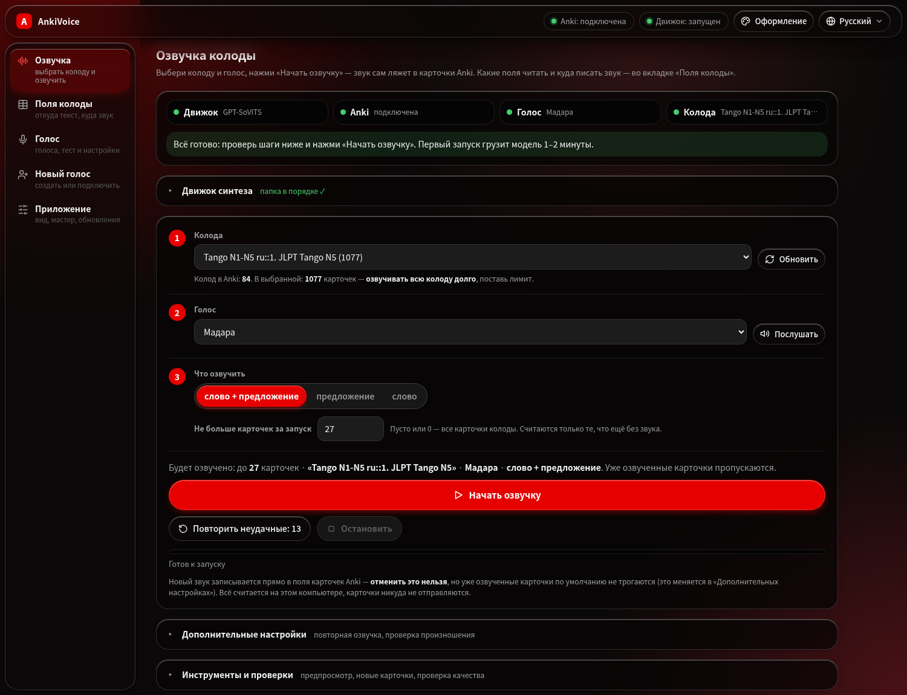
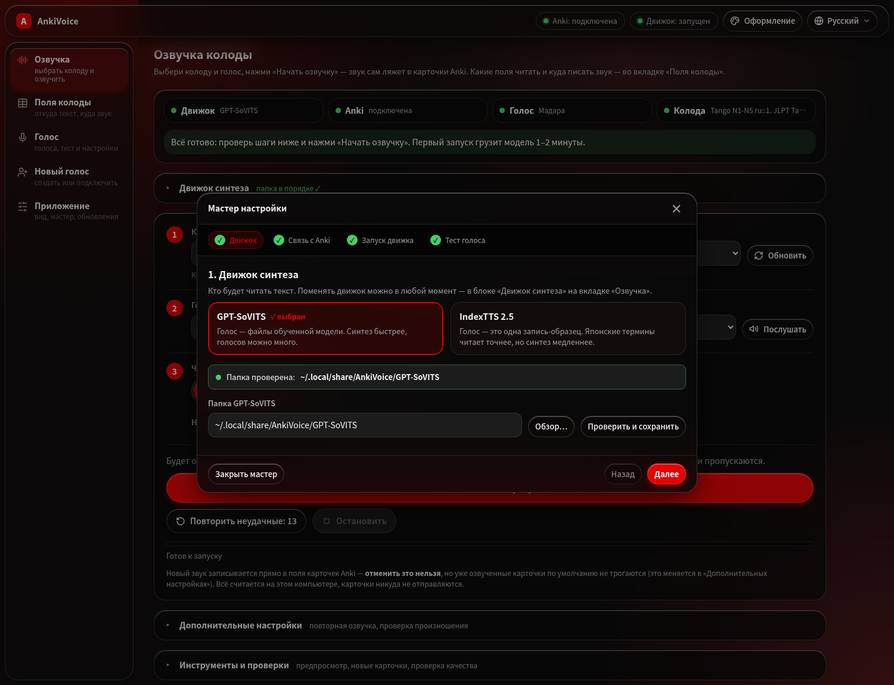
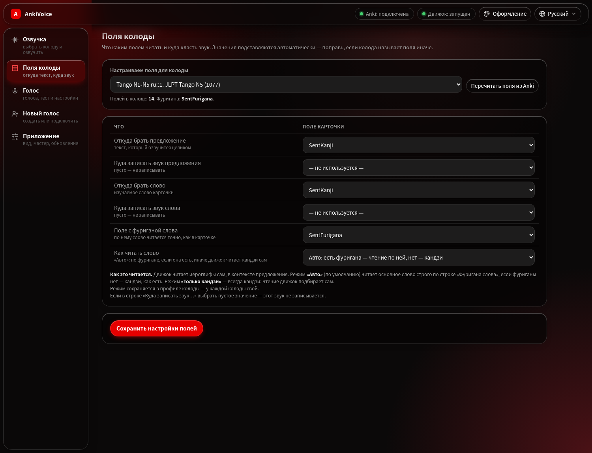
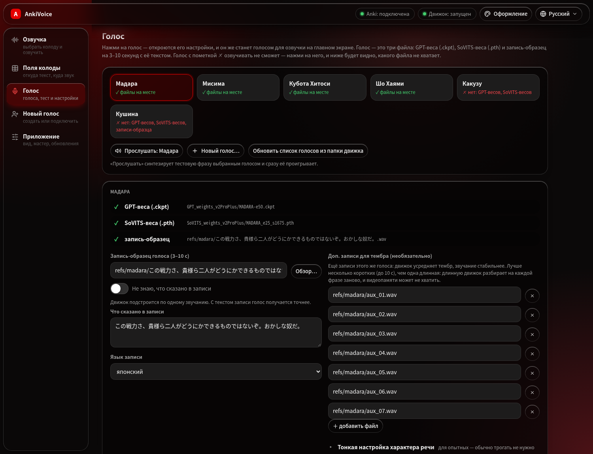
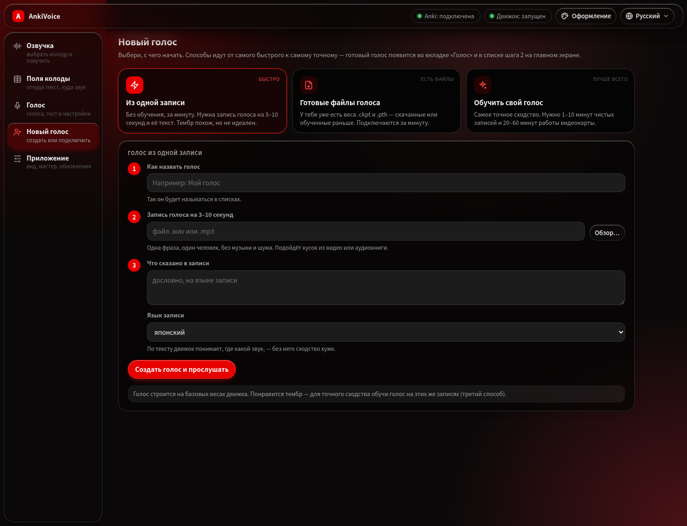
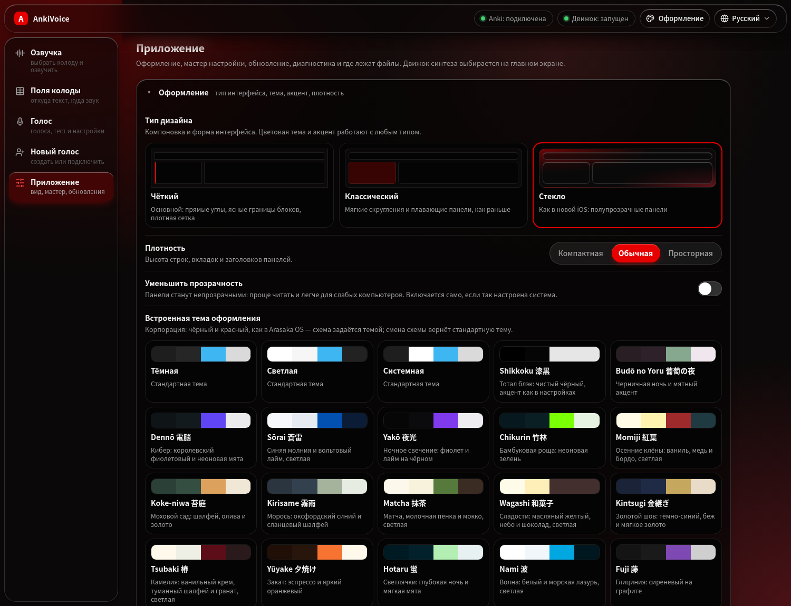
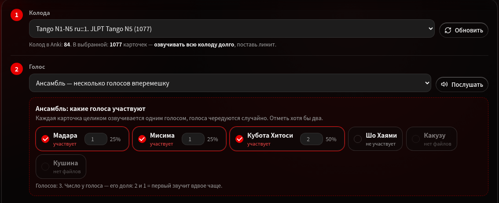
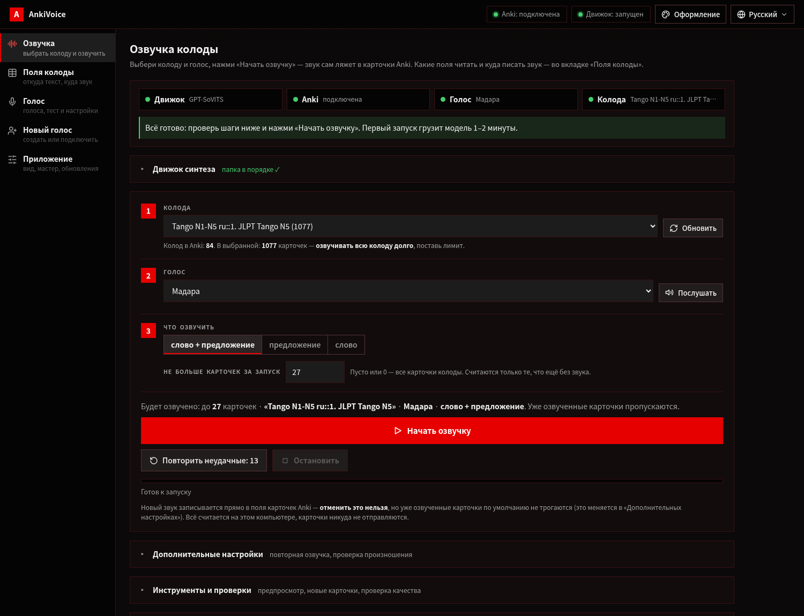
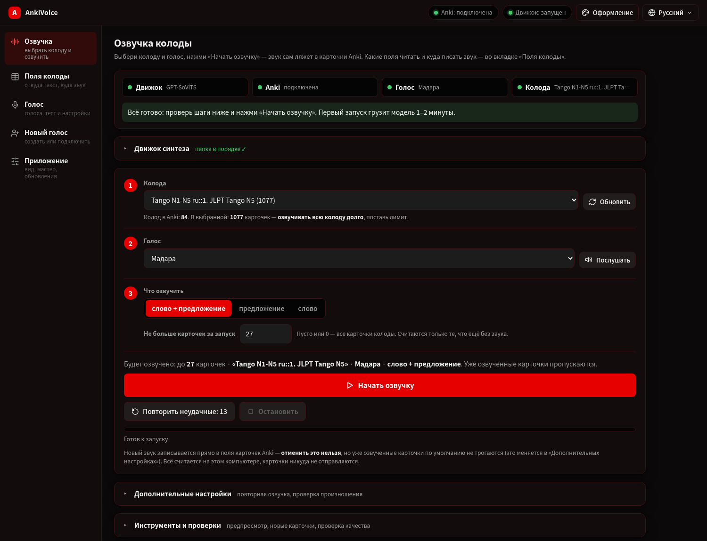
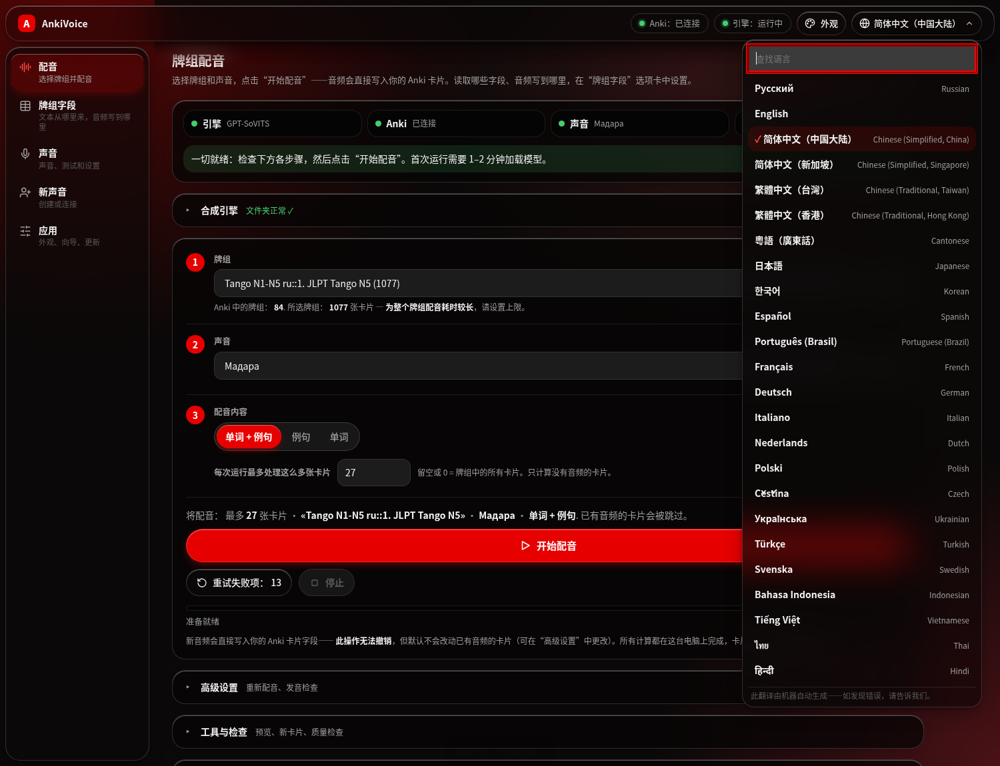

<p align="center">
  
</p>

<p align="center">
  <a href="https://github.com/Daii1414/AnkiVoice/releases/latest">
    
  </a>
  <a href="https://github.com/Daii1414/AnkiVoice/blob/main/LICENSE">
    
  </a>
  
  
</p>

<p align="center"><b>Озвучка японских карточек Anki</b><br>
Голос GPT-SoVITS или IndexTTS 2.5 — целиком на вашем компьютере. Движок читает
иероглифы сам, связно, в контексте предложения, а чтение основного слова берётся
из фуриганы карточки. Готовый звук (.ogg) ложится прямо в поля Anki.</p>

<p align="center">
  <a href="https://github.com/Daii1414/AnkiVoice/releases/latest">
    
  </a>
  &nbsp;
  <a href="#установка-на-linux">
    
  </a>
  &nbsp;&nbsp;
  <a href="#что-нужно-для-работы">Что нужно для работы →</a>
</p>

<p align="center">
  
</p>

<p align="center">
  <a href="#как-это-работает">Как это работает</a> •
  <a href="#установка-на-windows">Windows</a> •
  <a href="#установка-на-linux">Linux</a> •
  <a href="#интерфейс">Интерфейс</a> •
  <a href="#свой-голос">Свой голос</a> •
  <a href="#как-читаются-иероглифы">Чтение иероглифов</a> •
  <a href="#если-что-то-не-работает">Если не работает</a>
</p>

<p align="center"></p>

**Русский** | [English](README.en.md)

---

## Что это и для кого

| Кто ты | Что получишь | Читай дальше |
|---|---|---|
| Учу японский по карточкам Anki | звук предложения и слова прямо в полях карточки, всё локально | [Первый звук](#первый-звук) |
| Хочу конкретный голос | свой голос из одной записи — или обученный на нескольких минутах речи | [Свой голос](#свой-голос) |
| Хочу разнообразия | ансамбль: карточки делятся между несколькими голосами | [Ансамбль голосов](#ансамбль-голосов) |
| Хочу, чтобы термины читались точно | чтение берётся из фуриганы карточки | [Как читаются иероглифы](#как-читаются-иероглифы) |
| Ищу TTS по HTTP API | не подойдёт: это приложение для Anki, не сервис | — |


## Оглавление

- [Что умеет](#что-умеет)
- [Как это работает](#как-это-работает)
- [Что нужно для работы](#что-нужно-для-работы)
- [Установка на Windows](#установка-на-windows)
- [Установка на Linux](#установка-на-linux)
- [Первый звук](#первый-звук)
- [Интерфейс](#интерфейс)
- [Ансамбль голосов](#ансамбль-голосов)
- [Свой голос](#свой-голос)
- [Оформление и языки](#оформление-и-языки)
- [Звук: формат и размер](#звук-формат-и-размер)
- [Проверка произношения](#проверка-произношения)
- [Второй движок: IndexTTS 2.5](#второй-движок-indextts-25)
- [Как читаются иероглифы](#как-читаются-иероглифы)
- [Документация](#документация)
- [Обновления и удаление](#обновления-и-удаление)
- [Что перезаписывается, что уходит в сеть](#что-перезаписывается-что-уходит-в-сеть)
- [Если что-то не работает](#если-что-то-не-работает)
- [Участие в проекте](#участие-в-проекте)
- [Лицензия](#лицензия)
- [Благодарности](#благодарности)

---

## Что умеет

| | |
|---|---|
| 🎧 **Озвучка карточек** | Кладёт звук предложения и слова прямо в поля Anki. Голос клонирует GPT-SoVITS (или IndexTTS 2.5). |
| 📖 **Точное чтение** | Движок читает иероглифы сам — связно, в контексте; чтение основного слова берётся из фуриганы карточки. Нет фуриганы — читает кандзи сам. |
| 🔤 **Английские слова** | Нейросеть [e2k](https://github.com/Patchethium/e2k) переводит их в катакану (bus→バス), аббревиатуры — побуквенно (USB→ユーエスビー), смешанные токены — по словарю (3D→スリーディー). |
| 🎭 **Ансамбль голосов** | Пункт «Ансамбль» в списке голосов: отметь голоса и их доли — карточки разделятся между ними, каждая озвучится одним голосом целиком. |
| 🎙 **Свой голос** | Вкладка «Новый голос»: голос из одной записи за минуту, подключение готовых весов или обучение в студии GPT-SoVITS — по шагам. |
| 🗜 **Лёгкие колоды** | Звук сжимается в .ogg (Vorbis) — фраза ~50 КБ вместо ~300 КБ в .wav; старые .wav-озвучки пережимаются одной кнопкой. |
| 🧪 **Контроль качества** | Несколько независимых сигналов (тишина, разрывы, дубль, обрезка, уровень, темп) — брак переделывается сам; сбой движка (нехватка видеопамяти) распознаётся отдельно. |
| 🔍 **Проверка произношения** | Приложение слушает собственный звук и сверяет его с текстом. Совет, а не приговор — решение за тобой. |
| ♻ **Только нужное** | Уже озвученные карточки пропускаются; «Обновить изменённые» переозвучит лишь те, где поменялся текст или голос; «Повторить неудачные» — только ошибки. |
| 🧩 **Настройки на колоду** | Поля, режим чтения и состав ансамбля — свои для каждой колоды. |
| 👁 **Предпросмотр** | Без синтеза покажет, какой текст уйдёт в озвучку и сработала ли подстановка фуриганы. |
| 🎨 **Оформление Fragile** | Три типа интерфейса (чёткий, обычный, стекло), 19 цветовых тем, свой акцент, плотность; плавные анимации, уважающие «меньше движения». |
| 🌐 **24 языка** | Русский, английский, китайский во всех вариантах (упрощённый — Китай и Сингапур; традиционный — Тайвань и Гонконг; кантонский), японский, корейский и ещё 15. |
| 🧙 **Установщики, которые спрашивают** | Windows и Linux сами проверяют, чего не хватает (Anki, AnkiConnect, движок, ffmpeg…), и до загрузки спрашивают: поставить или указать папку, где оно уже есть. |
| 🔒 **Полностью локально** | Страница работает офлайн, без CDN, телеметрии и аккаунтов. Лицензия AGPL-3.0. |

> **Послушать, как это звучит:** [демо-ролик](doc/gptsovits/gpt-sovits-demo.mp4) —
> озвучка японских предложений моделью (озвучка идёт офлайн на вашей машине).

## Как это работает


AnkiVoice не копирует код движка: [GPT-SoVITS](https://github.com/RVC-Boss/GPT-SoVITS)
поднимается как обычный локальный сервер (`127.0.0.1`), программа шлёт ему текст
и забирает звук. Карточки читаются и пишутся через дополнение
[AnkiConnect](https://ankiweb.net/shared/info/2055492159). Интерфейс — локальная
веб-страница, которую программа открывает в браузере.

## Что нужно для работы

| Что | Где взять | Размер | Обязательно | Зачем |
|---|---|---|---|---|
| **AnkiVoice** | Windows — [Releases](https://github.com/Daii1414/AnkiVoice/releases/latest) → `AnkiVoice-Setup-x.y.exe`; Linux — [одна команда](#установка-на-linux) | ~160 МБ (Windows) | да | интерфейс, локальный сервер, словарь чтения, e2k |
| **Anki + AnkiConnect** | [apps.ankiweb.net](https://apps.ankiweb.net); дополнение `2055492159` | ~200 МБ | да | колоды и поля |
| **Движок** (один из двух) | [GPT-SoVITS](https://github.com/RVC-Boss/GPT-SoVITS/releases) или [IndexTTS 2.5](https://github.com/index-tts/index-tts) | 6–10 ГБ или ~5 ГБ | да, один | синтез речи |
| **Голос** | свой (вкладка «Новый голос»), в движке или у сообщества | веса + запись 3–10 с | да | тембр и характер речи |
| **Видеокарта NVIDIA** | драйвер NVIDIA, CUDA 12.4+ | от 6 ГБ видеопамяти | желательно | без неё синтез на процессоре, в разы медленнее |
| **Модель распознавания** | скачивается кнопкой в приложении (`faster-whisper`) | ~1,5 ГБ | нет | только проверка произношения |

Установщики проверяют всё это сами и спрашивают, что докачать. Интернет нужен
только чтобы скачать — сама озвучка идёт офлайн.

> [!NOTE]
> Веса голоса должны подходить версии движка: веса **v2Pro / v2ProPlus**
> загружаются только движком `20250606v2pro` и новее. Старый пакет
> (например, `v3lora-20250228`) понимает лишь v1/v2/v3.

## Установка на Windows

1. Скачай **`AnkiVoice-Setup-x.y.exe`** со страницы
   [Releases](https://github.com/Daii1414/AnkiVoice/releases/latest). Контрольная
   сумма — в заметках к релизу (`certutil -hashfile AnkiVoice-Setup-x.y.exe SHA256`).
   Кнопка **Code → Download ZIP** отдаёт исходники, а не установщик.
2. Запусти и выбери язык установщика (21 язык; он же станет языком программы).
   > [!IMPORTANT]
   > Установщик не подписан — Windows покажет окно SmartScreen. Нажми
   > **«Подробнее» → «Выполнить в любом случае»**.
3. Страница **«Что нужно для работы»** проверит Anki, AnkiConnect, движок
   GPT-SoVITS и драйвер NVIDIA. Для каждого недостающего — **«Скачать и
   установить»** или **«Уже установлено — папка»** (например, движок на диске D:
   — установщик проверит, что в папке именно он). Перед загрузкой покажет план
   и спросит подтверждение. Скачать он может:
   - Anki 26.09.3 (MSI);
   - AnkiConnect — сразу в папку дополнений Anki;
   - движок GPT-SoVITS v2pro-20250604 (~8 ГБ, распаковка `tar.exe`; если
     не выйдет — подскажет распаковать архив 7-Zip'ом).
4. «Установить» → «Завершить» — программа откроется сама.

Установка идёт в `%LOCALAPPDATA%\Programs\AnkiVoice`, без прав администратора.

## Установка на Linux

Одна команда — сначала проверит систему и спросит, что ставить, потом скачает
программу, соберёт оба Python-окружения, найдёт (или скачает) движок
GPT-SoVITS и создаст команду `ankivoice`:

```bash
curl -fsSL https://raw.githubusercontent.com/Daii1414/AnkiVoice/main/install.sh | bash
```

Поддерживаются Arch (и Manjaro, EndeavourOS, CachyOS), Debian/Ubuntu (Mint,
Pop!_OS), Fedora (и RHEL-подобные), openSUSE, Void, Solus и Gentoo; NixOS и
Alpine — с оговорками (установщик их назовёт). Порядок такой:

1. **Проверка** — что уже есть: git, curl, ffmpeg, компилятор и cmake, uv,
   видеокарта NVIDIA, место на диске, Anki, AnkiConnect, движок GPT-SoVITS.
2. **Вопросы до любой загрузки** — для каждого недостающего: поставить
   (пакетом дистрибутива, из Flathub или скачать), **указать папку, где оно
   уже стоит** (например, на другом диске — она попадёт в PATH команды
   `ankivoice`), или пропустить, если без него можно. Мало места —
   предложит положить окружения и движок на другой диск.
3. **План и подтверждение**, затем установка. AnkiConnect установщик ставит
   сам (с AnkiWeb, в папку дополнений Anki).

Вопросы — в окнах `whiptail` (если он есть) или текстом, на русском или
английском. Из уже скачанной папки — то же самое: `./install.sh`. Флаги:

| Флаг | Что делает |
|---|---|
| `--check` | только показать, что есть и чего не хватает |
| `--dry-run` | пройти вопросы и показать план, ничего не меняя |
| `--engine ПАПКА` | взять свою папку GPT-SoVITS (подойдёт и распакованный Windows-пакет: из него берутся `api_v2.py`, веса и версии библиотек) |
| `--download-engine` | скачать GPT-SoVITS `20250606v2pro` и его модели (~6 ГБ) |
| `--no-engine` | движок настроить позже |
| `--data-dir ПАПКА` | куда класть окружения и движок (~8 ГБ), например на другой диск |
| `--cpu` | torch без CUDA (нет видеокарты NVIDIA) |
| `--yes` | без вопросов: недостающее ставится, необязательное пропускается |
| `--no-tui` | вопросы текстом, без окон `whiptail` |
| `--lang ru\|en` | язык установщика (по умолчанию — как в системе) |
| `--uninstall` | удалить (спросит, удалять ли окружения и настройки) |

Что где лежит:

| Что | Где |
|---|---|
| программа и `pyruntime/` (Python 3.12: Haqumei, SudachiPy, веб-интерфейс) | папка установки (по умолчанию `~/.local/share/AnkiVoice/app`) |
| Python движка (3.10, torch, зависимости GPT-SoVITS) | `~/.local/share/AnkiVoice/gsv-venv` или `.venv` внутри скачанного движка |
| настройки, итоги прогонов, отчёты | `~/.config/AnkiVoice/` |
| команда запуска | `~/.local/bin/ankivoice` + ярлык «AnkiVoice» в меню |

Запуск — `ankivoice` (откроется страница в браузере), без PATH — `./run.sh` из
папки программы. Консоль: `ankivoice pipeline selftest`,
`ankivoice pipeline voice --voice ИМЯ --deck "Колода"`. Диагностика —
`ankivoice doctor`, обновление — `ankivoice update`, удаление — `ankivoice uninstall`.

## Первый звук

1. Открой Anki (с AnkiConnect) и запусти AnkiVoice.
2. Если чего-то не хватает, сам откроется **мастер настройки**: движок →
   связь с Anki → запуск движка → тест голоса. Каждый шаг показывает, что не
   так и что нажать.

   

3. На главном экране: **1** — колода, **2** — голос, **3** — что озвучить
   (слово + предложение, только предложение или только слово) и сколько
   карточек за запуск.
4. **«Начать озвучку»**. Первый запуск грузит модель 1–2 минуты, дальше —
   секунды на фразу. Если все карточки уже озвучены, кнопка так и скажет:
   «Все карточки уже озвучены».

Какие поля читать и куда писать звук, приложение подбирает само по названиям
полей; поправить — на вкладке «Поля колоды».

## Интерфейс

Пять вкладок слева; в шапке — статус Anki и движка, «Оформление» и язык.
Сервер слушает только `127.0.0.1` и принимает только свои запросы: чужой сайт,
открытый в том же браузере, не сможет запустить озвучку.

### «Озвучка» — главный экран


* **Готовность** — четыре плашки (движок, Anki, голос, колода) и одна строка
  «что сделать сейчас» с кнопкой, если что-то не так.
* **Движок синтеза** — GPT-SoVITS или IndexTTS 2.5 двумя карточками и папка
  движка с проверкой. Переключается на ходу.
* **Шаги 1–3** — колода, голос (или [ансамбль](#ансамбль-голосов)), что
  озвучить и лимит за запуск. Лимит — это объём работы: «27 карточек» — это 27
  карточек без звука, а не первые 27 в колоде.
* **Сводка** над кнопкой — сколько карточек без звука, сколько озвучится, какой
  голос и режим.
* **«Начать озвучку»**, **«Повторить неудачные»**, **«Остановить»**; полоса
  прогресса с оценкой «осталось ≈».
* **Дополнительные настройки** — что делать с карточками, где звук уже есть
  (пропускать / обновить изменённые / переозвучить все) и проверка
  произношения.
* **Инструменты и проверки** — предпросмотр, «Озвучить новые карточки»,
  проверка звука в карточках, поиск лишних аудиофайлов, **«Сжать звук колоды в
  .ogg»** и проверка качества по шагам (колода «Брак», вердикты, итоги).
* **Журнал** — живой лог с цветной разметкой: зелёное — готово, красное —
  ошибка, жёлтое — брак и повторы.

### «Поля колоды» — что откуда читать



Строки-вопросы: откуда брать предложение, куда записать его звук, откуда брать
слово, куда записать звук слова, поле с фуриганой и как читать слово.
Значения подставляются по названиям полей; пустой выбор «Куда записать звук»
— этот звук не пишется. Настройки сохраняются на колоду.

### «Голос» — голоса и их настройки



* **Карточки голосов** — все голоса из `voices.json`; у неготовых видно,
  какого файла не хватает.
* **Редактор** — файлы голоса (GPT-веса, SoVITS-веса, запись-образец) с
  отметками ✓/✗, запись-образец 3–10 с и её текст, язык, **доп. записи для
  тембра** (лучше несколько коротких, до 10 с, чем одна длинная).
* **Тонкая настройка характера речи** — seed, «живость» (temperature),
  top_p, top_k, скорость; «Сбросить к стандартным».
* **«Прослушать»** — синтезирует тестовую фразу и сразу её проигрывает.

### «Новый голос»



Три способа получить голос — подробнее в разделе [Свой голос](#свой-голос).

### «Приложение»



[Оформление](#оформление-и-языки), мастер настройки, обновления, проверка
(«Проверить» — быстро, «Подробная проверка» — всё сразу), где лежат файлы,
история озвучек (клик — полный отчёт по операциям) и «Закрыть AnkiVoice».

## Ансамбль голосов



В списке голосов шага 2 есть пункт **«Ансамбль — несколько голосов
вперемешку»**. Под ним появляются голоса: отметь хотя бы два и задай доли
(2 и 1 — первый звучит вдвое чаще). Состав ансамбля запоминается на колоду.

Как раздаются карточки:

* **Заранее, до синтеза.** Каждая карточка получает голос случайно, с учётом
  долей; генератор с фиксированным зерном — тот же набор карточек
  распределится так же.
* **Уже озвученные карточки сохраняют свой голос** (тег `av_voice::имя`):
  переозвучка части колоды не меняет голос у остальных.
* **Озвучка партиями** — сначала все карточки одного голоса, потом следующего:
  веса каждого голоса загружаются один раз за прогон.
* Доли соблюдаются **в среднем**: на маленькой колоде фактический счёт может
  заметно отличаться от процентов.

## Свой голос

Вкладка **«Новый голос»** — три способа, от быстрого к точному:

| Способ | Что нужно | Сколько времени | Сходство |
|---|---|---|---|
| **Из одной записи** | запись 3–10 с и её текст | минута | похоже, но не идеально |
| **Готовые файлы голоса** | веса `.ckpt` и `.pth` + запись-образец | минута | как у весов |
| **Обучить свой голос** | 1–10 минут чистой речи одного человека | 20–60 минут работы видеокарты | самое точное |

* **Из одной записи** — голос строится на базовых весах движка, тембр
  подхватывается из записи. Сразу после создания голос выбирается и звучит
  пробная фраза. Длина записи проверяется при добавлении (движок принимает
  только 3–10 с).
* **Готовые файлы** — кнопка «Найти голоса в папке движка» подхватит веса из
  `GPT_weights_*` и `SoVITS_weights_*`, или укажи файлы вручную. Внутреннее
  имя голоса придумывать не нужно.
* **Обучить свой голос** — кнопка открывает студию обучения GPT-SoVITS (её
  собственный интерфейс) в браузере; на вкладке — шаги: подготовка записей
  (0b нарезка, 0c распознавание текста), 1A подготовка данных, 1B обучение
  SoVITS и GPT, затем «Найти обученные голоса». Первый запуск один раз
  докачивает ~250 МБ файлов для обучения. Студия слушает только этот
  компьютер (`127.0.0.1`), а не всю локальную сеть.

## Оформление и языки

<p align="center">
  
  
  
</p>

«Оформление» (кнопка в шапке или вкладка «Приложение»):

* **Тип дизайна** — чёткий (прямые углы, ясные границы), обычный (мягкие
  скругления) или стекло (полупрозрачные панели; то, что уходит под шапку,
  размывается и затемняется).
* **19 встроенных тем** плюс стандартные тёмная, светлая и системная, **свой
  цвет акцента**, плотность (компактная / обычная / просторная), «Уменьшить
  прозрачность».
* Анимации — смена темы волной от курсора, «линза» под активным пунктом,
  появление карточек по очереди; при системной настройке «меньше движения»
  они отключаются.

Светлая тема — [пример](doc/shots/main-light.png).

<p align="center"></p>

**Язык** — выпадающий список с поиском в шапке: русский, английский, китайский
(упрощённый — Китай и Сингапур; традиционный — Тайвань и Гонконг; кантонский),
японский, корейский, испанский, португальский (Бразилия), французский,
немецкий, итальянский, нидерландский, польский, чешский, украинский, турецкий,
шведский, индонезийский, вьетнамский, тайский, хинди. Переключается на лету.
Без выбора берётся язык установщика Windows или язык системы. Переводы сделаны
автоматически — нашёл ошибку, [напиши](https://github.com/Daii1414/AnkiVoice/issues).

## Звук: формат и размер

* В колоду пишется **OGG Vorbis** — фраза ~50 КБ вместо ~300 КБ в WAV. Новые
  движки отдают только WAV, поэтому приложение сжимает звук само (ffmpeg).
* Уже записанные `.wav`-озвучки пережимает **«Инструменты и проверки» →
  «Сжать звук колоды в .ogg»** (консоль: `pipeline compress-media --deck
  "Колода"`): ссылки в карточках заменяются, старые `.wav` уходят в корзину
  медиа Anki.
* **«Найти лишние аудиофайлы»** — отчёт о файлах `tts_*`, на которые больше не
  ссылается ни одна карточка (удаление — из консоли, `cleanup-media --apply`).

## Проверка произношения

GPT-SoVITS иногда **теряет кусок фразы или придумывает лишний**: длительность
в норме, звук — речь, а содержание не то. Проверка «тишина / длина / дубль»
такое не видит.

«Дополнительные настройки» → **«Проверять во время озвучки»**: приложение
распознаёт собственный звук (faster-whisper) и сверяет его с текстом. Модель
распознавания (~1,5 ГБ) скачивается кнопкой там же.

**Это совет, а не приговор.** По замеру на 27 размеченных карточках
подтверждённых браков — 2, а ложных срабатываний — 25: распознаватель
переворачивает доменные термины, и по тексту их не отличить от настоящей
ошибки. Поэтому проверка

* не бракует карточку и не метит её тегом;
* печатает в журнал покрытие, ошибку и участок расхождения;
* по шагам в «Инструментах»: проверить уже озвученные → собрать колоду
  **«Брак»** с вариантами → послушать и отметить в поле «Вердикт» → итоги
  (как часто проверка права).

### Что приложение проверяет само

| Что проверяет | Как | Итог |
|---|---|---|
| Тишина, обрезка, дубль | несколько независимых сигналов | брак переделывается сам |
| Разрывы в речи | пауза больше 4 с внутри фразы | пересборка куска |
| Уровень и темп | неслышно или слишком быстро | пересборка |
| Сбой движка | 1 с тишины вместо звука (например, нехватка видеопамяти) | понятная причина из лога, без 9 одинаковых попыток |
| Произношение (по желанию) | распознавание и сверка с текстом | подсказка, решение — твоё |

Пороги — свои для каждого голоса: приложение считает норму по принятым кускам.

## Второй движок: IndexTTS 2.5

Кроме GPT-SoVITS можно работать с **IndexTTS 2.5** — zero-shot движком,
которому достаточно одной записи. Переключатель — в блоке «Движок синтеза» на
главном экране.

| | GPT-SoVITS | IndexTTS 2.5 |
|---|---|---|
| голос | файлы `.ckpt` + `.pth` + запись-образец | **одна запись** (3–10 с) |
| веса | свои у каждого голоса | общие у модели |
| как ставится | распакованный архив или `install.sh` | `git clone` + `uv sync --extra webui` + веса в `checkpoints` |
| размер на диске | 6–10 ГБ | ~5 ГБ |
| проверка произношения | есть | нет, только акустический контроль |
| ручные настройки звука | seed, temperature, top_p, top_k | нет |
| для кого | хочу качество и контроль | хочу минимум возни |

Подробности — в [doc/engines.md](doc/engines.md).

## Как читаются иероглифы

GPT-SoVITS читает кандзи сам — но на редких терминах по-своему. Режим чтения
выбирается на вкладке «Поля колоды» → «Как читать слово»:

| Режим | Что уходит движку | Когда выбирать |
|---|---|---|
| **Авто (по умолчанию)** | весь текст кандзи, кроме основного слова: его чтение подставлено из фуриганы; нет фуриганы — всё кандзи | универсальный |
| **Только кандзи** | весь текст кандзи, без подстановок | колоды с обычными словами: звук самый цельный |

Чем «чистое чтение» отличается от «точного» (замер на 150 фразах и слепое
сравнение на 10): по качеству звука чистый кандзи выигрывает — 7 голосов из
10, но в 12 фразах из 150 модель прочитала термин не так, как в карточке; в
смешанном режиме — 2 из 150.

| Случай | Что делает приложение | Почему |
|---|---|---|
| Термин с фуриганой | подставляет чтение из поля фуриганы | карточка знает правильнее движка |
| Окуригана (データ) | оставляет слово как есть | иначе прозвучит дважды |
| Обычное английское слово (bus, coffee) | e2k → катакана | バス, コーヒー |
| Аббревиатура (USB, CPU, HTML) | побуквенно | ユーエスビー, シーピーユー |
| Смешанный токен (3D, Wi-Fi) | фиксированный словарь | スリーディー, ワイファイ |
| Строчная буква перед словом (iPhone, iOS) | буква + слово | アイフォン, アイオーエス |
| Слово не найдено в тексте | карточка остаётся как есть | нельзя подставить чужое чтение |

Цифры (`2.0`, `12`) движок читает сам. Как текст превращается в хирагану шаг
за шагом — [doc/reading.md](doc/reading.md). В консоли режим — флаг
`--reading ""|mix|asis`.

## Документация

| Документ | О чём |
|---|---|
| [doc/reading.md](doc/reading.md) | как текст превращается в хирагану: конвейер чтения, латиница, цифры |
| [doc/fields.md](doc/fields.md) | поля карточек: откуда брать текст и куда писать звук |
| [doc/cli.md](doc/cli.md) | консоль: все команды пайплайна |
| [doc/engines.md](doc/engines.md) | второй движок IndexTTS 2.5 |
| [CHANGELOG.md](CHANGELOG.md) | что нового в каждой версии |
| [CONTRIBUTING.md](CONTRIBUTING.md) | разработка: сборка, проверки, структура, переводы |

## Обновления и удаление

* **Windows**: вкладка «Приложение» → **«Проверить обновления»** — changelog,
  скачивание установщика и обязательная проверка SHA256. Или новый установщик
  с [Releases](https://github.com/Daii1414/AnkiVoice/releases/latest) поверх
  старой версии — настройки и голоса сохранятся. Удаление: Пуск → «Удалить
  AnkiVoice» (настройки и `voices.json` остаются).
* **Linux**: `ankivoice update` (git pull + проверка окружений),
  удаление — `ankivoice uninstall`.

## Что перезаписывается, что уходит в сеть

| Действие | Что с карточкой |
|---|---|
| Озвучка | в поле звука пишется новый файл; старый остаётся в медиа Anki, ссылка на него теряется |
| Текст карточки | не меняется никогда |
| «Сжать звук в .ogg» | ссылка `.wav` → `.ogg`, старый `.wav` — в корзину медиа Anki |
| Колода «Брак» | новая колода с копиями карточек; оригиналы не трогает |
| Проверка произношения | ничего не пишет — только слушает и советует |

| Что уходит в сеть | Когда |
|---|---|
| `api.github.com` | только по кнопке «Проверить обновления» |
| загрузки установщиков (Anki, AnkiConnect, движок, пакеты, uv) | только при установке, после твоего подтверждения |
| HuggingFace | модели движка, распознавания и обучения — только по кнопке или в установщике |
| карточки и тексты | **никогда** — всё считается локально |
| телеметрия, аккаунты | **нет** |

## Если что-то не работает

| Что происходит | Почему | Что делать |
|---|---|---|
| Не найдена папка GPT-SoVITS | путь не указан или указывает не туда | «Движок синтеза» → «Обзор…» или `./install.sh --engine ПАПКА` |
| «Anki не отвечает» | Anki закрыта или нет AnkiConnect | открыть Anki; дополнение `2055492159`, перезапустить Anki |
| У голоса ✗ «нет файлов» | веса или запись не там | вкладка «Голос» покажет, какого файла нет |
| «Запись-образец длится N с» | движок принимает только 3–10 с | вырезать кусок с одной фразой |
| «Движку не хватило видеопамяти» | видеокарту заняли другие программы или проверка произношения | закрыть тяжёлые программы, выключить проверку; длинные доп. записи заменить короткими |
| Звук весит много | старые озвучки в `.wav` | «Сжать звук колоды в .ogg» |
| «Все карточки уже озвучены» | звук уже есть | «Дополнительные настройки» → «Переозвучить все» или другая колода |
| Первый звук идёт минутами | загрузка модели или включена проверка произношения | подождать первый запуск; проверку — выключить |
| «Пайплайн уже запущен» | идёт другая работа | дождаться её конца |
| Windows: «Защитил ваш компьютер» | установщик не подписан | «Подробнее» → «Выполнить в любом случае» |

Полезно: «Приложение» → «Подробная проверка» (или `ankivoice doctor`) печатает,
что именно видит программа — движок, голоса, словарь чтения, AnkiConnect,
сервер.

## Участие в проекте

* Правки и идеи — через [issues](https://github.com/Daii1414/AnkiVoice/issues) и
  pull request'ы.
* Правила разработки, сборка, проверки и переводы — в
  [CONTRIBUTING.md](CONTRIBUTING.md); уязвимости — по [SECURITY.md](SECURITY.md).

<p align="center">
  <a href="https://github.com/Daii1414/AnkiVoice/actions/workflows/checks.yml">
    
  </a>
</p>

## Лицензия

**AGPL-3.0** (текст — в файле [LICENSE](LICENSE)): кто изменит и распространит
этот инструмент — обязан опубликовать исходники своих изменений, в том числе
при использовании через сеть.

## Благодарности

* [GPT-SoVITS](https://github.com/RVC-Boss/GPT-SoVITS) — движок синтеза (MIT).
* [IndexTTS](https://github.com/index-tts/index-tts) — второй движок.
* [e2k](https://github.com/Patchethium/e2k) — английские слова в катакану (MIT).
* [Haqumei](https://github.com/o24s/haqumei) — контекстное чтение иероглифов.
* [Sudachi](https://github.com/WorksApplications/SudachiPy) и UniDic — запасной ход и проверка чтений.
* [faster-whisper](https://github.com/SYSTRAN/faster-whisper) — проверка произношения.
* [AnkiConnect](https://ankiweb.net/shared/info/2055492159) — мост к Anki.
* [Inno Setup](https://jrsoftware.org/isinfo.php) — установщик Windows.
