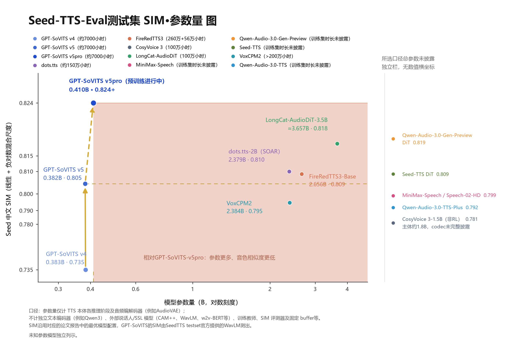

# AnkiVoice

> **Local Japanese audio for Anki — kanji readings via Sudachi/UniDic, voices via GPT-SoVITS. Fully offline, nothing to install.**

Озвучка колод Anki голосами GPT-SoVITS. Инструмент сам читает иероглифы
современным словарём, умеет подставлять проверенное чтение из фуриганы
карточки, клонирует выбранный голос и кладёт готовые ogg-файлы прямо
в поля карточек. Всё локально: интернет нужен только чтобы скачать.

Полное техническое описание (устройство, вся логика, история багов) —
в `PROJECT.md`. Здесь — как установить и пользоваться.

## На чём построено

Синтез речи делает **[GPT-SoVITS](https://github.com/RVC-Boss/GPT-SoVITS)** —
открытый движок few-shot TTS (лицензия MIT). AnkiVoice его код не копирует:
движок поднимается как обычный локальный сервер на `127.0.0.1:9880`, а
программа шлёт ему текст и забирает готовый звук. Поэтому вместе с AnkiVoice
работает и родной веб-интерфейс GPT-SoVITS, и любые его голоса.

Чем это полезно на практике: **5 секунд** референса — и голос уже говорит;
**минута** обучающих данных — похожесть заметно выше.

Демо few-shot на незнакомом спикере (китайский и японский, 1:26):

https://github.com/user-attachments/assets/f954276c-40ca-4a8a-a4f3-39ad4fb1a4a4

*Файл дублируется в репозитории — [doc/gptsovits/gpt-sovits-demo.mp4](doc/gptsovits/gpt-sovits-demo.mp4).
Оригинал: [GPT-SoVITS](https://github.com/RVC-Boss/GPT-SoVITS).*

Версия, на которой собран AnkiVoice, — **v2Pro**. Скорость из их замеров:
RTF **0.028** на RTX 4060 Ti и **0.014** на RTX 4090 (4 минуты речи примерно
за 3 секунды), **0.526** на CPU M4.

Сравнение похожести голоса на тестовом наборе SeedTTS (выше — лучше,
синим — GPT-SoVITS):



Благодарности: [GPT-SoVITS](https://github.com/RVC-Boss/GPT-SoVITS) — движок;
[gradio](https://github.com/gradio-app/gradio) — раскладка ползунков на
вкладке «Голос» сделана в их стиле; [Sudachi](https://github.com/WorksApplications/SudachiPy)
и словарь UniDic — чтение иероглифов.

## Что нужно

1. **Windows 10/11** и GPU с CUDA (комфортно — от 6 ГБ видеопамяти).
2. **GPT-SoVITS** установлен и запускался (папка с `runtime\python.exe` и `api_v2.py`).
3. **Anki** с включённым **AnkiConnect** (плагин, отвечает на `127.0.0.1:8765`).

Больше ничего: чтение иероглифов работает на **встроенном Python**
(`pyruntime.zip` + `sudachidict.zip` уже внутри установщика, распаковываются
сами при первом запуске — ставить ничего не нужно).

## Быстрый старт

1. Скачай **`AnkiVoice-Setup-1.1.exe`** со страницы [Releases](../../releases) —
   это один файл, в нём уже всё внутри.
2. Запусти его: «Далее» → «Установить» → «Завершить»
   (галочка «Запустить AnkiVoice» включена — программа откроется сама).
3. Укажи папку GPT-SoVITS (обычно находит сама, путь запоминается навсегда).
4. Во вкладке **«Голос»** выбери голос → во вкладке **«Поля колоды»** колоду
   и поля → во вкладке **«Озвучка»** нажми **«Начать озвучку»**.

Программа поднимает локальный сервер и открывает страницу в браузере —
это обычное поведение, ничего ставить дополнительно не нужно.

Установка идёт в папку пользователя (`AppData\Local\Programs\AnkiVoice`),
прав администратора не спрашивается. Удаление: меню Пуск → «Удалить AnkiVoice».
Первый запуск дольше обычного (~10 секунд): распаковывается встроенный
Python и словарь. Дальше всё быстро.

## Интерфейс (четыре вкладки)

Оболочка — локальная веб-страница (`anki_web.py`): сервер слушает только
`127.0.0.1`, наружу ничего не уходит. Страница работает офлайн, без CDN.
Старое tkinter-окно сохранено — запускается флагом `--classic`.

### Вкладка «Озвучка» — главный экран


* **Колода** и **Голос** — списки подтягиваются из Anki и `voices.json`.
* **Что озвучивать** — «слово + предложение» (обычно), только предложение
  или только слово; лимит карточек (0 = все); «пересобрать всё заново»
  игнорирует уже готовые карточки.
* **«Начать озвучку»** — главная кнопка; рядом **«Остановить»**,
  **«Проверить колоду»** и **«Самопроверка»**.
* **Полоса прогресса** — точный счётчик «N / всего» и число ошибок.
* **Журнал** — живой лог потоком (SSE), с цветной разметкой: зелёное —
  готово, красное — ошибка, жёлтое — брак и повторы QC. Настройка
  «Следить» сама прокручивает лог.

### Вкладка «Поля колоды» — что откуда читать


* **Колода** + кнопка **«Поля выбранной колоды»** — заполняет таблицу ролей
  автоматически по шаблону (Sentence / Expression / *Audio / Furigana).
* Строки таблицы: текст предложения, звук предложения, основное слово,
  звук слова, **фуригана слова ← поле** и источник чтения.
* Пустой выбор в колонке «→» = звук не записывать. Пустая фуригана =
  слово прочитается автоматически.

### Вкладка «Голос» — референс и характер речи


* **Карточки голосов** — все голоса из `voices.json`; ✅/✗ показывает,
  найдены ли файлы gpt/sovits/ref.
* **Референс (3–10 с)** — образец голоса: файл, его текст и язык. Длинный
  aux-референс не давай — API упадёт от нехватки памяти.
* **Характер речи** — ползунки `temperature`/`top_p`/`top_k`/`speed`
  и поле `seed`: меньше значение — ровнее и спокойнее речь (дефолты из
  официального webui: 0.6 / 0.6 / 20).
* **«Прослушать тест»** — быстрая проверка голоса, файл играет прямо
  на странице. **«Обновить веса в движке»** — автоскан новых весов.

### Вкладка «Приложение» — папка движка и диагностика


* **Папка GPT-SoVITS** — путь к движку; кнопки «Проверить» и «Обзор…»
  говорят, что именно не так, а не просто «проверь папку».
* **Диагностика** — всё сразу: инструмент, конфиг, путь, Anki, сервер,
  список голосов. Сюда же смотреть, если что-то не работает.
* **Где лежат файлы** — папка программы и конфиг.

Статусы в шапке: **Anki** (подключена?), **Сервер** (GPT-SoVITS запущен),
индикатор выполняющейся операции. Тема переключается кнопкой справа.

Светлая тема — те же вкладки: [Озвучка](doc/shots/voice-light.png),
[Поля колоды](doc/shots/anki-light.png), [Голос](doc/shots/sound-light.png),
[Приложение](doc/shots/app-light.png). Полный снимок страницы целиком —
[voice-dark-full.png](doc/shots/voice-dark-full.png).

## Режимы чтения слов (важно)

GPT-SoVITS принимает только текст, поэтому иероглифы кто-то должен
прочитать. Во вкладке «Поля колоды» за это отвечают **две разные строки**,
и их легко перепутать:

| Строка | Что делает | По умолчанию |
|---|---|---|
| **Фуригана слова ← поле** | Читает **только основное слово** строго по фуригане из этого поля, остальной текст — автоматически. Работает всегда, если поле выбрано, даже когда «Источник чтения» стоит в «Не подставлять» | `ExpressionFurigana` |
| **Источник чтения** | Более старый способ: подставляет готовое чтение **в предложение целиком**, а не только в основное слово. Включается только при явном выборе поля | «Не подставлять» (`off`) |

Если выбраны обе строки, для основного слова **выигрывает фуригана** —
она применяется последней. Поэтому на практике:

* колода с `ExpressionFurigana` → «Фуригана слова ← поле» =
  `ExpressionFurigana`, «Источник чтения» = «Не подставлять»;
* колода без фуриганы → обе строки можно оставить по умолчанию: слово
  и предложение прочитает встроенный Sudachi 0.7 + UniDic 20261015.

В консоли это флаги `--furigana-src ИМЯ_ПОЛЯ` (фуригана основного слова)
и `--reading off|ИМЯ_ПОЛЯ` (готовое чтение на всё предложение).

Правила безопасности подстановки: только чистая кана, только если слово
найдено в предложении целиком, иначе карточка остаётся как есть.

**Что даёт фуригана (замеры на 100 реальных карточках «Тест100»):**

* чтения из поля и Sudachi **совпадают в 68% случаев**;
* в ~18% случаев **точнее поле** — доменные термины: `亜鉛鍍金` →
  あえん**めっき** (Sudachi даёт あえんときん), `I形梁` →
  あいがた**ば**り, `IAEE` → по буквам;
* в ~5% точнее **Sudachi** — когда в поле мусор или список чтений;
* остальное — лишние пробелы, звучат одинаково.

Итог: колода с `ExpressionFurigana` → фуригана включена; без фуриганы →
обе строки по умолчанию, читает Sudachi.

## Как текст превращается в хирагану

GPT-SoVITS разбирает японский своим морфологом (MeCab) и ошибается на
редких терминах и катакановых аббревиатурах — поэтому конвейер `kanaize()`
готовит текст сам, строго по шагам:

1. **NFKC-нормализация** — полноразмерные буквы/цифры и полукатакана
   сводятся к обычным формам (знаки препинания не трогаются);
2. **латиница → катакана по буквам** (`IEC` → アイイーシー);
3. **катакана → хирагана** (приветствия コンニチハ/コンバンハ остаются
   катаканой — иначе MeCab читает их частицей; знаки повторения ヽゝゞヾ
   раскрываются контекстно — повтор предыдущего слога);
4. **g2p только для оставшихся иероглифов**: Sudachi по словарю, запасной
   ход — pyopenjtalk (MeCab); цифры всегда через MeCab, потому что Sudachi
   читает числа как даты (2024 → 二月二日);
5. **повторный проход катакана → хирагана** — и в API уходит чистая хирагана.

Что конвейер **не трогает**: саму заметку в Anki (обрабатывается копия
текста) и фуригану карточки (используется только как источник чтения).

Проверка чтения встроена: `pipeline.bat selftest` (10 проверок подстановки
и 11 проверок режимов чтения) и расширенная батарея
`python kana_stress.py` (58 сложных слов).

## Поля карточек

У разных колод поля называются по-разному — откуда брать текст и куда
писать звук настраивается (GUI: вкладка «Поля колоды»; консоль: флаги `voice` /
`make-deck` / `check`):

```
--sentence-src "Sentence"        поле с текстом предложения
--sentence-audio "SentenceAudio" поле, куда кладётся звук предложения
--word-src "Expression"          поле со словом (для Expression работает разбор фуриганы)
--word-audio "ExpressionAudio"   поле, куда кладётся звук слова
--furigana-src "ExpressionFurigana"  поле с фуриганой основного слова
--reading off|ИМЯ_ПОЛЯ           готовое чтение на всё предложение (см. выше)
```

## Консоль (без exe)

`pipeline.bat` — то же самое в консоли, сам находит папку движка:

```
pipeline.bat list              список голосов
pipeline.bat selftest          проверка окружения (запускать и при беде)
pipeline.bat test --voice madara --text "こんにちは"
pipeline.bat voice --voice madara --deck "Архитектура" --mode both
pipeline.bat check --deck "Архитектура"          полная проверка колоды
pipeline.bat check --deck "Архитектура" --fast   то же без скачивания аудио (в 30 раз быстрее)
pipeline.bat scan --apply     найти голоса в движке и дописать в voices.json
pipeline.bat doctor           короткая диагностика окружения
```

Диагностика есть и у exe: `AnkiVoice.exe doctor`.

## Если что-то не работает

| Сообщение | Что делать |
|---|---|
| `Не найдена папка GPT-SoVITS` | Указать путь: `gptsovits_path.txt`, env `GPT_SOVITS_ROOT` или кнопкой «Обзор…» в программе |
| `AnkiConnect недоступен` | Открыть Anki и убедиться, что AnkiConnect установлен/включён |
| `Референс X с — API требует 3–10 с` | Перерезать клип под 3–10 секунд |
| `Не получилось переключить... Перезапуск` | Норма: пайплайн сам перезапустит сервер и повторит |
| `сервер вернул пустой звук` | Обычно видеопамять занята чужими процессами (браузер, игры). Закрыть их или перезапустить сервер: `pipeline.bat serve --voice <голос>` |
| `Пайплайн уже запущен другим процессом` | Дождаться завершения первого запуска (защита от двойной работы) |
| Windows: «Защитил ваш компьютер» | Скачанный exe не подписан: в окне SmartScreen нажми «Подробнее» → «Всё равно запустить» |

Полезно: `selftest` печатает, что именно видит (движок, голоса, словарь
чтения, AnkiConnect, сервер) — 90% проблем видно сразу.

## Ограничения (проверено на практике)

* **Референс строго 3–10 секунд** — API отклоняет всё вне диапазона.
* **Движку нужно ~4–6 ГБ свободной оперативной памяти** при старте;
  длинный aux-референс → CUDA OOM на видеокарте 6 ГБ.
* **Не используй `localhost` в URL к AnkiConnect** — IPv6-резолв даёт
  секундные задержки (в коде везде `127.0.0.1`).
* Корпоративный прокси/VPN не мешает — локальные запросы идут мимо него.
* Заметка, открытая в редакторе Anki, не принимает запись — пайплайн
  попросит закрыть редактор и продолжит.
* Большие колоды обрабатываются частями; уже озвученное пропускается
  (без `--force`).

## Пересборка exe

Изменения в `voice_pipeline.py` в exe не нужны — он запускает пайплайн
с диска. Пересборка нужна только после правок `anki_gui.py`, `anki_web.py`
или `anki_web_page.py` (~20 секунд):

```
set ENGINE=C:\Путь\К\GPT-SoVITS
%ENGINE%\runtime\python.exe -m pip install pyinstaller
%ENGINE%\runtime\python.exe -m PyInstaller --noconfirm --onefile --windowed ^
    --name AnkiVoice --distpath . --workpath %TEMP%\pyi_build --specpath %TEMP% anki_gui.py
```

Установщик собирается Inno Setup 6 (скрипт уже в репозитории):

```
ISCC.exe AnkiVoice.iss
```

→ получится `dist\AnkiVoice-Setup-1.1.exe`.

## Структура репозитория

| Файл | Что это |
|---|---|
| `AnkiVoice.exe` | Программа с интерфейсом (двойной клик) |
| `AnkiVoice.iss` | Скрипт сборки установщика (Inno Setup 6) |
| `voice_pipeline.py` | Вся логика: синтез, чтение иероглифов, подстановка, CLI |
| `anki_gui.py` | Точка входа exe: веб-интерфейс по умолчанию, `--classic` — старое окно |
| `anki_web.py` | Локальный HTTP-сервер интерфейса (только 127.0.0.1) |
| `anki_web_page.py` | HTML/CSS/JS страницы (офлайн, без CDN) |
| `pipeline.bat` | Консольная точка входа |
| `sudachi_g2p.py` | Помощник-«читатель» иероглифов: SudachiPy 0.7 + словарь 20261015 |
| `pyruntime.zip` | Встроенный Python 3.13 + SudachiPy 0.7.0 (~14 МБ, разворачивается сам) |
| `sudachidict.zip` | Словарь Sudachi core 20261015 (~73 МБ, распаковывает помощник) |
| `voices.json` | Реестр голосов: веса, референсы, промпт, sampling |
| `kana_stress.py` | Батарея из 58 сложных слов для проверки чтения |
| `anki_tts.py` | Старый отдельный скрипт, оставлен для истории, не используется |
| `doc/` | Скриншоты интерфейса и медиа движка для README |
| `lab/` | Тесты и вспомогательные скрипты (в установщик не входят) |
| `README.md`, `PROJECT.md` | Эта инструкция и полное техописание |
| `LICENSE` | AGPL-3.0 |

В git не попадают: `gptsovits_path.txt`, `pyruntime/` (разворачивается из
zip), `test_*.ogg`, `logs/`.

## Обновление и релизы

* **Обновление**: скачай новый установщик релиза и просто запусти его
  поверх старой версии — путь к движку и настройки сохранятся.
* **Удаление**: меню Пуск → «Удалить AnkiVoice» (настройки останутся —
  при следующей установке подхватятся снова).
* Релиз — один файл `AnkiVoice-Setup-x.y.exe` на [Releases](../../releases).
* Для разработчиков: git-репозиторий, `git pull` и запуск с диска —
  всё работает без установки.

## Лицензия

**AGPL-3.0** (текст — в файле `LICENSE`): кто изменит и распространит
этот инструмент — обязан опубликовать исходники своих изменений, в том
 числе при использовании через сеть.
