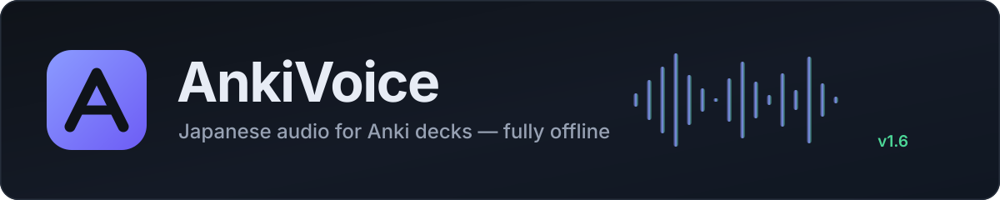
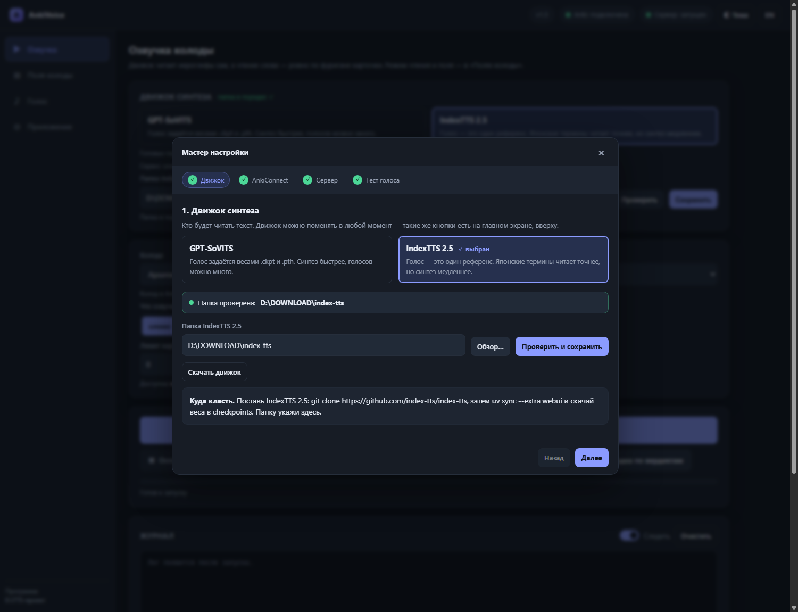
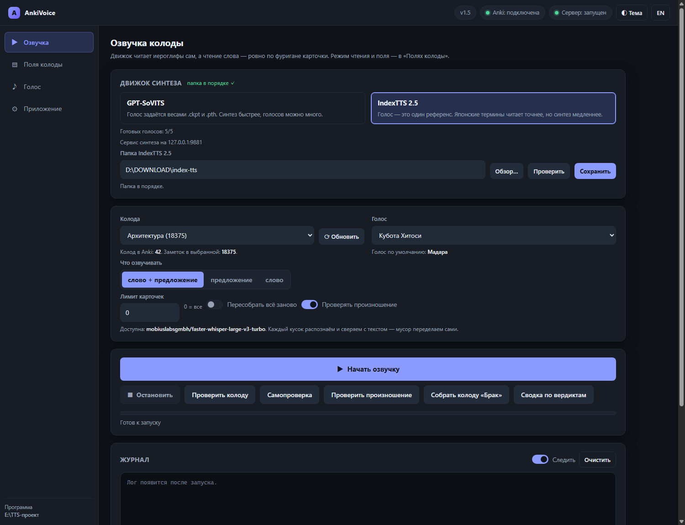
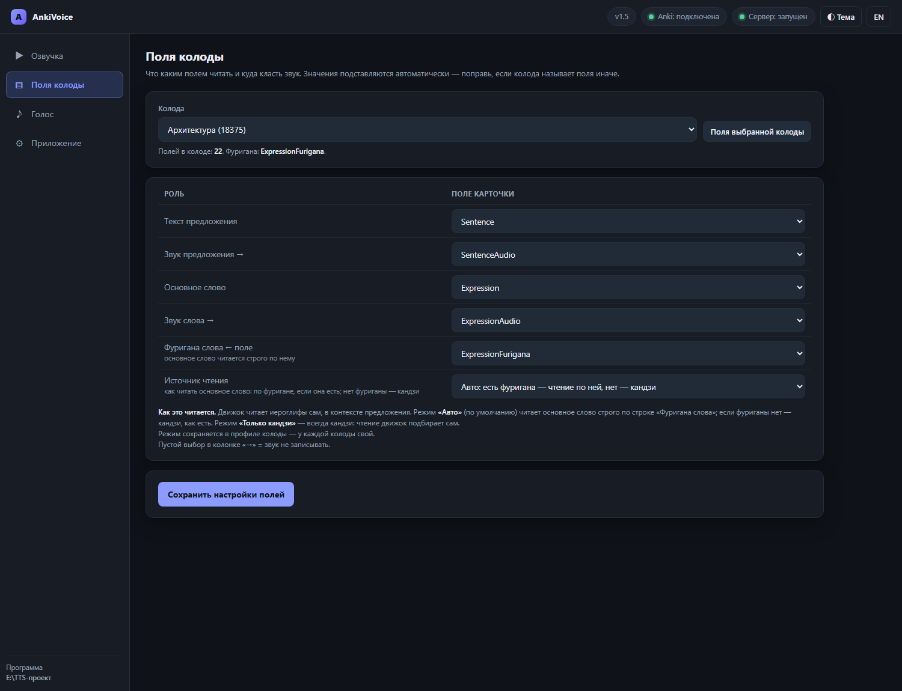
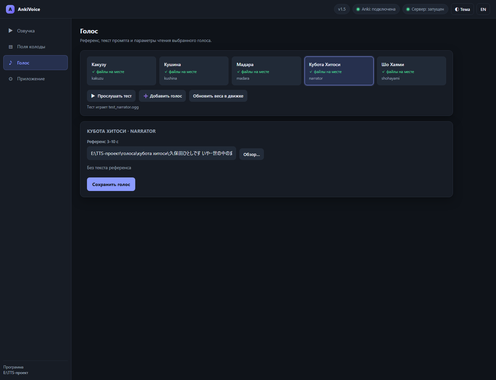
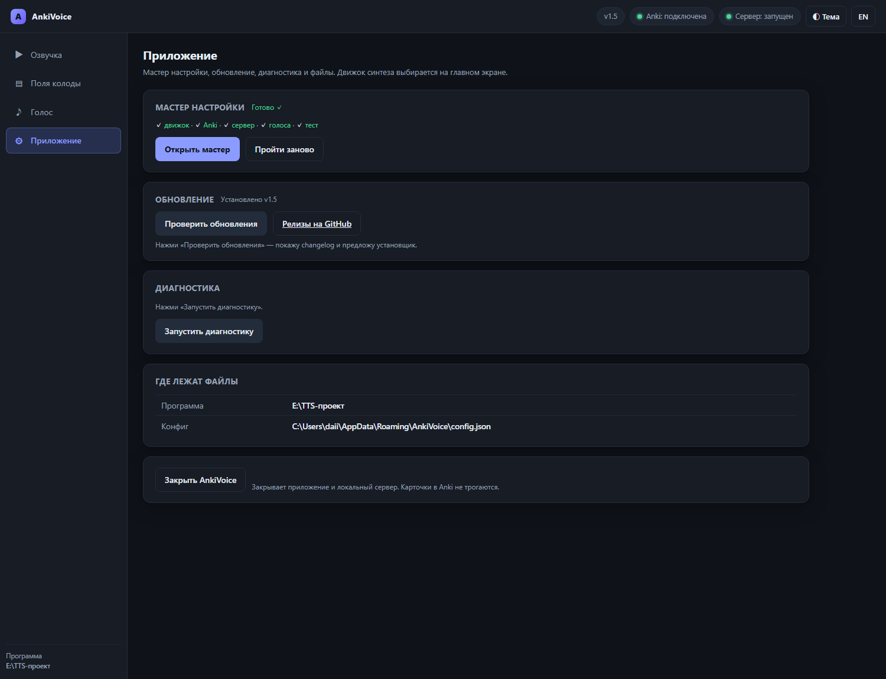

<p align="center">
  
</p>

<p align="center">
  <a href="https://github.com/Daii1414/AnkiVoice/actions/workflows/checks.yml">
    
  </a>
  <a href="https://github.com/Daii1414/AnkiVoice/releases/latest">
    
  </a>
  <a href="https://github.com/Daii1414/AnkiVoice/blob/main/LICENSE">
    
  </a>
  
  
</p>

<p align="center"><b>Локальная озвучка японских карточек Anki голосом GPT-SoVITS.</b><br>
Движок читает иероглифы сам — связно, в контексте предложения — а чтение основного слова берётся из фуриганы карточки. Готовые ogg-файлы
кладутся прямо в поля Anki. Интернет нужен только чтобы скачать.</p>

<p align="center">
  <a href="#что-умеет">Возможности</a> •
  <a href="#быстрый-старт">Установка</a> •
  <a href="#интерфейс-четыре-вкладки">Интерфейс</a> •
  <a href="#как-читаются-иероглифы">Чтение иероглифов</a> •
  <a href="#разработка">Разработка</a> •
  <a href="#лицензия">Лицензия</a>
</p>

**Русский** | [English](README.en.md)

---

## Оглавление

- [Что умеет](#что-умеет)
- [Как это работает](#как-это-работает)
- [Требования](#требования)
- [Быстрый старт](#быстрый-старт)
- [Интерфейс (четыре вкладки)](#интерфейс-четыре-вкладки)
- [Что нового в 1.5](#что-нового-в-15)
- [Что нового в 1.4](#что-нового-в-14)
- [Что нового в 1.3](#что-нового-в-13)
- [Что нового в 1.2](#что-нового-в-12)
- [Проверка произношения](#проверка-произношения)
- [Как читаются иероглифы](#как-читаются-иероглифы)
- [Как текст превращается в хирагану](#как-текст-превращается-в-хирагану)
- [Поля карточек](#поля-карточек)
- [Консоль](#консоль)
- [Обновления](#обновления)
- [Если что-то не работает](#если-что-то-не-работает)
- [Разработка](#разработка)
- [Структура репозитория](#структура-репозитория)
- [Участие в проекте](#участие-в-проекте)
- [Лицензия](#лицензия)
- [Благодарности](#благодарности)

---

## Что умеет

| | |
|---|---|
| 🎧 **Озвучка карточек** | Кладёт `<audio>` с озвучкой предложения и слова прямо в поля Anki. Клон голоса делает GPT-SoVITS сам. |
| 📖 **Два режима чтения** | Движок читает иероглифы сам — связно, в контексте предложения; чтение основного слова при этом берётся из фуриганы карточки. Нет фуриганы — читает кандзи сам. |
| 🧩 **Настройки на колоду** | Поля и режим чтения — свои для каждой колоды: переключил колоду, подставилось её. |
| 🧪 **Контроль качества** | QC v2 считает несколько независимых сигналов (тишина, разрывы в речи, дубль, обрезка, уровень, скорость) и перегенерирует брак сам. |
| 🎙 **Проверка произношения** | Приложение слушает собственный звук и сверяет его с текстом: показывает, где фраза разошлась. Совет, а не приговор — решение принимаешь ты. |
| 🧙 **Мастер первого запуска** | Четыре шага: папка GPT-SoVITS, AnkiConnect, сервер, тестовая фраза. Показывает, что скачать, куда положить и что нажать. |
| 🔄 **Обновления из приложения** | «Проверить обновления»: changelog, скачивание установщика и обязательная проверка SHA256. |
| 🌐 **Два языка** | Интерфейс целиком на русском и английском — переключается кнопкой EN в шапке. |
| 🔒 **Полностью локально** | Страница работает офлайн, без CDN. Наружу уходит только запрос проверки обновлений. |
| 🧩 **Прозрачность** | Никакой телеметрии, никаких аккаунтов. Лицензия AGPL-3.0 — исходники открыты.
## Как это работает

```
карточка Anki
   │
   ├─► режим чтения (настройка колоды)
   │      ├─► авто: есть фуригана — термин ровно по ней, нет — кандзи
   │      └─► «только кандзи»: движок читает иероглифы сам
   │
   ├─► GPT-SoVITS (127.0.0.1:9880) ──► ogg
   │
   ├─► QC v2: сигналы качества ──► перегенерация брака
   │
   └─► проверка произношения (совет): ASR сверяет звук с текстом
```

AnkiVoice не копирует код движка: [GPT-SoVITS](https://github.com/RVC-Boss/GPT-SoVITS)
поднимается как обычный локальный сервер, программа шлёт ему текст и забирает
звук. Поэтому родной веб-интерфейс GPT-SoVITS и любые его голоса продолжают
работать рядом.
## Требования

1. **Windows 10/11** и GPU с CUDA (комфортно — от 6 ГБ видеопамяти).
2. **GPT-SoVITS** установлен и запускался хотя бы раз (папка с
   `runtime\python.exe` и `api_v2.py`).
3. **Anki** с включённым **AnkiConnect** (плагин отвечает на `127.0.0.1:8765`).

Больше ничего ставить не нужно: словарь чтения и встроенный Python уже внутри
установщика (`pyruntime.zip`, `sudachidict.zip`) и разворачиваются сами.

## Быстрый старт

1. Скачай **`AnkiVoice-Setup-1.5.exe`** со страницы
   [Releases](https://github.com/Daii1414/AnkiVoice/releases/latest) — один файл,
   внутри всё.
2. Запусти: «Далее» → «Установить» → «Завершить»
   (галочка «Запустить AnkiVoice» включена — программа откроется сама).
3. Мастер настройки проведёт по шагам: выбор движка → папка движка →
   AnkiConnect → сервер → тестовая фраза. Он открывается сам при каждом
   запуске, пока настройка не завершена.

   

4. Дальше: вкладка **«Голос»** — выбрать голос, вкладка **«Поля колоды»** —
   колоду и поля, вкладка **«Озвучка»** — **«Начать озвучку»**.

Код дополнения **AnkiConnect** — `2055492159`
(Anki → Инструменты → Дополнения → Получить дополнения). После установки
дополнения перезапусти Anki.

Программа поднимает локальный сервер и открывает страницу в браузере — это
обычное поведение, ничего дополнительно ставить не нужно. Сервер принимает
только свои запросы: чужой сайт, открытый в том же браузере, не сможет
запустить озвучку или закрыть приложение.

Кнопка **EN** в шапке переключает интерфейс на английский (и обратно). Установка идёт в
`%LOCALAPPDATA%\Programs\AnkiVoice`, права администратора не спрашиваются.
Удаление: меню Пуск → «Удалить AnkiVoice» (настройки и голоса остаются).

> [!TIP]
> Не хватает движка? Мастер сам даст ссылку на официальные релизы
> [GPT-SoVITS](https://github.com/RVC-Boss/GPT-SoVITS/releases) и покажет, какие
> файлы должны лежать в папке. Скачивать и распаковывать движок за тебя не нужно.

## Интерфейс (четыре вкладки)

Оболочка — локальная веб-страница (`anki_web.py`): сервер слушает только
`127.0.0.1`, наружу ничего не уходит. Старое tkinter-окно сохранено и
запускается флагом `--classic`.

### «Озвучка» — главный экран



* **Движок синтеза — крупными карточками вверху.** Две большие кнопки:
  GPT-SoVITS или IndexTTS 2.5, с коротким описанием каждого. Переключается
  на ходу, без перезапуска: меняются папка движка, адрес сервера и список
  голосов. Под карточками — сколько голосов готово и где живёт сервер.
* **Колода** и **Голос** — списки подтягиваются из Anki и `voices.json`.
* **Что озвучивать** — «слово + предложение» (обычно), только предложение
  или только слово; лимит карточек (0 = все); «пересобрать всё заново»
  игнорирует уже готовые карточки.
* **Лимит — это объём работы**, а не позиция в колоде: «озвучить 20 карточек»
  значит взять 20 карточек, где звука ещё нет, а не первые двадцать.
* **«Начать озвучку»** — главная кнопка; рядом **«Остановить»**,
  **«Проверить колоду»** и **«Самопроверка»**.
* **Полоса прогресса** — точный счётчик «N / всего» и число ошибок.
* **Журнал** — живой лог потоком (SSE) с цветной разметкой: зелёное —
  готово, красное — ошибка, жёлтое — брак и повторы QC.

### «Поля колоды» — что откуда читать



* **Колода** + кнопка **«Поля выбранной колоды»** — заполняет таблицу ролей
  автоматически по шаблону (Sentence / Expression / \*Audio / Furigana).
  Поля подставляются и сами: стоит выбрать колоду — приложение читает её поля
  и подбирает роли; вручную меняется на вкладке «Поля колоды».
* Строки таблицы: текст предложения, звук предложения, основное слово,
  звук слова, **фуригана слова ← поле** и источник чтения.
* Пустой выбор в колонке «→» = звук не записывать. Пустая фуригана =
  слово прочитается автоматически.

### «Голос» — референс и характер речи



* **Карточки голосов** — все голоса из `voices.json`; ✅/✗ показывает, найдены
  ли файлы gpt/sovits/ref.
* **Референс (3–10 с)** — образец голоса: файл, его текст и язык. Длинный
  aux-референс не давай — API упадёт от нехватки памяти.
* **Характер речи** — ползунки `temperature`/`top_p`/`top_k`/`speed` и поле
  `seed`: меньше значение — ровнее и спокойнее речь (дефолты из официального
  webui: 0.6 / 0.6 / 20).
* **«Прослушать тест»** — быстрая проверка голоса, файл играет прямо на
  странице. **«Обновить веса в движке»** — автоскан новых весов.

### «Приложение» — мастер, обновления, диагностика



* **Мастер настройки** — четыре шага: движок, AnkiConnect, сервер, тестовая
  фраза. Показывает статус каждого шага и что делать, если он красный. Первый
  шаг — выбор движка (две карточки) и папка выбранного движка.
* **Обновление** — кнопка «Проверить обновления»: показывает changelog,
  скачивает установщик и проверяет его SHA256.
* **Диагностика** — всё сразу: инструмент, конфиг, путь, Anki, сервер, список
  голосов. Сюда и смотреть, если что-то не работает.
* **Где лежат файлы** — папка программы и конфиг.

Папка движка и её проверка — на главном экране, рядом с выбором движка.

Статусы в шапке: **Anki** (подключена?), **Сервер** (GPT-SoVITS запущен),
версия и индикатор выполняющейся операции. Тема переключается кнопкой справа.

Светлая тема — те же вкладки: [Озвучка](doc/shots/voice-light.png),
[Поля колоды](doc/shots/anki-light.png), [Голос](doc/shots/sound-light.png),
[Приложение](doc/shots/app-light.png). Полный снимок страницы целиком —
[voice-dark-full.png](doc/shots/voice-dark-full.png).

## Что нового в 1.5

* **Выбор движка — на главном экране, крупными карточками.** На вкладке
  «Озвучка» сверху две большие кнопки: GPT-SoVITS или IndexTTS 2.5, с описанием
  каждого. Переключение работает на ходу, без перезапуска. Раньше переключатель
  был один, на вкладке «Приложение», в настройках.
* **Настройки движка переехали на главный экран:** папка движка, «Обзор…»,
  «Проверить» и «Сохранить» — рядом с выбором движка. В «Приложении» осталось
  только обслуживание: мастер, обновление, диагностика, пути и выход.
* **Мастер при первом запуске спрашивает движок по-настоящему:** первый шаг —
  выбор из двух карточек, дальше папка выбранного движка и подсказка, куда его
  класть. Спросит один раз — дальше мастер не пристаёт, а движок меняется
  кнопками на главном экране.
* **Проверка папки смотрит на выбранный движок** (раньше всегда проверялась
  папка GPT-SoVITS, даже когда работал IndexTTS).

## Что нового в 1.4

* **Второй движок — IndexTTS 2.5.** В «Приложении» появился переключатель
  «Движок синтеза»: GPT-SoVITS или IndexTTS. Выбор сохраняется и действует на всё
  приложение.
* **Голос для IndexTTS — один референс.** У IndexTTS нет весов у голоса (они общие
  у модели), поэтому в карточке голоса прячутся поля `.ckpt`/`.pth` и параметры
  сэмплирования.
* **Мост к IndexTTS** (`lab/indextts_service.py`): у IndexTTS нет HTTP-API, а грузить
  веса на каждую карточку нельзя. Сервис держит модель в памяти и отвечает
  `POST /tts`.
* **Ускорение на слабых картах.** IndexTTS 2.5 на картах без bf16 считает почти всё
  в fp32 и с 25 шагами диффузии — фраза звучит 3–4 минуты. Сервис сам применяет
  две правки движка (12 шагов и fp16): на RTX 2060 фраза звучит **30–60 с** вместо
  186–229 с.
* **Чтение сверено с новым движком.** На карточках с редкими кандзи-терминами
  замерено, как IndexTTS читает их с фуриганой и без: с подстановкой чтения из
  фуриганы покрытие распознавания выше (0.92–0.97 против 0.88–0.90) — поэтому
  режим «авто» и для IndexTTS берёт чтение из фуриганы, а термины с латиницей и
  цифрами (3D, PLATEAU, 2.0) остаются как есть: своя транслитерация («3D» →
  «すりーでぃー») вводит модель в цикл — 96 секунд на фразу против 4.

## Что нового в 1.3

* **Два режима чтения, и основной выбирается сам.** Основной режим: обычный
  текст движок читает кандзи (связно, в контексте предложения), а основное
  слово — ровно по фуригане карточки. Второй режим: всё кандзи, движок читает сам.
* **Режим решается по каждой карточке.** Если поле с фуриганой пустое (или его
  нет вовсе) — карточка читается кандзи сама, без подстановок. Выбирать ничего
  не нужно: по умолчанию работает «авто».
* **Настройки по колодам** — поля и режим чтения сохраняются в профиле колоды.
* **Проверка произношения — совет.** Приложение слушает свой звук и показывает,
  где фраза разошлась, — но не бракует карточку и не переозвучивает её.
  Решение принимаешь ты: кнопки «Собрать колоду “Брак”» и «Сводка по
  вердиктам», твои вердикты копятся в карточке «Брак».
* **Английский интерфейс** — кнопка EN в шапке.
* **Локальный сервер принимает только свои запросы** — проверяет адрес, источник
  и служебный ключ запуска, поэтому чужой сайт в том же браузере не может
  запустить озвучку или закрыть приложение.
* **Починен синтез.** Раньше результат отбрасывался, если проверка содержания
  была выключена, и всегда делались все девять вариантов даже когда сравнивать
  нечего. Теперь — один вариант, если сравнивать не с чем, и лог не врёт.
* **Интерфейс приведён в порядок** (внешний аудит): список «Источник чтения»
  больше не пустой, мастер не приставает, когда всё настроено, английский
  интерфейс переведён полностью, выключенная кнопка «Остановить» выглядит
  выключенной, а битый конфиг больше не стирает настройки.

## Что нового в 1.2

* **Мастер первого запуска** — четыре шага (движок, AnkiConnect, сервер,
  тестовая фраза) и конкретные инструкции: что скачать, куда распаковать и
  что нажать. Пока настройка не завершена, мастер открывается сам при каждом
  запуске.
* **Проверка обновлений** — кнопка «Проверить обновления» на вкладке
  «Приложение»: показывает changelog, скачивает установщик и **обязательно**
  сверяет SHA256 (без хэша в релизе скачивание запрещено). Перед запуском
  установщика хэш проверяется ещё раз.
* **Живая диагностика** — вкладка «Приложение» показывает состояние движка,
  Anki, сервера, голосов и теста.
* **Установщик везёт подсистемы чтения** — в установленное приложение
  добавлены 10 модулей из `lab/`: система чтения (provenance, доменный
  словарь, резолвер), QC v2 и проверка произношения. Раньше они не попадали
  в установщик, и приложение молча работало на простом критерии «есть звук».
* **Два режима чтения** — движок читает иероглифы сам, а термин — ровно по
  фуригане. Режим задаётся **на колоду** (в профиле колоды): трудным колодам
  оставляешь точный режим, остальным — чистый кандзи.
* **Проверка произношения в приложении** — распознаёт собственный звук и
  сверяет с текстом, показывает, где фраза разошлась. Решение принимаешь ты:
  колода «Брак» и вердикты в ней.
* **Английский интерфейс** — кнопка EN в шапке переключает язык.
* **Локальный сервер принимает только свои запросы** — проверяет адрес,
  источник и служебный ключ запуска, поэтому чужой сайт в том же браузере
  не может запустить озвучку или закрыть приложение.

Полный список изменений — в [CHANGELOG.md](CHANGELOG.md) и в
[релизе v1.2](https://github.com/Daii1414/AnkiVoice/releases/tag/v1.2).
## Второй движок: IndexTTS 2.5

Кроме GPT-SoVITS можно работать с **IndexTTS 2.5** — zero-shot движком,
которому достаточно одного референса. Переключатель — вкладка
**«Приложение» → «Движок синтеза»**. Выбор сохраняется и действует на всё
приложение.

Разница в устройстве:

| | GPT-SoVITS | IndexTTS 2.5 |
|---|---|---|
| голос | файлы `.ckpt` + `.pth` + референс | **один референс** (3–10 с) |
| веса | свои у каждого голоса | общие у модели |
| как ставится | распакованный архив | `git clone` + `uv sync --extra webui` + веса в `checkpoints` |
| своё чтение японского | g2p движка | свой японский g2p (`ja_g2p`) |

Поставить IndexTTS 2.5:

```
git clone https://github.com/index-tts/index-tts.git D:\DOWNLOAD\index-tts
cd D:\DOWNLOAD\index-tts
uv sync --extra webui
uv tool install "huggingface-hub"
hf download IndexTeam/IndexTTS-2.5 --local-dir checkpoints
```

Папку укажи в «Приложении» (или нажми «Проверить» — AnkiVoice найдёт её
сам). Нужен `uv` в PATH и драйвер NVIDIA с CUDA 12.8 или новее.

**Зачем мост.** У IndexTTS нет HTTP-API: есть только Python-API и вебморда.
AnkiVoice поднимает рядом с собой небольшой сервис
(`lab/indextts_service.py` — едет в установщике), который **один раз**
загружает модель и отвечает на `POST /tts`. Без него на каждую карточку
пришлось бы грузить веса заново.

Что работает одинаково: QC акустический, режим чтения (авто/только кандзи),
правила подстановки чтения из фуриганы, запись звука в карточку, колода
«Брак» и вердикты.

Чего нет в режиме IndexTTS:

* **проверки содержания** (распознавание своим голосом) — она живёт в
  окружении GPT-SoVITS (faster-whisper). Если GPT-SoVITS не установлен,
  остаётся акустическая проверка, а распознавание отключается;
* ручных настроек сэмплирования (seed, temperature, top_p, top_k) — у
  IndexTTS их нет, интерфейс их прячет.

## Проверка произношения

GPT-SoVITS иногда **теряет кусок фразы или придумывает лишний**: длительность
в норме, звук — речь, а содержание не то. Проверка «тишина / длина / дубль»
такое не видит.

Вкладка «Озвучка» → **«Проверить произношение»**: приложение распознаёт
собственный звук (faster-whisper) и сверяет его с текстом, который было
велено произнести. Расхождение показывается с точностью до доли секунды —
сразу видно, где фраза разошлась.

**Это совет, а не приговор.** По замеру на 27 размеченных карточках
подтверждённых браков — 2, а ложных срабатываний — 25: распознаватель
переворачивает доменные термины («だいくはこうさぶ» → «ないくはこうさぶん»),
и по тексту их не отличить от настоящей ошибки. Поэтому проверка

* не бракует карточку и не метит её тегом;
* печатает в журнал покрытие, ошибки и участок расхождения;
* складывает сомнительные куски в колоду **«Брак»** — с тремя вариантами
  каждого. Послушаешь и напишешь «верно» или «ложное срабатывание».

Три кнопки на вкладке «Озвучка»:

* **«Проверить произношение»** — распознаёт уже озвученные карточки колоды;
* **«Собрать колоду “Брак”»** — сомнительные куски с вариантами;
* **«Сводка по вердиктам»** — считает накопленные отметки и показывает, где
  наши пороги занижены.

**Проверяем по предложению, не по слову.** Изолированное слово
распознаётся ненадёжно: зоны «настоящий брак» и «ложное срабатывание»
пересекаются полностью. Слово ловит акустический QC (тишина, темп, длина).

**Пороги — свои для каждого голоса.** У одного голоса норма покрытия 0.95, у
другого 0.85. Приложение считает норму по принятым кускам и сравнивает с ней,
а не с одной общей цифрой.

Что нужно: `faster-whisper` в питоне GPT-SoVITS и одна скачанная модель
(в кэше HuggingFace). Если их нет — проверка просто не работает, озвучка идёт
как обычно. Проверка одного куска — около 0.5 с на GPU.

## Как читаются иероглифы

GPT-SoVITS умеет читать кандзи сам — но на редких терминах он читает
по-своему. Поэтому режим чтения переключается в «Поля колоды» →
«Источник чтения»:

| Режим | Что уходит движку | Когда выбирать |
|---|---|---|
| **Авто (по умолчанию)** | Если в поле с фуриганой что-то есть — весь текст кандзи, кроме основного слова: его чтение подставлено из фуриганы. Если поля нет или оно пустое — весь текст кандзи | Универсальный: точное чтение там, где фуригана есть, и обычное — там, где её нет |
| **Только кандзи (движок читает сам)** | Весь текст кандзи, без подстановок | Колоды с обычными словами: звук самый цельный |

Режим — **настройка колоды**: он сохраняется в профиль колоды вместе с полями.
В режиме «авто» решение принимается **по каждой карточке**: пустое поле с
фуриганой означает «читай кандзи сам», и подставлять нечего.

Чем «чистое чтение» отличается от «точного» (замер на 150 фразах и слепое
сравнение на 10 фразах):

* по качеству звука чистый кандзи выигрывает — 7 голосов из 10;
* но в 12 фразах из 150 модель прочитала термин не так, как в карточке
  (`麻院[あさすса]` → «アサイン»). В смешанном режиме — 2 из 150.

Фуригана карточки — источник истины для основного слова: поле
`ExpressionFurigana` (или другое, если в колоде так). Правила безопасности
подстановки: только чистая кана, только если слово найдено в предложении
целиком, иначе карточка остаётся как есть.

Два исключения, проверенные замером на карточках с катаканными терминами:

* разметка на всё слово («点群データ[てんぐんでーта]») читается как есть — иначе
  окуригана («データ») попала бы в чтение второй раз и прозвучала бы дважды.
  На случай, если разбор ошибётся, есть страховка: готовый текст проверяется,
  и если окуригана прозвучала бы дважды, термин оставляется как есть — его
  прочитает сам движок;
* термины с латиницей или цифрами («3D», «PLATEAU», «BIM/CIM», «2.0») не
  переводятся в кана: движок читает их лучше сам, а своя транслитерация
  («3D» → «すりーでぃー») вводит модель в цикл — на замере это 96 секунд и
  покрытие 0.89 против 4 секунд и 1.00.

В консоли это флаг `--reading ""|mix|asis` (пусто — авто).
## Как текст превращается в хирагану

Предложение уходит движку **кандзи**: GPT-SoVITS читает иероглифы сам, в
контексте предложения — поэтому звук связный, а не набор отдельных кусков.

Хирагану готовит конвейер `kanaize()` — но только там, где это нужно:

* **основное слово** — в режиме с фуриганой берётся чтение из фуриганы карточки;
  если фуригана не подходит (слово не нашлось в тексте, в чтении есть
  иероглифы) — слово переводится в кана нашим же конвейером;
* **в режиме «только кандзи»** не готовится ничего: и слово, и предложение
  уходят движку как есть, читает он сам.

Шаги `kanaize()`:

1. **NFKC-нормализация** — полноразмерные буквы/цифры и полукатакана сводятся
   к обычным формам (знаки препинания не трогаются);
2. **латиница → катакана по буквам** (`IEC` → アイイーシー);
3. **катакана → хирагана** (приветствия コンニチハ/コンバンハ остаются катаканой
   — иначе MeCab читает их частицей; знаки повторения ヽゝゞヾ раскрываются
   контекстно — повтор предыдущего слога);
4. **g2p только для оставшихся иероглифов**: Haqumei читает каждое слово в
   контексте предложения (сандхи, соседняя катакана), запасные ходы — Sudachi
   по словарю UniDic и pyopenjtalk (MeCab); цифры всегда через MeCab, потому
   что Sudachi читает числа как даты (2024 → 二月二日);
5. **повторный проход катакана → хирагана** — и в API уходит чистая хирагана.

Что конвейер **не трогает**: саму заметку в Anki (обрабатывается копия текста)
и фуригану карточки (используется только как источник чтения).

Проверка чтения встроена: `pipeline.bat selftest` (10 проверок подстановки и
11 проверок режимов чтения) и расширенная батарея `python kana_stress.py`
(63 сложных слова). Подробные замеры — в
[doc/reports/](doc/reports).

## Поля карточек

У разных колод поля называются по-разному — откуда брать текст и куда писать
звук настраивается (GUI: вкладка «Поля колоды»; консоль: флаги `voice` /
`make-deck` / `check`):

```
--sentence-src "Sentence"             поле с текстом предложения
--sentence-audio "SentenceAudio"      поле, куда кладётся звук предложения
--word-src "Expression"               поле со словом (для Expression работает разбор фуриганы)
--word-audio "ExpressionAudio"        поле, куда кладётся звук слова
--furigana-src "ExpressionFurigana"   поле с фуриганой основного слова
    --reading ""|mix|asis         режим чтения (см. выше; пусто — авто)
```

## Консоль

`pipeline.bat` — то же самое в консоли, сам находит папку движка:

```
pipeline.bat list              список голосов
pipeline.bat selftest          проверка окружения (запускать и при беде)
pipeline.bat test --voice madara --text "こんにちは"
pipeline.bat voice --voice madara --deck "Архитектура" --mode both
pipeline.bat verify --deck "Архитектура"    проверить произношение озвученного
pipeline.bat qc-deck                         собрать колоду «Брак» с вариантами
pipeline.bat verdicts                        сводка по твоим вердиктам
pipeline.bat check --deck "Архитектура"          полная проверка колоды
pipeline.bat check --deck "Архитектура" --fast   то же без скачивания аудио
pipeline.bat scan --apply     найти голоса в движке и дописать в voices.json
```

Диагностика есть и у exe: `AnkiVoice.exe doctor`.
## Обновления

* **Из приложения**: вкладка «Приложение» → **«Проверить обновления»**.
  Программа покажет changelog, скачает установщик и проверит SHA256 — без
  проверки скачивание не запускается. Затем нажми «Запустить установщик».
* **Вручную**: скачать новый установщик с
  [Releases](https://github.com/Daii1414/AnkiVoice/releases/latest) и запустить
  поверх старой версии — путь к движку и настройки сохранятся.
* **Удаление**: меню Пуск → «Удалить AnkiVoice» (настройки останутся — при
  следующей установке подхватятся снова).

## Если что-то не работает

| Сообщение | Что делать |
|---|---|
| `Не найдена папка GPT-SoVITS` | Указать путь: `gptsovits_path.txt`, env `GPT_SOVITS_ROOT` или кнопкой «Обзор…» в программе |
| `AnkiConnect недоступен` | Открыть Anki; если дополнения нет — Инструменты → Дополнения → Получить дополнения, код `2055492159`, перезапустить Anki |
| `Референс X с — API требует 3–10 с` | Перерезать клип под 3–10 секунд |
| `Не получилось переключить... Перезапуск` | Норма: пайплайн сам перезапустит сервер и повторит |
| `сервер вернул пустой звук` | Обычно видеопамять занята чужими процессами (браузер, игры). Закрыть их или перезапустить сервер: `pipeline.bat serve --voice <голос>` |
| `Пайплайн уже запущен другим процессом` | Дождаться завершения первого запуска (защита от двойной работы) |
| Windows: «Защитил ваш компьютер» | Скачанный exe не подписан: в окне SmartScreen нажми «Подробнее» → «Всё равно запустить» |

Полезно: `selftest` печатает, что именно видит (движок, голоса, словарь
чтения, модули чтения, QC v2, AnkiConnect, сервер) — 90% проблем видно сразу.

## Разработка

```bash
git clone https://github.com/Daii1414/AnkiVoice.git
cd AnkiVoice
```

Пересборка нужна только после правок `anki_gui.py`, `anki_web.py` или
`anki_web_page.py` — `voice_pipeline.py` запускается с диска и применяется
сразу.

**exe** (нужен Python из движка GPT-SoVITS с PyInstaller):

```bat
set ENGINE=C:\Путь\К\GPT-SoVITS
%ENGINE%\runtime\python.exe -m pip install pyinstaller
%ENGINE%\runtime\python.exe -m PyInstaller --noconfirm --onefile --windowed ^
    --name AnkiVoice --distpath . --workpath %TEMP%\pyi_build --specpath %TEMP% anki_gui.py
```

**установщик** (Inno Setup 6, запускать из корня репозитория):

```bat
ISCC.exe AnkiVoice.iss
```

→ получится `dist\AnkiVoice-Setup-1.3.exe`.

**тесты** (Python 3.12+, без GPU и без сети):

```bash
python -m pip install numpy haqumei
python lab/qc_unit.py
python lab/quality_unit.py
python lab/test_g2p_infrastructure.py
python lab/test_v12_features.py
python lab/web_js_check.py
python lab/integration_check.py
python lab/readme_check.py
python lab/fmt_check.py
```

`lab/readme_check.py` сверяет README с кодом: файлы из таблицы структуры,
картинки, якоря оглавления, команды консоли, число режимов чтения и модулей
в установщике. Расходится — падает.

`lab/fmt_check.py` проверяет, что в каждой формат-строке столько плейсхолдеров, сколько аргументов - такая ошибка падает из записа
на конце работы, а не в конце длинной войны.

`lab/robust_tests.py` — 10 проверок устойчивости пайплайна, требует
запущенного Anki. CI гоняет всё остальное на каждом пуше
([checks.yml](.github/workflows/checks.yml)) и собирает установщик на
windows-latest.

## Структура репозитория

| Файл | Что это |
|---|---|
| `AnkiVoice.exe` | Программа с интерфейсом (двойной клик) |
| `AnkiVoice.iss` | Скрипт сборки установщика (Inno Setup 6) |
| `voice_pipeline.py` | Вся логика: синтез, чтение иероглифов, подстановка, CLI |
| `anki_gui.py` | Точка входа exe: веб-интерфейс по умолчанию, `--classic` — старое окно |
| `anki_web.py` | Локальный HTTP-сервер интерфейса (только 127.0.0.1) |
| `anki_web_page.py` | HTML/CSS/JS страницы (офлайн, без CDN) |
| `pipeline.bat` | Консольная точка входа |
| `sudachi_g2p.py` | Запасной помощник-«читатель»: SudachiPy 0.7 + словарь UniDic |
| `g2p_core.py` | Ядро чтения Haqumei: слово в контексте предложения, форма pron |
| `kana_stress.py` | Батарея из 63 сложных слов для проверки чтения |
| `i18n_en.py` | Словарь английского интерфейса (RU/EN) |
| `lab/pron_check.py` | Проверка произношения: распознавание, покрытие, карантин, локализация расхождения |
| `lab/align_ja.py` | Экспериментальное акустическое выравнивание по японской CTC-модели (выключается переменной) |
| `pyruntime.zip` | Встроенный Python + Haqumei 0.12.2 + SudachiPy 0.7 (~44 МБ, разворачивается сам) |
| `sudachidict.zip` | Словарь Sudachi core 20261015 (~73 МБ, распаковывает помощник) |
| `voices.json` | Реестр голосов: веса, референсы, промпт, sampling |
| `lab/` | Модули системы чтения, QC v2 и сервис IndexTTS (10 файлов едут в установщик) + тесты и dev-инструменты |
| `doc/` | Скриншоты интерфейса, логотип, медиа движка, отчёты по замерам |
| `CHANGELOG.md`, `CONTRIBUTING.md`, `SECURITY.md` | История, правила разработки, политика безопасности |
| `.github/` | CI, шаблоны issue и pull request |
| `LICENSE` | AGPL-3.0 |

В git не попадают: `gptsovits_path.txt`, `pyruntime/` (разворачивается из zip),
`test_*.ogg`, `logs/`, `dist/`.

## Участие в проекте

* Правки и идеи — через [issues](https://github.com/Daii1414/AnkiVoice/issues) и
  pull request'ы. Шаблоны — в `.github/ISSUE_TEMPLATE`.
* Правила разработки, сборка, стиль коммитов — в
  [CONTRIBUTING.md](CONTRIBUTING.md).
* Уязвимости — по инструкции из [SECURITY.md](SECURITY.md).

## Лицензия

**AGPL-3.0** (текст — в файле [LICENSE](LICENSE)): кто изменит и распространит
этот инструмент — обязан опубликовать исходники своих изменений, в том числе
при использовании через сеть.

## Благодарности

* [GPT-SoVITS](https://github.com/RVC-Boss/GPT-SoVITS) — движок синтеза (MIT).
* [Haqumei](https://github.com/o24s/haqumei) — контекстное чтение иероглифов
  (основное ядро).
* [Sudachi](https://github.com/WorksApplications/SudachiPy) и словарь UniDic —
  запасной ход и проверка чтений.
* [gradio](https://github.com/gradio-app/gradio) — вкладка «Голос» свёрстана
  по мотивам их webui.
* [AnkiConnect](https://ankiweb.net/shared/info/2055492159) — мост к Anki.
