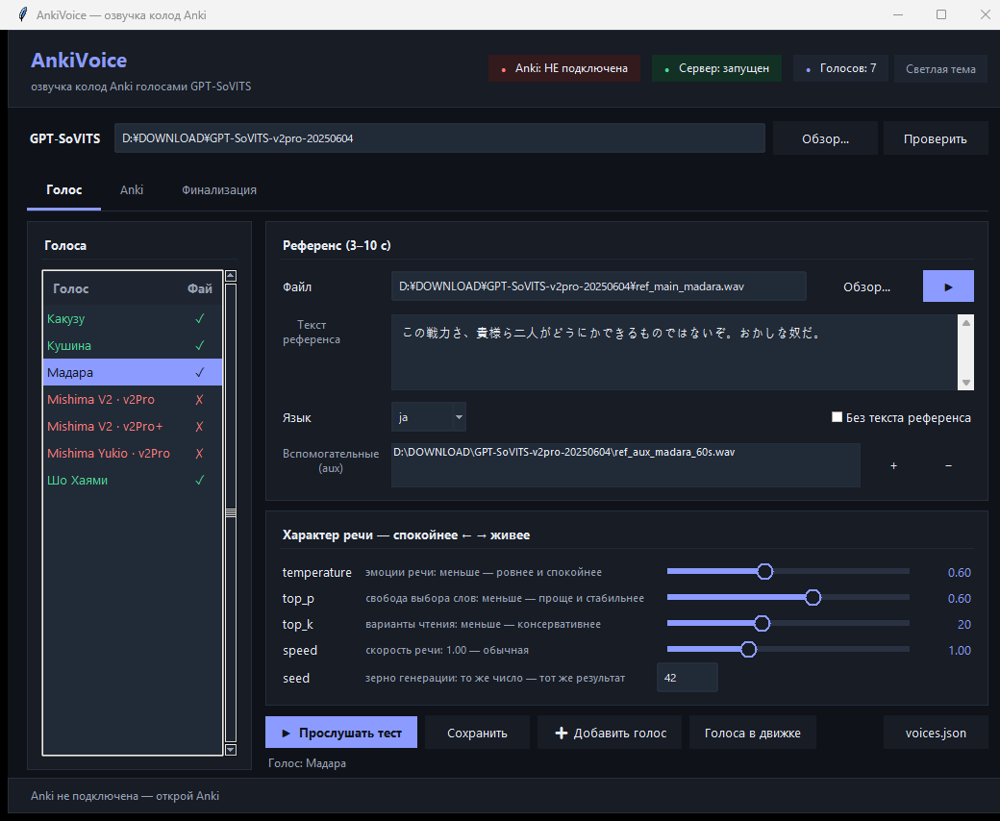
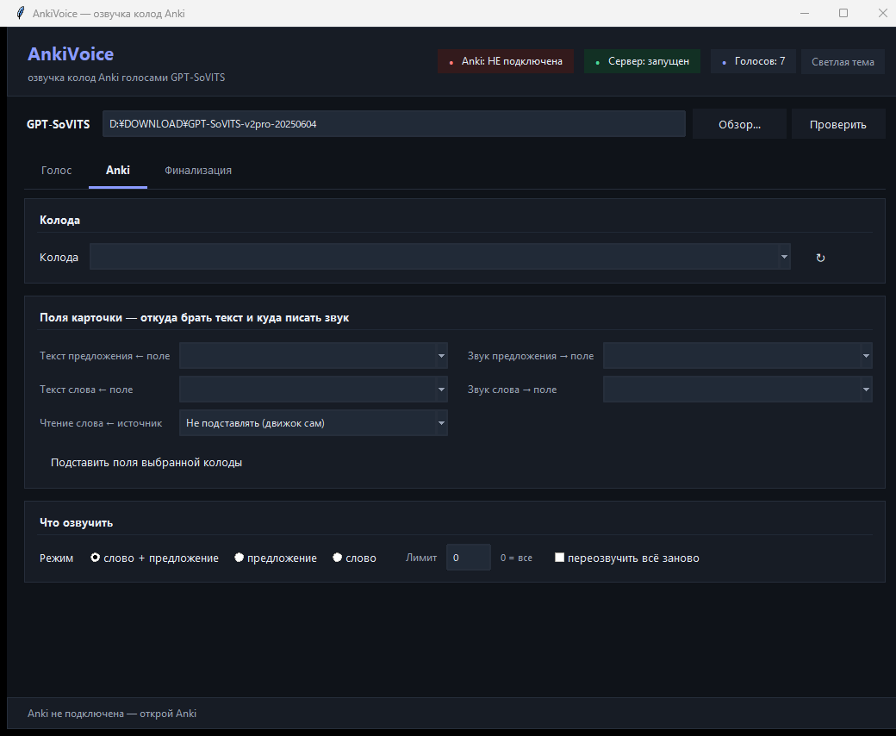
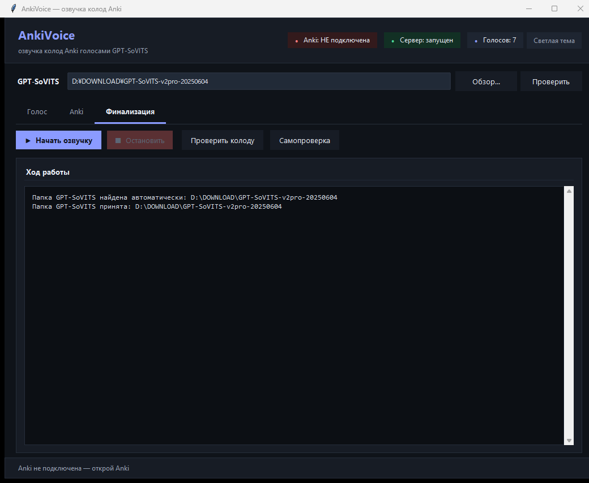

# AnkiVoice

> **Local Japanese audio for Anki — kanji readings via Sudachi/UniDic, voices via GPT-SoVITS. Fully offline, nothing to install.**

Озвучка колод Anki голосами GPT-SoVITS. Инструмент сам читает иероглифы
современным словарём, умеет подставлять проверенное чтение из фуриганы
карточки, клонирует выбранный голос и кладёт готовые ogg-файлы прямо
в поля карточек. Всё локально: интернет нужен только чтобы скачать.

Полное техническое описание (устройство, вся логика, история багов) —
в `PROJECT.md`. Здесь — как установить и пользоваться.

## Что нужно

1. **Windows 10/11** и GPU с CUDA (комфортно — от 6 ГБ видеопамяти).
2. **GPT-SoVITS** установлен и запускался (папка с `runtime\python.exe` и `api_v2.py`).
3. **Anki** с включённым **AnkiConnect** (плагин, отвечает на `127.0.0.1:8765`).

Больше ничего: чтение иероглифов работает на **встроенном Python**
(`pyruntime.zip` + `sudachidict.zip` уже в архиве, распаковываются сами
при первом запуске — ставить ничего не нужно).

## Быстрый старт

1. Скачай **`AnkiVoice-v1.0.zip`** со страницы [Releases](../../releases)
   (или весь репозиторий — Code → ZIP).
2. Распакуй в любую папку (путь может быть с кириллицей и пробелами).
3. Запусти **`AnkiVoice.exe`** → укажи папку GPT-SoVITS (обычно
   находит сама, путь запоминается навсегда).
4. Во вкладке **«Голос»** выбери голос → во вкладке **«Anki»** колоду
   и поля → во вкладке **«Финализация»** нажми **«Начать озвучку»**.

Первый запуск дольше обычного (~10 секунд): распаковывается встроенный
Python и словарь. Дальше всё быстро.

## Интерфейс (три вкладки)

### Вкладка «Голос» — какой голос и как он говорит



* **Слева** — все голоса из `voices.json`: зелёная галочка ✗/✓ означает,
  что файлы весов найдены; голоса с ✗ нужно донастроить (выбрать референс).
* **Референс (3–10 с)** — образец голоса: файл, его текст и язык, кнопка
  ▶ прослушать. Длинный aux-референс не давай — API упадёт от нехватки памяти.
* **Характер речи** — слайдеры `temperature`/`top_p`/`top_k`/`speed`/`seed`:
  меньше значение — ровнее и спокойнее речь (дефолты из официального
  webui: 0.6 / 0.6 / 20).
* **«Голоса в движке»** — автоскан папок движка: находит новые веса и
  дописывает голоса в `voices.json` руками ничего вписывать не надо.
* **«Прослушать тест»** — быстрая проверка голоса на короткой фразе.

### Вкладка «Anki» — что озвучивать и как читать слова



* **Колода** — выпадающий список колод Anki (нужен запущенный Anki).
* **Поля карточки** — откуда брать текст предложения/слова и куда писать
  звук. У колоды свои имена полей — «Подставить поля выбранной колоды»
  заполнит их автоматически по шаблону.
* **Чтение слова ← источник** — главный переключатель чтения (подробно —
  раздел «Режимы чтения» ниже): «Не подставлять» или конкретное поле.
* **Что озвучить** — «слово + предложение» (обычно), только предложение
  или только слово; лимит карточек (0 = все); «переозвучить всё заново»
  игнорирует уже готовые карточки.

### Вкладка «Финализация» — запуск и контроль



* **«Начать озвучку»** — главная кнопка: карточки клонируются в новую
  колоду, синтезируются слово и предложение, ogg попадают в медиа Anki.
* **«Остановить»** — корректная остановка на паузе.
* **«Проверить колоду»** — сверка: все ли поля заполнены и файлы на месте.
* **«Самопроверка»** — диагностика всего сразу (голоса, словарь чтения,
  AnkiConnect, сервер) — сюда же смотреть, если что-то не работает.
* **«Ход работы»** — живой лог всего, что делает пайплайн.

Статусы в шапке: **Anki** (подключена?), **Сервер** (GPT-SoVITS запущен),
**Голосов** (сколько найдено). Тема переключается кнопкой справа.

## Режимы чтения слов (важно)

GPT-SoVITS принимает только текст, поэтому иероглифы кто-то должен
прочитать. Источник чтения задаётся во вкладке «Anki» (строка
**«Чтение слова ← источник»**) или флагом `--reading`:

| Режим | Что происходит | Когда выбирать |
|---|---|---|
| **Не подставлять** (`off`, по умолчанию) | всё читает встроенный Sudachi 0.7 + словарь UniDic 20261015: и предложение, и слово | колода без фуриганы; «просто озвучь» |
| **Имя поля** (напр. `ExpressionFurigana`) | чтение слова берётся **строго из этого поля** и подставляется в текст; поле понимает и простое чтение (`あい`), и фуриганную разметку (`相欠[あいが]き`) | в колоде уже лежит проверенная фуригана терминов |

Правила безопасности подстановки: только чистая кана, только если слово
найдено в предложении целиком, иначе карточка остаётся как есть.

**Что даёт поле (замеры на 100 реальных карточках «Тест100»):**

* чтения из поля и Sudachi **совпадают в 68% случаев**;
* в ~18% случаев **точнее поле** — доменные термины: `亜鉛鍍金` →
  あえん**めっき** (Sudachi даёт あえんときん), `I形梁` →
  あいがた**ば**り, `IAEE` → по буквам;
* в ~5% точнее **Sudachi** — когда в поле мусор или список чтений;
* остальное — лишние пробелы, звучат одинаково.

Итог: колода с `ExpressionFurigana` → режим «поле»; без фуриганы → `off`.

## Как текст превращается в хирагану

GPT-SoVITS разбирает японский своим морфологом (MeCab) и ошибается на
редких терминах и катакановых аббревиатурах — поэтому конвейер `kanaize()`
готовит текст сам, строго по шагам:

1. **NFKC-нормализация** — полноразмерные буквы/цифры и полукатакана
   сводятся к обычным формам (знаки препинания не трогаются);
2. **`kana_overrides.txt`** — точечные замены слов с чтением, известным
   точнее любого словаря (29 штук; лишние замены не добавляй — они ломают
   разбор соседних слов);
3. **латиница → катакана по буквам** (`IEC` → アイエーシー);
4. **катакана → хирагана** (приветствия コンニチハ/コンбанハ остаются
   катаканой — иначе MeCab читает их частицей);
5. **g2p только для оставшихся иероглифов**: Sudachi по словарю, запасной
   ход — pyopenjtalk (MeCab); цифры всегда через MeCab, потому что Sudachi
   читает числа как даты (2024 → 二月二日);
6. **повторный проход катакана → хирагана** — и в API уходит чистая хирагана.

Что конвейер **не трогает**: саму заметку в Anki (обрабатывается копия
текста) и фуригану карточки (используется только как источник чтения).

Проверка чтения встроена: `pipeline.bat selftest` (10 проверок подстановки
и 11 проверок режимов чтения) и расширенная батарея
`python kana_stress.py` (58 сложных слов).

## Поля карточек

У разных колод поля называются по-разному — откуда брать текст и куда
писать звук настраивается (GUI: вкладка «Anki»; консоль: флаги `voice` /
`make-deck` / `check`):

```
--sentence-src "Sentence"        поле с текстом предложения
--sentence-audio "SentenceAudio" поле, куда кладётся звук предложения
--word-src "Expression"          поле со словом (для Expression работает разбор фуриганы)
--word-audio "ExpressionAudio"   поле, куда кладётся звук слова
--reading off|ИМЯ_ПОЛА           источник чтения слова (см. выше)
```

## Консоль (без exe)

`pipeline.bat` — то же самое в консоли, сам находит папку движка:

```
pipeline.bat list              список голосов
pipeline.bat selftest          проверка окружения (запускать и при беде)
pipeline.bat test --voice madara --text "こんにちは"
pipeline.bat voice --voice madara --deck "Архитектура" --mode both
pipeline.bat check --deck "Архитектура"          полная проверка колоды
pipeline.bat check --deck "Архитектура" --fast   то же без скачивания аудио (в 30 раз быстрее)
pipeline.bat scan --apply     найти голоса в движке и дописать в voices.json
pipeline.bat doctor           короткая диагностика окружения
```

Диагностика есть и у exe: `AnkiVoice.exe doctor`.

## Если что-то не работает

| Сообщение | Что делать |
|---|---|
| `Не найдена папка GPT-SoVITS` | Указать путь: `gptsovits_path.txt`, env `GPT_SOVITS_ROOT` или кнопкой «Обзор…» в программе |
| `AnkiConnect недоступен` | Открыть Anki и убедиться, что AnkiConnect установлен/включён |
| `Референс X с — API требует 3–10 с` | Перерезать клип под 3–10 секунд |
| `Не получилось переключить... Перезапуск` | Норма: пайплайн сам перезапустит сервер и повторит |
| `сервер вернул пустой звук` | Обычно видеопамять занята чужими процессами (браузер, игры). Закрыть их или перезапустить сервер: `pipeline.bat serve --voice <голос>` |
| `Пайплайн уже запущен другим процессом` | Дождаться завершения первого запуска (защита от двойной работы) |
| exe ругается Windows Defender | Типовая реакция на PyInstaller: добавить в исключения или пересобрать (см. ниже) |

Полезно: `selftest` печатает, что именно видит (движок, голоса, словарь
чтения, AnkiConnect, сервер) — 90% проблем видно сразу.

## Ограничения (проверено на практике)

* **Референс строго 3–10 секунд** — API отклоняет всё вне диапазона.
* **Движку нужно ~4–6 ГБ свободной оперативной памяти** при старте;
  длинный aux-референс → CUDA OOM на видеокарте 6 ГБ.
* **Словарь `kana_overrides.txt` не раздувать** — лишняя замена меняет
  контекст разбора и портит чтение соседних слов.
* **Не используй `localhost` в URL к AnkiConnect** — IPv6-резолв даёт
  секундные задержки (в коде везде `127.0.0.1`).
* Корпоративный прокси/VPN не мешает — локальные запросы идут мимо него.
* Заметка, открытая в редакторе Anki, не принимает запись — пайплайн
  попросит закрыть редактор и продолжит.
* Большие колоды обрабатываются частями; уже озвученное пропускается
  (без `--force`).

## Пересборка exe

Изменения в `voice_pipeline.py` в exe не нужны — он запускает пайплайн
с диска. Пересборка нужна только после правок `anki_gui.py` (~20 секунд):

```
set ENGINE=C:\Путь\К\GPT-SoVITS
%ENGINE%\runtime\python.exe -m pip install pyinstaller
%ENGINE%\runtime\python.exe -m PyInstaller --noconfirm --onefile --windowed ^
    --name AnkiVoice --distpath . --workpath %TEMP%\pyi_build --specpath %TEMP% anki_gui.py
```

## Структура репозитория

| Файл | Что это |
|---|---|
| `AnkiVoice.exe` | Программа с интерфейсом (двойной клик) |
| `voice_pipeline.py` | Вся логика: синтез, чтение иероглифов, подстановка, CLI |
| `anki_gui.py` | Исходник GUI (для пересборки exe) |
| `pipeline.bat` | Консольная точка входа |
| `sudachi_g2p.py` | Помощник-«читатель» иероглифов: SudachiPy 0.7 + словарь 20261015 |
| `pyruntime.zip` | Встроенный Python 3.13 + SudachiPy 0.7.0 (~14 МБ, разворачивается сам) |
| `sudachidict.zip` | Словарь Sudachi core 20261015 (~73 МБ, распаковывает помощник) |
| `voices.json` | Реестр голосов: веса, референсы, промпт, sampling |
| `kana_overrides.txt` | Словарь принудительных чтений (29 слов) |
| `kana_stress.py` | Батарея из 58 сложных слов для проверки чтения |
| `README.md`, `PROJECT.md` | Эта инструкция и полное техописание |
| `LICENSE` | AGPL-3.0 |

В git не попадают: `gptsovits_path.txt`, `pyruntime/` (разворачивается из
zip), `test_*.ogg`, `logs/`.

## Обновление и релизы

* **Обновление**: скачай новый zip релиза, распакуй **поверх** старой
  папки (сохрани `gptsovits_path.txt` и `voices.json`, если менял) —
  настройки в `%APPDATA%\AnkiVoice\config.json` сохранятся сами.
* Релизы лежат на [Releases](../../releases): полный zip (всё внутри)
  и `AnkiVoice.exe` отдельно.
* Для разработчиков: git-репозиторий, `git pull` и запуск с диска —
  всё работает без сборки.

## Лицензия

**AGPL-3.0** (текст — в файле `LICENSE`): кто изменит и распространит
этот инструмент — обязан опубликовать исходники своих изменений, в том
 числе при использовании через сеть.
