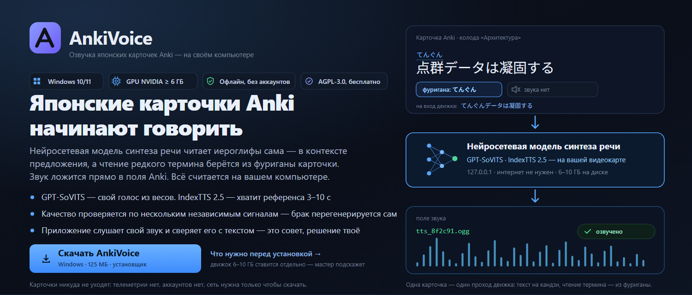
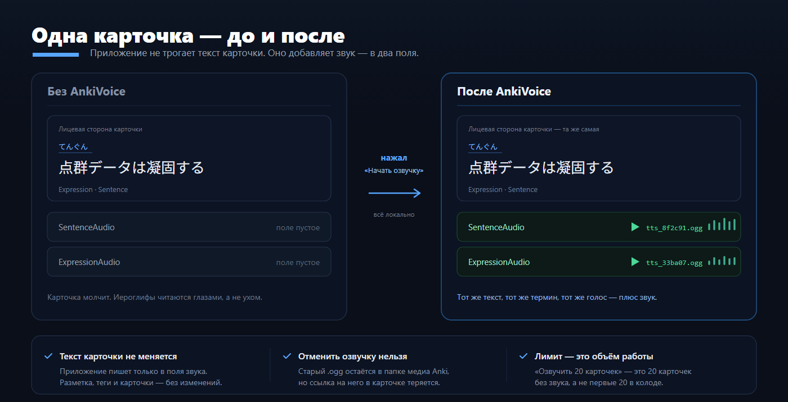
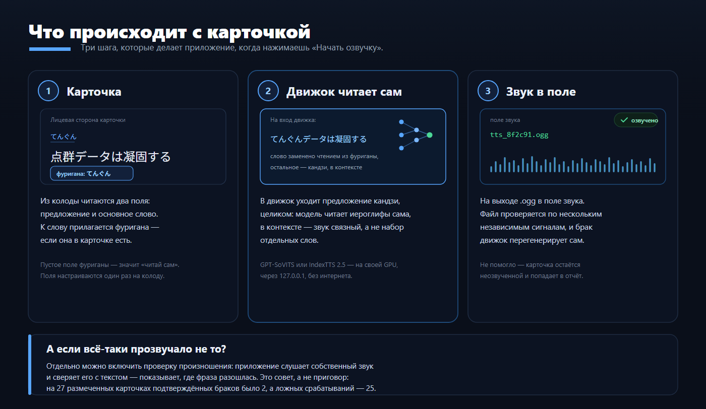

  

  
  

<b>Озвучка японских карточек Anki</b> 
Голос GPT-SoVITS или IndexTTS 2.5 — целиком на вашем компьютере. Движок читает
иероглифы сам, связно, в контексте предложения, а чтение основного слова берётся
из фуриганы карточки. Готовые .ogg-файлы кладутся прямо в поля Anki.

  
  &nbsp;&nbsp;
  <a href="#что-нужно-до-установки">Что нужно перед установкой →</a>

  

  <a href="#как-это-работает">Как это работает</a> •
  <a href="#первый-звук">Установка</a> •
  <a href="#интерфейс-четыре-вкладки">Интерфейс</a> •
  <a href="#как-читаются-иероглифы">Чтение иероглифов</a> •
  <a href="#если-что-то-не-работает">Если не работает</a> •
  <a href="#документация">Документация</a>

**Русский** | [English](README.en.md)

---

## Что это и для кого

| Кто ты | Что получишь | Читай дальше |
|---|---|---|
| Учу японский по карточкам Anki | готовые `.ogg` прямо в полях карточки, всё локально | [Первый звук](#первый-звук) |
| Хочу конкретный голос | референс 3–10 с плюс веса движка | [Какой движок выбрать](#второй-движок-indextts-25) |
| Хочу, чтобы термины читались точно | чтение берётся из фуриганы карточки | [Как читаются иероглифы](#как-читаются-иероглифы) |
| Ищу TTS по HTTP API | не подойдёт: это приложение для Anki, не сервис | — |

## Оглавление

- [Что умеет](#что-умеет)
- [Как это работает](#как-это-работает)
- [Что нужно до установки](#что-нужно-до-установки)
- [Первый звук](#первый-звук)
- [Интерфейс (четыре вкладки)](#интерфейс-четыре-вкладки)
- [Проверка произношения](#проверка-произношения)
- [Второй движок: IndexTTS 2.5](#второй-движок-indextts-25)
- [Как читаются иероглифы](#как-читаются-иероглифы)
- [Документация](#документация)
- [Обновления](#обновления)
- [Если что-то не работает](#если-что-то-не-работает)
- [Что перезаписывается, что уходит в сеть](#что-перезаписывается-что-уходит-в-сеть)
- [Участие в проекте](#участие-в-проекте)
- [Лицензия](#лицензия)
- [Благодарности](#благодарности)

---

## Что умеет

| | |
|---|---|
| 🎧 **Озвучка карточек** | Кладёт `<audio>` с озвучкой предложения и слова прямо в поля Anki. Клон голоса делает GPT-SoVITS сам. |
| 📖 **Два режима чтения** | Движок читает иероглифы сам — связно, в контексте предложения; чтение основного слова при этом берётся из фуриганы карточки. Нет фуриганы — читает кандзи сам. |
| 🔤 **Умное чтение английских слов** | Нейросеть [e2k](https://github.com/Patchethium/e2k) переводит английские слова в катакану (bus→バス), аббревиатуры читает побуквенно (USB→ユーエスビー), смешанные токены берёт из словаря (3D→スリーディー). Всё встроено в установщик. |
| 🧩 **Настройки на колоду** | Поля и режим чтения — свои для каждой колоды: переключил колоду, подставилось её. |
| 🧪 **Контроль качества** | QC v2 считает несколько независимых сигналов (тишина, разрывы в речи, дубль, обрезка, уровень, скорость) и перегенерирует брак сам. |
| 🎙 **Проверка произношения** | Приложение слушает собственный звук и сверяет его с текстом: показывает, где фраза разошлась. Совет, а не приговор — решение принимаешь ты. |
| 🧙 **Мастер первого запуска** | Пять шагов: выбор движка, папка движка, AnkiConnect, сервер, тестовая фраза. Показывает, что скачать, куда положить и что нажать. |
| 🔄 **Обновления из приложения** | «Проверить обновления»: changelog, скачивание установщика и обязательная проверка SHA256. |
| 🌐 **Два языка** | Интерфейс целиком на русском и английском — переключается кнопкой EN в шапке. |
| 🔒 **Полностью локально** | Страница работает офлайн, без CDN. Наружу уходит только запрос проверки обновлений. |
| 🧩 **Прозрачность** | Никакой телеметрии, никаких аккаунтов. Лицензия AGPL-3.0 — исходники открыты.
> **Послушать, как это звучит:** [демо-ролик](doc/gptsovits/gpt-sovits-demo.mp4) —
> озвучка японских предложений моделью (озвучка идёт офлайн на вашей машине).

## Как это работает

AnkiVoice не копирует код движка: [GPT-SoVITS](https://github.com/RVC-Boss/GPT-SoVITS)
поднимается как обычный локальный сервер, программа шлёт ему текст и забирает
звук. Поэтому родной веб-интерфейс GPT-SoVITS и любые его голоса продолжают
работать рядом.
## Что нужно до установки

| Что | Где взять | Размер | Обязательно | Зачем |
|---|---|---|---|---|
| **AnkiVoice** (программа) | [Releases](https://github.com/Daii1414/AnkiVoice/releases/latest) → `AnkiVoice-Setup-x.y.exe` | ~156 МБ, ~1 ГБ на диске | да | окно, локальный сервер, словарь чтения, транслитерация e2k |
| **Anki + AnkiConnect** | Anki → Дополнения → код `2055492159` | ~0 МБ | да | мост к колодам и полям |
| **Движок** (один из двух) | [GPT-SoVITS](https://github.com/RVC-Boss/GPT-SoVITS/releases) или [IndexTTS 2.5](https://github.com/index-tts/index-tts) | 6–10 ГБ или ~5 ГБ | да, один | синтез речи |
| **Голос** | в движке или у сообщества | веса + референс 3–10 с | да | тембр и характер речи |
| **Модель распознавания** | кэш HuggingFace (`faster-whisper`) | ~1,5 ГБ | нет | только проверка произношения |
| **GPU и драйвер NVIDIA** | драйвер NVIDIA, CUDA 12.8+ | от 6 ГБ VRAM | да | синтез на видеокарте |

Интернет нужен только чтобы скачать — сама озвучка идёт полностью офлайн.

### Приложение и движок — это разные установки

| Вопрос | AnkiVoice (приложение) | Движок синтеза | Подсказка |
|---|---|---|---|
| Откуда берётся | GitHub Releases, один файл | официальный релиз движка | движок качается отдельно |
| Размер | ~156 МБ, на диске ~1 ГБ | 6–10 ГБ / ~5 ГБ | в 5–10 раз тяжелее |
| Что внутри | интерфейс, сервер, словарь чтения | модель и веса голосов | звук делает движок |
| Если его нет | приложение работает, синтеза нет | озвучка невозможна | сначала ставим движок |

Больше ничего ставить не нужно: словарь чтения и встроенный Python уже внутри
установщика (`pyruntime.zip`, `sudachidict.zip`) и разворачиваются сами.

## Первый звук

Движок синтеза ставится отдельно — это самая долгая часть установки (6–10 ГБ, его нужно скачать один раз). Когда движок на месте, от выбора колоды до первого звука проходит около минуты: выбрал колоду, выбрал голос, нажал «Начать озвучку».

1. Скачай установщик **`AnkiVoice-Setup-x.y.exe`** со страницы
   [Releases](https://github.com/Daii1414/AnkiVoice/releases/latest) — один файл,
   внутри всё, размер **~156 МБ** (внутри — нейросетевые веса e2k и numpy). Контрольная сумма указана в заметках
   к релизу; проверить её можно командой
   `certutil -hashfile AnkiVoice-Setup-x.y.exe SHA256`.
   (Кнопка **Code → Download ZIP** отдаёт исходники, а не установщик — их
   распаковывать и запускать вручную не нужно.)
2. Запусти: «Далее» → «Установить» → «Завершить»
   (галочка «Запустить AnkiVoice» включена — программа откроется сама).
   > [!IMPORTANT]
   > Установщик не подписан цифровой подписью — Windows покажет синее окно
   > SmartScreen. Нажми **«Подробнее» → «Выполнить в любом случае»**: это
   > обычное предупреждение для файлов, скачанных не из магазина.
3. Мастер настройки проведёт по шагам: выбор движка → папка движка →
   AnkiConnect → сервер → тестовая фраза. Он открывается сам при каждом
   запуске, пока настройка не завершена.

   

4. Дальше: вкладка **«Голос»** — выбрать голос, вкладка **«Поля колоды»** —
   колоду и поля, вкладка **«Озвучка»** — **«Начать озвучку»**.

Код дополнения **AnkiConnect** — `2055492159`
(Anki → Инструменты → Дополнения → Получить дополнения). После установки
дополнения перезапусти Anki.

Программа поднимает локальный сервер и открывает страницу в браузере — это
обычное поведение, ничего дополнительно ставить не нужно. Сервер принимает
только свои запросы: чужой сайт, открытый в том же браузере, не сможет
запустить озвучку или закрыть приложение.

Кнопка **EN** в шапке переключает интерфейс на английский (и обратно). Установка идёт в
`%LOCALAPPDATA%\Programs\AnkiVoice`, права администратора не спрашиваются.
Удаление: меню Пуск → «Удалить AnkiVoice» (настройки и голоса остаются).

> [!TIP]
> Не хватает движка? Мастер сам даст ссылку на официальные релизы
> [GPT-SoVITS](https://github.com/RVC-Boss/GPT-SoVITS/releases) и покажет, какие
> файлы должны лежать в папке. Скачивать и распаковывать движок за тебя не нужно.

## Интерфейс (четыре вкладки)

Оболочка — локальная веб-страница (`anki_web.py`): сервер слушает только
`127.0.0.1`, наружу ничего не уходит. Старое tkinter-окно сохранено и
запускается флагом `--classic`.

### «Озвучка» — главный экран

* **Движок синтеза — крупными карточками вверху.** Две большие кнопки:
  GPT-SoVITS или IndexTTS 2.5, с коротким описанием каждого. Переключается
  на ходу, без перезапуска: меняются папка движка, адрес сервера и список
  голосов. Под карточками — сколько голосов готово и где живёт сервер.
* **Колода** и **Голос** — списки подтягиваются из Anki и `voices.json`.
* **Что озвучивать** — «слово + предложение» (обычно), только предложение
  или только слово; лимит карточек (0 = все); «пересобрать всё заново»
  игнорирует уже готовые карточки.
* **Лимит — это объём работы**, а не позиция в колоде: «озвучить 20 карточек»
  значит взять 20 карточек, где звука ещё нет, а не первые двадцать.
* **«Начать озвучку»** — главная кнопка; рядом **«Остановить»**,
  **«Проверить колоду»** и **«Самопроверка»**.
* **Полоса прогресса** — точный счётчик «N / всего» и число ошибок.
* **Журнал** — живой лог потоком (SSE) с цветной разметкой: зелёное —
  готово, красное — ошибка, жёлтое — брак и повторы QC.

### «Поля колоды» — что откуда читать

* **Колода** + кнопка **«Поля выбранной колоды»** — заполняет таблицу ролей
  автоматически по шаблону (Sentence / Expression / \*Audio / Furigana).
  Поля подставляются и сами: стоит выбрать колоду — приложение читает её поля
  и подбирает роли; вручную меняется на вкладке «Поля колоды».
* Строки таблицы: текст предложения, звук предложения, основное слово,
  звук слова, **фуригана слова ← поле** и источник чтения.
* Пустой выбор в колонке «→» = звук не записывать. Пустая фуригана =
  слово прочитается автоматически.

### «Голос» — референс и характер речи

* **Карточки голосов** — все голоса из `voices.json`; ✅/✗ показывает, найдены
  ли файлы gpt/sovits/ref.
* **Референс (3–10 с)** — образец голоса: файл, его текст и язык. Длинный
  aux-референс не давай — API упадёт от нехватки памяти.
* **Характер речи** — ползунки `temperature`/`top_p`/`top_k`/`speed` и поле
  `seed`: меньше значение — ровнее и спокойнее речь (дефолты из официального
  webui: 0.6 / 0.6 / 20).
* **«Прослушать тест»** — быстрая проверка голоса, файл играет прямо на
  странице. **«Обновить веса в движке»** — автоскан новых весов.

### «Приложение» — мастер, обновления, диагностика

* **Мастер настройки** — четыре шага: движок, AnkiConnect, сервер, тестовая
  фраза. Показывает статус каждого шага и что делать, если он красный. Первый
  шаг — выбор движка (две карточки) и папка выбранного движка.
* **Обновление** — кнопка «Проверить обновления»: показывает changelog,
  скачивает установщик и проверяет его SHA256.
* **Диагностика** — всё сразу: инструмент, конфиг, путь, Anki, сервер, список
  голосов. Сюда и смотреть, если что-то не работает.
* **Где лежат файлы** — папка программы и конфиг.

Папка движка и её проверка — на главном экране, рядом с выбором движка.

Статусы в шапке: **Anki** (подключена?), **Сервер** (GPT-SoVITS запущен),
версия и индикатор выполняющейся операции. Тема переключается кнопкой справа.

Светлая тема — те же вкладки: [Озвучка](doc/shots/voice-light.png),
[Поля колоды](doc/shots/anki-light.png), [Голос](doc/shots/sound-light.png),
[Приложение](doc/shots/app-light.png). Полный снимок страницы целиком —
[voice-dark-full.png](doc/shots/voice-dark-full.png).

## Второй движок: IndexTTS 2.5

Кроме GPT-SoVITS можно работать с **IndexTTS 2.5** — zero-shot движком,
которому достаточно одного референса. Переключатель — **на главном экране**,
вверху, двумя большими карточками. Выбор сохраняется и действует на всё
приложение.

Разница в устройстве:

| | GPT-SoVITS | IndexTTS 2.5 |
|---|---|---|
| голос | файлы `.ckpt` + `.pth` + референс | **один референс** (3–10 с) |
| веса | свои у каждого голоса | общие у модели |
| как ставится | распакованный архив | `git clone` + `uv sync --extra webui` + веса в `checkpoints` |
| размер на диске | 6–10 ГБ (веса отдельно) | ~5 ГБ весов модели |
| своё чтение японского | g2p движка | свой японский g2p (`ja_g2p`) |
| проверка произношения | есть (faster-whisper в окружении) | нет, только акустический QC |
| ручные настройки звука | seed, temperature, top_p, top_k | нет, интерфейс прячет |
| для кого | хочу качество и контроль | хочу минимум возни: один референс |

Переключение — двумя большими карточками на главном экране.

Подробности — установка, мост и чего в этом режиме нет — в
[doc/engines.md](doc/engines.md).

## Проверка произношения

GPT-SoVITS иногда **теряет кусок фразы или придумывает лишний**: длительность
в норме, звук — речь, а содержание не то. Проверка «тишина / длина / дубль»
такое не видит.

Вкладка «Озвучка» → **«Проверить произношение»**: приложение распознаёт
собственный звук (faster-whisper) и сверяет его с текстом, который было
велено произнести. Расхождение показывается с точностью до доли секунды —
сразу видно, где фраза разошлась.

**Это совет, а не приговор.** По замеру на 27 размеченных карточках
подтверждённых браков — 2, а ложных срабатываний — 25: распознаватель
переворачивает доменные термины («だいくはこうさぶ» → «ないくはこうさぶん»),
и по тексту их не отличить от настоящей ошибки. Поэтому проверка

* не бракует карточку и не метит её тегом;
* печатает в журнал покрытие, ошибки и участок расхождения;
* складывает сомнительные куски в колоду **«Брак»** — с тремя вариантами
  каждого. Послушаешь и напишешь «верно» или «ложное срабатывание».

Три кнопки на вкладке «Озвучка»:

* **«Проверить произношение»** — распознаёт уже озвученные карточки колоды;
* **«Собрать колоду “Брак”»** — сомнительные куски с вариантами;
* **«Сводка по вердиктам»** — считает накопленные отметки и показывает, где
  наши пороги занижены.

### Что приложение проверяет само

| Что проверяет | Как | Итог |
|---|---|---|
| Тишина, обрезка, дубль | QC v2 по нескольким сигналам | брак перегенерируется сам |
| Разрывы в речи | пауза больше 4 с внутри фразы | пересборка куска |
| Уровень и темп | неслышно или слишком быстро | пересборка с другой скоростью |
| Произношение (по желанию) | ASR слушает свой звук и сверяет с текстом | подсказка, решение — твоё |

**Проверяем по предложению, не по слову.** Изолированное слово
распознаётся ненадёжно: зоны «настоящий брак» и «ложное срабатывание»
пересекаются полностью. Слово ловит акустический QC (тишина, темп, длина).

**Пороги — свои для каждого голоса.** У одного голоса норма покрытия 0.95, у
другого 0.85. Приложение считает норму по принятым кускам и сравнивает с ней,
а не с одной общей цифрой.

Что нужно: `faster-whisper` в питоне GPT-SoVITS и одна скачанная модель
(в кэше HuggingFace). Если их нет — проверка просто не работает, озвучка идёт
как обычно. Проверка одного куска — около 0.5 с на GPU.

## Как читаются иероглифы

GPT-SoVITS умеет читать кандзи сам — но на редких терминах он читает
по-своему. Поэтому режим чтения переключается в «Поля колоды» →
«Источник чтения»:

| Режим | Что уходит движку | Когда выбирать |
|---|---|---|
| **Авто (по умолчанию)** | Если в поле с фуриганой что-то есть — весь текст кандзи, кроме основного слова: его чтение подставлено из фуриганы. Если поля нет или оно пустое — весь текст кандзи | Универсальный: точное чтение там, где фуригана есть, и обычное — там, где её нет |
| **Только кандзи (движок читает сам)** | Весь текст кандзи, без подстановок | Колоды с обычными словами: звук самый цельный |

Режим — **настройка колоды**: он сохраняется в профиль колоды вместе с полями.
В режиме «авто» решение принимается **по каждой карточке**: пустое поле с
фуриганой означает «читай кандзи сам», и подставлять нечего.

Чем «чистое чтение» отличается от «точного» (замер на 150 фразах и слепое
сравнение на 10 фразах):

* по качеству звука чистый кандзи выигрывает — 7 голосов из 10;
* но в 12 фразах из 150 модель прочитала термин не так, как в карточке
  (`麻院[あさすさ]` → «アサイン»). В смешанном режиме — 2 из 150.

Фуригана карточки — источник истины для основного слова: поле
`ExpressionFurigana` (или другое, если в колоде так). Правила безопасности
подстановки: только чистая кана, только если слово найдено в предложении
целиком, иначе карточка остаётся как есть.

Два исключения, проверенные замером на карточках с катаканными терминами:

* разметка на всё слово («点群データ[てんぐんでーた]») читается как есть — иначе
  окуригана («データ») попала бы в чтение второй раз и прозвучала бы дважды.
  На случай, если разбор ошибётся, есть страховка: готовый текст проверяется,
  и если окуригана прозвучала бы дважды, термин оставляется как есть — его
  прочитает сам движок;
* термины с латиницей или цифрами («3D», «PLATEAU», «BIM/CIM», «2.0») —
  английские слова транслитерируются нейросетью [e2k](https://github.com/Patchethium/e2k)
  в фонетическую катакану ещё до передачи движку (подробнее — ниже).

В консоли это флаг `--reading ""|mix|asis` (пусто — авто).

Как именно текст превращается в хирагану — шаг за шагом — в
[doc/reading.md](doc/reading.md).
| Случай | Что делает приложение | Почему |
|---|---|---|
| Термин с фуриганой | подставляет чтение из поля фуриганы | карточка знает правильнее движка |
| Окуригана (データ) | оставляет слово как есть | иначе прозвучит дважды |
| Обычное слово (bus, coffee) | e2k → фонетическая катакана | バス, コーヒー |
| Аббревиатура (USB, CPU, HTML) | побуквенная транслитерация | ユーエスビー, シーピーユー |
| Смешанный токен (3D, Wi-Fi) | фиксированный словарь | スリーディー, ワイファイ |
| Слово не найдено в тексте | карточка остаётся как есть | нельзя подставить чужое чтение |

### Как работает транслитерация английских слов

Нейросеть `e2k` (C2K + NGram) встроена прямо в установщик — ничего
dополнительно ставить не нужно. Перед передачей текста движку:

1. каждый латинский токен классифицируется: обычное слово, аббревиатура или смешанный (цифра+буква);
2. обычные слова → e2k (фонетическая катакана);
3. аббревиатуры (USB, CPU, AI, HTML) → побуквенно (ユーエスビー, シーピーユー);
4. смешанные токены (3D, 4K, Wi-Fi) → фиксированный словарь (スリーディー, フォーケー).

Только цифры (`2.0`, `12`) и слова, которых e2k не знает, передаются движку без изменений.

## Документация

| Документ | О чём |
|---|---|
| [doc/reading.md](doc/reading.md) | как текст превращается в хирагану: конвейер чтения, латиница, цифры, g2p |
| [doc/fields.md](doc/fields.md) | поля карточек: откуда брать текст и куда писать звук |
| [doc/cli.md](doc/cli.md) | консоль: все команды `pipeline.bat` и `AnkiVoice.exe` |
| [doc/engines.md](doc/engines.md) | второй движок IndexTTS 2.5: установка, мост, ограничения |
| [CONTRIBUTING.md](CONTRIBUTING.md) | разработка: сборка, проверки, структура репозитория |

## Обновления

* **Из приложения**: вкладка «Приложение» → **«Проверить обновления»**.
  Программа покажет changelog, скачает установщик и проверит SHA256 — без
  проверки скачивание не запускается. Затем нажми «Запустить установщик».
* **Вручную**: скачать новый установщик с
  [Releases](https://github.com/Daii1414/AnkiVoice/releases/latest) и запустить
  поверх старой версии — путь к движку и настройки сохранятся.
* **Удаление**: меню Пуск → «Удалить AnkiVoice» (настройки останутся — при
  следующей установке подхватятся снова).

## Что перезаписывается, что уходит в сеть

Границы приложения — честно, без недосказанности.

| Действие | Что с карточкой |
|---|---|
| Озвучка | в поле звука пишется новый файл; старый остаётся в папке медиа, ссылка на него теряется |
| Текст карточки | не меняется никогда |
| Колода «Брак» | создаёт новую колоду с копиями карточек; оригиналы не трогает |
| Проверка произношения | ничего не пишет — только слушает и советует |

| Что уходит в сеть | Когда |
|---|---|
| Запрос к `api.github.com` | только по кнопке «Проверить обновления» |
| Скачивание установщика | по кнопке обновления (с проверкой SHA256) |
| Ваши карточки и тексты | **никогда** — всё считается локально |
| Телеметрия, аккаунты | **нет** |

Интернет нужен один раз: чтобы скачать установщик и движок. Сама озвучка,
проверка произношения и обновление карточек работают полностью офлайн.

## Если что-то не работает

| Что происходит | Почему | Что делать |
|---|---|---|
| Не найдена папка GPT-SoVITS | путь не указан или указывает не туда | Указать путь: `gptsovits_path.txt`, env `GPT_SOVITS_ROOT` или кнопкой «Обзор…» в программе |
| `AnkiConnect недоступен` | Anki закрыта или дополнения нет | Открыть Anki; Инструменты → Дополнения → Получить дополнения, код `2055492159`, перезапустить Anki |
| Мастер просит папку движка | движок ставится отдельно, в установщике его нет | поставить движок и указать его папку |
| Готовых голосов: 0 из 5 | веса или референс не в папке движка | «Обновить веса в движке» или указать верный путь |
| `Референс X с — API требует 3–10 с` | клип вне диапазона | Перерезать клип под 3–10 секунд |
| `Не получилось переключить... Перезапуск` | не хватило видеопамяти | Норма: пайплайн сам перезапустит сервер и повторит |
| `Сервер вернул пустой звук` | видеопамять занята браузером или игрой | Закрыть тяжёлые программы или перезапустить сервер: `pipeline.bat serve --voice <голос>` |
| `Пайплайн уже запущен другим процессом` | уже идёт другая работа | Дождаться её конца (защита от двойной работы) |
| Первый звук идёт минутами | включена проверка произношения | выключить «Проверять произношение» — без неё звук за секунды |
| Звук старый, хочу заново | лимит берёт только карточки без звука | «Пересобрать всё заново» — спросит подтверждение |
| Windows: «Защитил ваш компьютер» | exe не подписан | «Подробнее» → «Всё равно запустить» |

Полезно: `selftest` печатает, что именно видит (движок, голоса, словарь
чтения, модули чтения, QC v2, AnkiConnect, сервер) — 90% проблем видно сразу.

## Участие в проекте

* Правки и идеи — через [issues](https://github.com/Daii1414/AnkiVoice/issues) и
  pull request'ы. Шаблоны — в `.github/ISSUE_TEMPLATE`.
* Правила разработки, сборка, стиль коммитов — в
  [CONTRIBUTING.md](CONTRIBUTING.md).
* Уязвимости — по инструкции из [SECURITY.md](SECURITY.md).

  

## Лицензия

**AGPL-3.0** (текст — в файле [LICENSE](LICENSE)): кто изменит и распространит
этот инструмент — обязан опубликовать исходники своих изменений, в том числе
при использовании через сеть.

## Благодарности

* [GPT-SoVITS](https://github.com/RVC-Boss/GPT-SoVITS) — движок синтеза (MIT).
* [e2k](https://github.com/Patchethium/e2k) — нейросетевая транслитерация английских слов в японскую катакану (MIT).
* [Haqumei](https://github.com/o24s/haqumei) — контекстное чтение иероглифов
  (основное ядро).
* [Sudachi](https://github.com/WorksApplications/SudachiPy) и словарь UniDic —
  запасной ход и проверка чтений.
* [gradio](https://github.com/gradio-app/gradio) — вкладка «Голос» свёрстана
  по мотивам их webui.
* [AnkiConnect](https://ankiweb.net/shared/info/2055492159) — мост к Anki.
